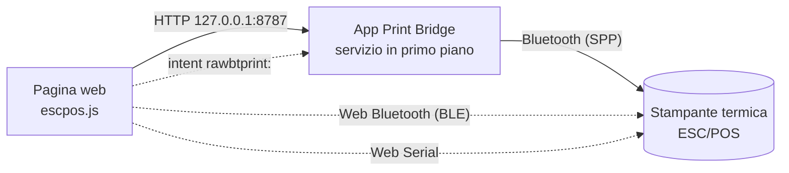

[English](README.md) | Italiano

<p align="center">
  
</p>

# Print Bridge

**Stampa scontrini su stampanti termiche direttamente dalle pagine web.** Una pagina
(gestionale, cassa, sistema di voto, prenotazioni…) costruisce lo scontrino e lo manda a una
stampante vicina, senza driver e senza uscire dal browser: su Android tramite l'app Print
Bridge, Web Bluetooth o Web Serial, su un computer tramite Web Bluetooth o Web Serial. Stampa
sulle stampanti per scontrini ESC/POS (58 e 80 mm) e, per le immagini, sulle Phomemo M02 e
M02 Pro.

| | |
|---|---|
| **Pagina iniziale** | [nb-camelot.github.io/raw-bt-print-bridge](https://nb-camelot.github.io/raw-bt-print-bridge/), la landing page su Pages: cosa funziona sul tuo dispositivo e quale pagina usare |
| **App Android** | [ultima Release](https://github.com/nb-camelot/raw-bt-print-bridge/releases/latest) (`app-release-<version>.apk`) |
| **Pagina di test dell'app** | [app.html](https://nb-camelot.github.io/raw-bt-print-bridge/app.html) su Pages, oppure `http://127.0.0.1:8787/` servita dall'app |
| **Stampa diretta BLE** | [ble.html](https://nb-camelot.github.io/raw-bt-print-bridge/ble.html), Web Bluetooth, senza l'app |
| **Stampa diretta seriale** | [serial.html](https://nb-camelot.github.io/raw-bt-print-bridge/serial.html), Web Serial, senza l'app: su un computer, oppure stampanti Bluetooth Classic da Chrome 138+ su Android |
| **Client web** | `escpos.js`, pacchetto npm [`@nb-camelot/rawbt-print`](https://www.npmjs.com/package/@nb-camelot/rawbt-print) |
| **Per gli agenti AI** | [llms.txt](https://nb-camelot.github.io/raw-bt-print-bridge/llms.txt) e [llms-full.txt](https://nb-camelot.github.io/raw-bt-print-bridge/llms-full.txt) su Pages (vedi [Per gli agenti AI](#per-gli-agenti-ai)) |
| **Skill per agenti** | [`skills/print-bridge/SKILL.md`](skills/print-bridge/SKILL.md) (anche [su Pages](https://nb-camelot.github.io/raw-bt-print-bridge/skills/print-bridge/SKILL.md)): istruzioni passo passo per aggiungere la stampa termica a una pagina web |
| **Novità** | [CHANGELOG.md](CHANGELOG.md) |

L'app si chiama **Raw BT Print Bridge** (package `com.rawbtprint.bridge`) e ha un marchio
proprio e neutro, **Print Bridge**. Il logo stampato in testa agli scontrini è di chi la usa:
si imposta da file, da URL o via API.

## Indice

- [Come funziona](#come-funziona)
- [Quale via scegliere](#quale-via-scegliere)
- [Avvio rapido](#avvio-rapido)
- [Lingue](#lingue)
- [L'app Android](#lapp-android)
- [Stampa diretta via Web Bluetooth (BLE)](#stampa-diretta-via-web-bluetooth-ble)
- [Stampa diretta via Web Serial](#stampa-diretta-via-web-serial)
- [Desktop](#desktop)
- [Per gli agenti AI](#per-gli-agenti-ai)
- [Usare Print Bridge nelle proprie pagine](#usare-print-bridge-nelle-proprie-pagine)
- [Layout di stampa](#layout-di-stampa)
- [Immagini e driver di stampa](#immagini-e-driver-di-stampa)
- [API HTTP locale dell'app](#api-http-locale-dellapp)
- [Risoluzione dei problemi](#risoluzione-dei-problemi)
- [Sviluppo](#sviluppo)

## Come funziona



1. La pagina include `escpos.js`, che costruisce i comandi ESC/POS (testo, grassetto,
   dimensioni, QR code nativo, logo raster), anche da un [layout di stampa](#layout-di-stampa)
   riempito con i dati o da un'immagine e un [driver di stampa](#immagini-e-driver-di-stampa),
   oppure uno scontrino JSON.
2. **Tramite l'app** (Android): la pagina chiama l'API locale dell'app su `127.0.0.1:8787`.
   L'app, tenuta viva da un servizio in primo piano, apre la connessione Bluetooth con la
   stampante accoppiata e stampa, restando dietro al browser.
3. **Tramite Web Bluetooth**: con una stampante **BLE** la pagina stampa da sola, tramite
   Chrome, senza nessuna app (vedi [sotto](#stampa-diretta-via-web-bluetooth-ble)).
4. **Tramite Web Serial**: con una stampante USB-seriale, o una stampante Bluetooth Classic
   accoppiata nel sistema, la pagina scrive da sola sulla porta seriale, senza nessuna app:
   Chrome ed Edge su un computer, Firefox 151 o successivo su un computer, Chrome 138 o
   successivo su Android (solo stampanti Bluetooth Classic; vedi [sotto](#stampa-diretta-via-web-serial)).
5. **Ripiego** (solo Android): se l'app non risponde, la pagina può aprirla con lo scheme
   `rawbtprint:base64,<data>`, e allora stampa l'app in primo piano.

## Quale via scegliere

| | App Android (API locale) | Web Bluetooth (BLE) | Web Serial | Scheme `rawbtprint:` |
|---|---|---|---|---|
| Stampanti | qualsiasi stampante Bluetooth accoppiata (Classic SPP) | solo stampanti **BLE** compatibili | stampanti USB-seriale e stampanti Bluetooth Classic (SPP) accoppiate nel sistema | come l'app |
| Serve l'app | sì | **no** | **no** | sì |
| Browser | Chrome su Android | Chrome su Android; Chrome ed Edge su Windows, macOS e ChromeOS (Chrome su Linux solo con un flag) | Chrome ed Edge su un computer; Firefox 151+ su un computer; Chrome 138+ su Android (solo stampanti Bluetooth Classic, niente USB) | Chrome su Android |
| Esito della stampa | sì (`ok`, `bytes`, `error`) | sì (scrittura completata) | sì (scrittura completata) | no |
| Resta nel browser | sì | sì | sì | no, l'app va in primo piano |
| Permessi | «App sul dispositivo» per le pagine pubbliche | scelta della stampante, una volta per scheda | scelta della porta, una volta per sito (Chrome ed Edge la ricordano); in Firefox, prima un componente aggiuntivo con i permessi del sito | nessuno |
| Uso consigliato | **predefinito** su Android, funziona con tutte le stampanti Bluetooth Classic (SPP) | stampanti BLE (l'unica via per le stampanti solo BLE), dispositivi senza l'app | computer con una stampante USB o Bluetooth Classic; stampanti Bluetooth Classic da Chrome 138+ su Android senza l'app | ripiego |

Safari e i browser di iPhone e iPad non hanno né Web Bluetooth né Web Serial; Firefox non ha
Web Bluetooth, e Firefox per Android non ha Web Serial.

Non sai quale fa al caso tuo? Apri la [pagina iniziale](https://nb-camelot.github.io/raw-bt-print-bridge/)
sul dispositivo: mostra cosa supporta il browser e suggerisce la pagina da usare.

## Avvio rapido

### Con l'app (stampanti Bluetooth Classic)

1. Accoppia la stampante in **Impostazioni → Bluetooth** di Android.
2. Scarica e installa `app-release-<version>.apk` dall'[ultima Release](https://github.com/nb-camelot/raw-bt-print-bridge/releases/latest).
3. Apri **Raw BT Print Bridge**, concedi il permesso Bluetooth e premi **Scegli stampante**.
4. **Disattiva l'ottimizzazione batteria** per l'app: l'app lo propone all'avvio, oppure premi
   **Risolvi** nel pannello di stato. Senza, Android può sospendere l'app quando passi al
   browser e le stampe restano in attesa (vedi
   [Batteria e sospensione in background](#batteria-e-sospensione-in-background-importante)).
5. Premi **Autotest completo**: tutte le voci devono essere ✓.
6. Apri in Chrome `http://127.0.0.1:8787/` (o [app.html](https://nb-camelot.github.io/raw-bt-print-bridge/app.html) su Pages) e prova una stampa.

### Senza l'app (stampanti BLE)

1. Apri la [pagina di stampa diretta BLE](https://nb-camelot.github.io/raw-bt-print-bridge/ble.html)
   in Chrome su Android, oppure in Chrome o Edge su Windows, macOS e ChromeOS (su Linux solo
   con un flag di Chrome).
2. Premi **Abbina stampante** e scegli la stampante nell'elenco di Chrome.
3. Stampa. Finché la scheda resta aperta non servono altre conferme. Dopo una ricarica bastano
   **Riconnetti** (o un tocco su una stampa) e la scelta della stampante nell'elenco; con
   un'opzione di Chrome la pagina si ricollega da sola (vedi
   [Abbinamento](#abbinamento-una-volta-per-scheda)).

### Su un computer (stampanti USB e Bluetooth Classic)

1. **Stampante USB**: collegala; deve comparire come porta seriale (su Windows una porta COM,
   per esempio «Dispositivo seriale USB»). **Stampante Bluetooth Classic**: prima accoppiala
   nel sistema (Windows: Impostazioni > Bluetooth e dispositivi > Aggiungi dispositivo, il PIN
   spesso è 0000 o 1234; macOS: Impostazioni di Sistema > Bluetooth).
2. Apri la [pagina di stampa diretta seriale](https://nb-camelot.github.io/raw-bt-print-bridge/serial.html)
   in Chrome o Edge, oppure in Firefox 151 o successivo: la prima volta Firefox chiede di
   installare un componente aggiuntivo con i permessi del sito, accetta.
3. Premi **Scegli porta** e scegli la porta della stampante. Per una stampante USB-seriale
   imposta **Velocità (baud rate)**: spesso 9600 o 115200, la mostra la pagina di autotest
   della stampante.
4. Stampa una prova. Chrome ed Edge ricordano la porta per il sito: alla visita successiva la
   pagina la riapre senza tocchi (vedi [Scelta della porta](#scelta-della-porta-una-volta-per-sito)).

Le stampanti BLE funzionano anche su un computer, dalla pagina BLE in Chrome o Edge (su
Linux solo con un flag di Chrome). Su Android, senza l'app, Chrome 138 o successivo stampa da
`serial.html` sulle stampanti Bluetooth Classic accoppiate nelle impostazioni di Android (non
sulle stampanti USB).

## Lingue

Print Bridge parla **inglese** e **italiano**.

- **Pagine.** La pagina iniziale (`index.html`), la pagina di test dell'app (`app.html`, e la
  copia servita dall'app), `ble.html` e `serial.html` sono in inglese e in italiano. Si aprono
  nella lingua di `RawBT.language()` e hanno nell'intestazione un selettore **EN | IT**, che
  chiama `RawBT.setLanguage` e ridisegna la pagina. La scelta resta nel `localStorage` del
  browser, sotto la chiave `printbridge.lang`, condivisa dalle pagine dello stesso sito:
  scegliere l'italiano nella pagina iniziale apre in italiano anche `ble.html`. La pagina di
  test servita dall'app (`http://127.0.0.1:8787/`) è un altro sito e tiene una scelta propria.
- **Messaggi di `escpos.js`.** Errori e spiegazioni sono in inglese o in italiano: l'`error`
  dei risultati di `RawBT.printLayout` e `RawBT.printCanvas`, `RawBT.ble.explain`,
  `RawBT.serial.explain`, gli errori dei layout e delle immagini, gli errori sull'app.
  - `RawBT.language()` restituisce `'en'` o `'it'`: la lingua impostata con `setLanguage`,
    altrimenti la prima lingua del browser che ha una traduzione, altrimenti l'inglese.
  - `RawBT.setLanguage('it' | 'en' | 'auto')` fissa la lingua e la conserva in
    `printbridge.lang`, così vale anche per le pagine di Print Bridge dello stesso sito;
    `'auto'` (o `null`) torna a seguire il browser. Restituisce la lingua in uso. La regione
    viene ignorata (`'it-IT'` è `'it'`); una lingua senza tabella lancia un errore con codice
    `language`.
  - `PrintBridge.translations` ha una tabella per lingua, `{ en, it }`, con le stesse chiavi e
    gli stessi segnaposto `{name}`; `PrintBridge.messages` è la tabella inglese. Per aggiungere
    una lingua basta aggiungere una tabella (per esempio
    `PrintBridge.translations.de = { … }`, poi `RawBT.setLanguage('de')`): una chiave che vi
    manca ripiega sull'inglese.
  - Ciò che si stampa non viene tradotto: layout e dati sono della pagina, e i filtri `euro`,
    `num` e `date` mantengono i loro formati. Fa eccezione il layout incluso `receipt`, che
    stampa etichette, data e importi nella lingua di `RawBT.language()`, come l'app stampa il
    suo scontrino nella lingua del dispositivo (vedi
    [Lo scontrino dell'app, impaginato dalla pagina](#lo-scontrino-dellapp-impaginato-dalla-pagina)).
- **L'app Android** è in inglese e in italiano e segue la lingua del dispositivo (vedi
  [Lingua dell'app](#lingua-dellapp)).

## L'app Android

Raw BT Print Bridge è un'app nativa minimale (Kotlin, nessuna libreria esterna, Android 6+).
Tiene attivo un **server HTTP locale** su `127.0.0.1:8787`, raggiungibile solo dal tablet
stesso, dentro un **servizio in primo piano** con notifica. È in inglese e in italiano.

La schermata è divisa in card:

- **Stato del bridge**: quattro righe con un pallino verde / ambra / rosso / grigio,
  aggiornate ogni 2 secondi.

  | Riga | Cosa dice |
  |---|---|
  | **Server API (127.0.0.1:8787)** | in ascolto da quando, esito e durata dell'ultimo controllo automatico (ogni 15 s), riavvii |
  | **Chiamate dal browser** | ultima chiamata (metodo, percorso, esito, ms, origine), richieste in corso, connessioni aperte senza richiesta, totale delle connessioni ricevute |
  | **Bluetooth e stampante** | Bluetooth acceso, stampante scelta e accoppiata, esito dell'ultima connessione |
  | **Batteria e sospensione in background** | ottimizzazione batteria, limitazioni, sospensione dell'app, risparmio energetico |

  Sotto ci sono **Autotest completo**, **Riavvia server**, **Prova Bluetooth** (si collega
  senza stampare) e, se serve, **Risolvi**.
- **Stampante**: stampante scelta e stato della stampa; **Scegli stampante**, **Prova stampa
  (via API)**, **Dimentica stampante**.
- **Indirizzi di prova**, ognuno con **Copia** e **Apri**: la pagina di test servita dall'app,
  stato e autotest in JSON, la pagina di test su GitHub Pages (`app.html`), l'URL CDN del
  client web.
- **Carta e logo dello scontrino**: 58 mm (32 colonne) o 80 mm (48 colonne); logo **Da file**,
  **Da URL**, oppure **Rimuovi**. Il logo incluso si imposta via API (vedi
  [Marchio e logo dello scontrino](#marchio-e-logo-dello-scontrino)).
- **Registro**: le ultime 300 righe, comprese le chiamate ricevute mentre l'app era in
  background. Si copia con un tocco.

**Autoriparazione.** Ogni 15 secondi il servizio chiama `GET /status` su se stesso. Se il
server non è in ascolto o non risponde due volte di seguito, lo chiude e lo riapre. Dopo tre
tentativi falliti riprova una volta al minuto. La notifica mostra lo stato reale.

**Autotest completo** (nell'app, con `GET /selftest` o dalla pagina di test) controlla in un
colpo solo:
- app e dispositivo;
- servizio, server e API;
- pagina di test e client web;
- Bluetooth e connessione alla stampante;
- batteria e sospensione;
- notifiche, compreso il canale del servizio;
- a scelta (solo dall'app), una stampa di prova via API.

Il riepilogo si può copiare per allegarlo a una segnalazione.

### Batteria e sospensione in background (importante)

Il server gira in un servizio in primo piano, ma alcune ROM (verificato su LineageOS 18.1 /
Android 11) sospendono comunque l'app quando non è davanti. Il sintomo è preciso: dal browser
la stampa, o `http://127.0.0.1:8787/status`, resta in **caricamento infinito** e parte da sola
appena si riapre l'app. Per evitarlo:

1. **Impostazioni → App → Raw BT Print Bridge → Batteria**: ottimizzazione batteria su **Non
   ottimizzare** (o «Senza restrizioni») e nessuna limitazione in background.
2. **Opzioni sviluppatore**, se attive: **«Sospendi esecuzione per app memorizzate nella
   cache»** disattivato. Su Android 11 il valore predefinito è spento, da Android 12 di solito
   è acceso.
3. Da Android 12, nelle impostazioni dell'app: **«Sospendi attività app se non in uso»**
   disattivato.
4. **Risparmio energetico** spento mentre si usa la stampante.

L'app controlla da sola questi punti:
- la riga **Batteria e sospensione in background** diventa rossa (un problema che blocca
  l'app) o ambra (uno che può bloccarla);
- **Risolvi** dice cosa apre e porta all'impostazione giusta;
- all'avvio un avviso spiega il problema, ma non quando l'app è stata aperta dal browser per
  stampare;
- la notifica mette l'avviso in testa, e `/status` lo riporta nel campo `power`, che la pagina
  di test mostra.

C'è anche un **controllo sul sintomo**. Se il controllo periodico si ferma per più di 45 s con
il tablet acceso, l'app è stata sospesa: il registro scrive «App sospesa dal sistema per N s»
e la riga resta rossa per mezz'ora, anche su ROM con impostazioni proprie. Lo schermo spento
non conta, perché il confronto usa l'orologio di sistema, che non avanza nel sonno profondo.

### Marchio e logo dello scontrino

**Print Bridge** è il marchio dell'app: una stampante termica con lo scontrino in uscita e il
simbolo Bluetooth, in teal (`#0F766E`) su ardesia. Lo usano l'icona, la notifica,
l'intestazione, le pagine e il favicon. I file sorgente sono in
[`assets/brand/`](assets/brand/).

Il logo in testa agli scontrini non è legato al marchio dell'app:
- si imposta nell'app (**Da file**, **Da URL**) oppure via API con `POST /config`:
  `{"logoMode":"url","logoUrl":"https://…/logo.png"}`, `{"logoMode":"asset"}` per il logo
  incluso, `{"logoMode":"none"}` per toglierlo;
- il **logo incluso** è quello neutro «Print Bridge», in bianco e nero;
- i PNG con **sfondo trasparente** vanno bene: la trasparenza diventa il bianco della carta.

<!-- BLE -->
## Stampa diretta via Web Bluetooth (BLE)

Con una stampante **Bluetooth Low Energy** la pagina può stampare da sola, tramite Chrome,
senza installare nulla. La pagina pronta è
[`ble.html`](https://nb-camelot.github.io/raw-bt-print-bridge/ble.html) su Pages; per le
proprie pagine c'è `RawBT.ble` in `escpos.js` (dalla 1.9.0).

### Stampanti compatibili

Funziona con le stampanti termiche ESC/POS che espongono un **canale seriale BLE**. La pagina
prova questi profili, in ordine:

| Servizio | Caratteristica di scrittura | Dove si trova |
|---|---|---|
| `18f0` | `2af1` | il più diffuso: molte stampanti cinesi, spesso annunciate come «BlueTooth Printer» (per esempio le Netum NT-1809) |
| `e7810a71-73ae-499d-8c15-faa9aef0c3f2` | `bef8d6c9-9c21-4c9e-b632-bd58c1009f9f` | varie stampanti portatili |
| `49535343-fe7d-4ae5-8fa9-9fafd205e455` (ISSC) | `49535343-8841-43f4-a8d4-ecbe34729bb3` | moduli Microchip/ISSC |
| `ff00` | `ff02` | moduli economici |
| `ffe0` | `ffe1` | moduli HM-10 e simili |
| `6e400001-b5a3-f393-e0a9-e50e24dcca9e` (Nordic UART) | `6e400002-b5a3-f393-e0a9-e50e24dcca9e` | moduli Nordic |

Se il servizio c'è ma la caratteristica ha un altro UUID, la pagina usa la prima
caratteristica scrivibile dello stesso servizio. Le «cat printer» (servizio `ae30`) non sono
ESC/POS e vengono rifiutate con un messaggio chiaro. Le Phomemo M02 e M02 Pro hanno driver
propri (vedi [Immagini e driver di stampa](#immagini-e-driver-di-stampa)).

- **Bluetooth 4 non vuol dire BLE.** Molte stampanti «Bluetooth 4.0» sono solo Classic (SPP):
  il browser non le vede in BLE, e servono l'app o
  [Web Serial](#stampa-diretta-via-web-serial). Le stampanti **doppia modalità**
  (dual mode) vanno bene, ma in BLE si presentano spesso con un altro nome.
- **Netum NT-1809DD**: è doppia modalità, ma non l'abbiamo provata direttamente. Se non stampa
  al primo tentativo, apri **Avanzate → Diagnostica** in `ble.html`: mostra servizi e
  caratteristiche e permette di scegliere a mano quella giusta con **Usa questa** (la scelta
  resta ricordata per quella stampante, e il canale viene riportato come profilo `'manual'`,
  mostrato come «scelto a mano»).
- La diagnostica vede solo i servizi elencati sopra più `18f1`, `fff0`, `ffe6` e `fee7`. Web
  Bluetooth non mostra alla pagina i servizi che non ha dichiarato alla scelta del
  dispositivo.

### Abbinamento: una volta per scheda

La prima volta si sceglie la stampante nell'elenco di Chrome. Poi:

- **finché la scheda resta aperta** la pagina tiene la connessione e le stampe partono senza
  altre conferme; se la stampante va in standby, la pagina si ricollega da sola alla stampa
  successiva;
- **dopo una ricarica o una nuova visita** Chrome stabile non restituisce alla pagina le
  stampanti già scelte: la pagina ricorda il nome e mostra **Riconnetti «nome»**, che apre
  l'elenco filtrato su quella stampante. Un tocco direttamente su una stampa fa lo stesso;
- per **ricordarla tra le visite**, senza tocchi, attiva in Chrome
  `chrome://flags/#enable-web-bluetooth-new-permissions-backend` (Enabled, poi riavvia
  Chrome). La pagina se ne accorge (riga «Ricorda la stampante tra le visite») e si ricollega
  all'apertura.

Non serve accoppiare la stampante nelle impostazioni Bluetooth di Android.

### Come vengono inviati i dati

- Una scrittura alla volta, in coda: due stampe lanciate insieme escono una dopo l'altra,
  senza mescolarsi.
- **Automatica**: se la caratteristica accetta scritture con conferma, pezzi da 100 byte con
  conferma (la conferma regola il flusso, così la stampante non perde byte). Se la stampante
  rifiuta il primo pezzo da 100 byte, la pagina passa da sola a 20 e la scelta resta
  ricordata. Se accetta solo scritture senza conferma, pezzi da 20 byte con 20 ms di pausa e
  l'ultimo con conferma quando possibile.
- Le scritture fallite con «GATT operation failed for unknown reason» o «already in progress»
  non sono partite e si ritentano fino a 3 volte; gli altri errori interrompono la stampa,
  perché ritentare potrebbe stampare due volte.
- In **Avanzate** si possono forzare una modalità di invio (con conferma a pezzi da 100 o da
  20 byte, senza conferma a pezzi da 20 byte), la larghezza della carta (58 o 80 mm) e la code
  page.
- Ogni stampa di `ble.html` comincia con `ESC @`, `FS .` (esce dalla modalità caratteri
  cinesi, attiva di default su molti firmware, che trasforma le lettere accentate in
  ideogrammi) ed `ESC t` con la code page di **Avanzate** (16 di default: Windows-1252, la
  codifica in cui `escpos.js` scrive il testo). I loghi sono alti al massimo 240 punti e
  divisi in bande da 128 righe, come nell'app.

### `RawBT.ble` nelle proprie pagine

```html
<button id="print">Print</button>
<script src="https://cdn.jsdelivr.net/npm/@nb-camelot/rawbt-print@1/escpos.js"></script>
<script>
  document.getElementById('print').onclick = function () {
    var ble = RawBT.ble;
    // In the tap handler and before any wait: Chrome's list opens only during a user
    // gesture.
    var ready = ble.info().paired ? Promise.resolve() : ble.pair({ sameName: true });
    ready.then(function () {
      var bytes = new EscPos().init().kanjiOff().codepage(16)
        .align('center').size(2, 2).line('THANK YOU').size(1, 1)
        .feed(3).cut().bytes();
      return ble.print(bytes, { onProgress: function (sent, total) {} });
    }).then(function (r) {
      console.log('sent', r.bytes, 'bytes in', r.ms, 'ms');
    }).catch(function (e) {
      var m = ble.explain(e);   // '' when the person closed the list
      if (m) alert(m);
    });
  };
</script>
```

| Funzione | Cosa fa |
|---|---|
| `supported()` | Web Bluetooth è disponibile (Chrome ed Edge; su Linux solo con un flag di Chrome; non Safari, iOS, Firefox) |
| `available()` | promessa: `true` se c'è una radio Bluetooth, `false` se no, `null` se non si sa |
| `canRemember()` | il browser può restituire le stampanti già scelte (opzione di Chrome attiva) |
| `pair({ sameName, all })` | apre l'elenco di Chrome (serve un gesto), si collega e sceglie il canale; `sameName` filtra sulla stampante usata prima, `all` mostra tutti i dispositivi. Restituisce `info()` |
| `reconnect()` | senza gesto: si ricollega alla stampante di questa scheda o, con `canRemember()`, a quella ricordata; `null` quando serve un tocco |
| `print(bytes, { onProgress })` | stampa, in coda; `{ ok, bytes, ms, chunk, withResponse }` |
| `info()` / `on(fn)` | stato attuale / avviso a ogni cambiamento: `status` (`idle`, `connecting`, `connected` dopo `describe()` quando non è ancora scelto un canale di stampa, `ready`, `printing`, `disconnected`, `error`), `name`, `paired`, `connected`, `profile` (il canale in uso: un profilo noto come `18F0`, oppure `'manual'` per quello scelto con `useCharacteristic`), `characteristic`, `writeMode`, `remembered`, `lastError` |
| `describe()` | servizi e caratteristiche visibili, con le loro proprietà |
| `useCharacteristic(service, characteristic)` | sceglie a mano il canale, ricordato per quella stampante; `info().profile` diventa allora `'manual'` (`'scelto a mano'` nella 1.12.0 e nelle precedenti), che le pagine traducono |
| `setWriteMode(mode)` | `auto`, `response-100`, `response-20`, `noresponse-20` |
| `disconnect()` / `forget()` | chiude la connessione / dimentica la stampante (anche nel browser, se supportato) |
| `explain(error)` | spiegazione di un errore Web Bluetooth nella [lingua](#lingue) corrente (`''` se annullato) |

La stampante ricordata e le scelte manuali stanno nel `localStorage` della pagina, sotto la
chiave `printbridge.ble`.

### Limiti di BLE

- Una stampante BLE accetta **una connessione alla volta** e, mentre è collegata a qualcosa
  (l'app, un altro telefono, un PC), di solito smette di farsi vedere: scollegala, oppure
  spegnila e riaccendila.
- Su **Android 11 e precedenti** Chrome trova i dispositivi Bluetooth solo con il permesso
  **Posizione** e la Localizzazione attiva.
- La pagina deve restare aperta durante la stampa; se va in background Chrome può chiudere la
  connessione, e la pagina la riapre alla stampa successiva.
- Serve una pagina in **https** (o `localhost`).

## Stampa diretta via Web Serial

Web Serial apre le **porte seriali**: le stampanti dietro un chip USB-seriale e le stampanti
**Bluetooth Classic** accoppiate nel sistema (Serial Port Profile, SPP, su RFCOMM). La pagina
stampa da sola, senza installare nulla. La pagina pronta è
[`serial.html`](https://nb-camelot.github.io/raw-bt-print-bridge/serial.html) su Pages; per
le proprie pagine c'è `RawBT.serial` in `escpos.js`. I byte sono lo stesso ESC/POS dell'app e
di BLE.

| Browser | Stampanti USB-seriale | Stampanti Bluetooth Classic (SPP) |
|---|---|---|
| Chrome ed Edge su un computer (Windows, macOS, Linux, ChromeOS) | sì | sì, dalla 117 |
| Firefox 151 o successivo su un computer | sì, dopo un componente aggiuntivo con i permessi del sito che Firefox propone la prima volta | non documentato |
| Chrome 138 o successivo su Android | non ancora | sì, le stampanti accoppiate nelle impostazioni di Android |
| Safari, iPhone e iPad, Firefox per Android | no | no |

### Quali stampanti

- **Stampanti USB con chip seriale** (CH340, PL2303, FTDI, CP210x): su Windows compaiono come
  «Dispositivo seriale USB» o come porta COM in Gestione dispositivi. Su Windows il chip può
  richiedere il driver del produttore. Solo su computer: Chrome su Android non apre ancora le
  porte seriali USB.
- **Stampanti Bluetooth Classic (SPP)**, le stesse che usa l'app Android: accoppiale prima nel
  sistema operativo (Windows: Impostazioni > Bluetooth e dispositivi > Aggiungi dispositivo;
  macOS: Impostazioni di Sistema > Bluetooth; Android: Impostazioni > Bluetooth, o Dispositivi
  connessi, > Accoppia nuovo dispositivo). Su un computer la stampante diventa così una porta
  seriale (su Windows una porta COM, «Collegamento seriale standard tramite Bluetooth»), e
  Chrome ed Edge 117 o successivi elencano anche direttamente le stampanti Bluetooth
  accoppiate; su Android, Chrome elenca le stampanti accoppiate.
- **Non raggiungibili**: una stampante USB che il sistema ha installato con un suo driver (su
  Windows è elencata in «Stampanti e scanner», non come porta COM) e le stampanti Ethernet o
  Wi-Fi (porta 9100). Non sono porte seriali, e Web Serial vede solo quelle: vedi
  [Desktop](#desktop).
- Le stampanti BLE passano da [Web Bluetooth](#stampa-diretta-via-web-bluetooth-ble), anche su
  un computer. I driver Phomemo sono solo BLE.

### Scelta della porta: una volta per sito

- La prima volta premi **Scegli porta** in `serial.html` (oppure chiama `RawBT.serial.pair()`
  nel gestore di un tocco) e scegli la porta nell'elenco del browser.
- Chrome ed Edge **ricordano** le porte consentite al sito: alla visita successiva la pagina
  riapre la porta da sola, senza tocchi (`RawBT.serial.reconnect()`). Alcuni adattatori USB
  senza numero di serie vanno scelti di nuovo dopo averli scollegati.
- Una porta seriale la può usare **un solo programma alla volta**: chiudi l'utility della
  stampante, i programmi di cassa e le altre schede della pagina, poi premi **Riconnetti**.
  Una stampante Bluetooth accetta una connessione alla volta: su Android chiudi anche l'app
  Print Bridge o le altre app collegate alla stampante. **Scollega** libera la porta per gli
  altri programmi; **Dimentica** toglie anche il permesso al browser, quando il browser lo
  supporta.
- Dopo aver scollegato la stampante, ricollegala e premi **Riconnetti** (o **Scegli porta**).
  Quando una porta sparisce la pagina la lascia andare ma tiene ciò che ricorda, così
  `RawBT.serial.reconnect()` ritrova la stampante ricollegata tra le porte che il browser
  consente al sito, senza l'elenco.

### Invio e velocità

- Una stampa alla volta, in coda: due stampe lanciate insieme escono una dopo l'altra.
- Pezzi da 256 byte con 25 ms di pausa, come scrive l'app via SPP: le stampanti economiche
  hanno un collegamento seriale senza controllo di flusso e perdono i byte che arrivano troppo
  in fretta.
- Un pezzo che non viene scritto entro 10 s (stampante spenta, senza carta o che blocca la
  linea) viene interrotto: la stampa fallisce con codice `write` e la successiva in coda va
  avanti.
- **Velocità** (baud rate): 9600 (predefinita), 19200, 38400, 57600 o 115200. La usano solo le
  stampanti USB-seriale (la mostra la pagina di autotest della stampante, spesso 9600 o
  115200); le porte Bluetooth la ignorano. Caratteri a caso da una stampante USB-seriale di
  solito vogliono dire velocità sbagliata. In `serial.html` la velocità è nella scheda
  **Stampante**, e una porta aperta si riapre subito con quella nuova.
- In `serial.html`, **Avanzate** imposta la larghezza della carta (58 o 80 mm) e la code page:
  il testo viene inviato in Windows-1252, quasi sempre la code page 16.

### `RawBT.serial` nelle proprie pagine

```html
<button id="print">Print</button>
<script src="https://cdn.jsdelivr.net/npm/@nb-camelot/rawbt-print@1/escpos.js"></script>
<script>
  var serial = RawBT.serial;
  // When the page loads: reopens the port the browser remembers for this site, without a tap.
  if (serial.supported()) serial.reconnect().catch(function () { /* a tap will choose it */ });

  document.getElementById('print').onclick = function () {
    // In the tap handler and before any wait: the browser's port chooser opens only during
    // a user gesture.
    var ready = serial.info().paired ? Promise.resolve() : serial.pair({ baudRate: 9600 });
    ready.then(function () {
      var bytes = new EscPos().init().kanjiOff().codepage(16)
        .align('center').size(2, 2).line('THANK YOU').size(1, 1)
        .feed(3).cut().bytes();
      return serial.print(bytes);
    }).then(function (r) {
      console.log('sent', r.bytes, 'bytes in', r.ms, 'ms');
    }).catch(function (e) {
      var m = serial.explain(e);   // '' when the person closed the chooser
      if (m) alert(m);
    });
  };
</script>
```

| Funzione | Cosa fa |
|---|---|
| `supported()` | Web Serial è disponibile: Chrome ed Edge su un computer, Firefox 151+ su un computer, Chrome 138+ su Android (vedi [la tabella sopra](#stampa-diretta-via-web-serial)) |
| `pair({ filters, bluetoothServiceClassIds, baudRate })` | apre l'elenco delle porte del browser (serve un gesto), apre la porta e restituisce `info()`; rifiuta in caso di errore (`explain(e)`). `filters` come nella Web Serial API (`usbVendorId`, `usbProductId`); il Serial Port Profile (`RawBT.serial.spp`) è sempre consentito, `bluetoothServiceClassIds` aggiunge altri servizi Bluetooth; `baudRate` è uno dei valori di `RawBT.serial.bauds` |
| `reconnect()` | senza gesto: riapre la porta di questa scheda o quella che il browser ricorda per questo sito (quella usata l'ultima volta, o l'unica consentita); `null` quando serve un tocco |
| `print(bytes, { onProgress })` | stampa, in coda; `{ ok, bytes, ms, chunk }` |
| `info()` / `on(fn)` | stato attuale / avviso a ogni cambiamento: `status` (`idle`, `connecting`, `ready`, `printing`, `disconnected`, `error`), `paired`, `connected`, `label` (`USB VVVV:PPPP` con gli id del produttore e del prodotto, `Bluetooth SPP`, oppure «porta seriale»), `baudRate`, `remembered`, `lastError`. `on` restituisce una funzione che toglie l'ascoltatore |
| `saved()` | ciò che la pagina ricorda (la porta e la velocità), oppure `null` |
| `setBaudRate(n)` | velocità, uno dei valori di `RawBT.serial.bauds` (9600, 19200, 38400, 57600, 115200); chiude la porta, che si riapre alla stampa successiva con la nuova velocità |
| `disconnect()` / `forget()` | chiude la porta dopo le stampe in coda (resta scelta per `reconnect()`) / la chiude e la dimentica, anche nel browser quando è supportato |
| `explain(error)` | spiegazione di un errore Web Serial nella [lingua](#lingue) corrente (`''` se la persona ha chiuso l'elenco) |

La porta ricordata (i suoi id USB o il servizio Bluetooth) e la velocità stanno nel
`localStorage` della pagina, sotto la chiave `printbridge.serial`. Gli errori di
`RawBT.serial` hanno `name` `PrintBridgeSerialError` e un `code`: `unsupported`, `baud`,
`no-port`, `open`, `write` o `closed`.

### Limiti di Web Serial

- **Browser**: Chrome ed Edge su un computer; Firefox 151 o successivo su un computer, dopo il
  componente aggiuntivo con i permessi del sito; Chrome 138 o successivo su Android, solo per
  le stampanti Bluetooth Classic accoppiate in Android (per ora niente USB). Non Safari, non
  Firefox per Android, e nessun browser su iPhone e iPad, che non hanno né Web Serial né Web
  Bluetooth.
- Su un computer, le porte Bluetooth Classic richiedono Chrome o Edge 117 o successivi e una
  stampante accoppiata nel sistema.
- La porta aperta appartiene alla scheda: chiudere la scheda chiude la porta, e la visita
  successiva la riapre.
- Serve una pagina in **https** (o `localhost`).

## Desktop

Su un computer, Chrome ed Edge stampano già senza installare nulla: le stampanti BLE via
[Web Bluetooth](#stampa-diretta-via-web-bluetooth-ble) (su Linux solo con un flag di Chrome), le
stampanti USB-seriale e Bluetooth Classic accoppiate via
[Web Serial](#stampa-diretta-via-web-serial). Anche Firefox 151 o successivo stampa via Web
Serial (non ha Web Bluetooth). Alcuni casi restano fuori portata: le stampanti USB installate
nel sistema con il driver del produttore e le stampanti di rete in TCP raw (porta 9100), su
cui nessun browser può scrivere, e i browser senza queste API, come Safari.

Per questi casi, un'**app desktop** nativa per Windows, macOS e Linux, che risponda alla stessa
API locale dell'app Android su `127.0.0.1:8787`, è una **proposta, non implementata**.
[`docs/desktop-companion.it.md`](docs/desktop-companion.it.md) descrive cosa farebbe e perché,
quanto costerebbe e le decisioni che richiede (in inglese:
[`docs/desktop-companion.md`](docs/desktop-companion.md)).

## Per gli agenti AI

Per aggiungere Print Bridge a un'app web con un agente AI di programmazione, dai all'agente uno
di questi file (sono serviti tutti e tre su Pages così come sono, accanto alle pagine):

- [`llms.txt`](https://nb-camelot.github.io/raw-bt-print-bridge/llms.txt): l'indice breve per
  gli LLM, con le regole che più spesso rompono le integrazioni e i link al resto;
- [`llms-full.txt`](https://nb-camelot.github.io/raw-bt-print-bridge/llms-full.txt): un
  riferimento di integrazione autosufficiente: le quattro vie e la matrice delle piattaforme,
  `EscPos`, i layout, i driver delle immagini, `RawBT.ble`, `RawBT.serial`, l'API locale
  dell'app, risultati e codici di errore;
- la skill per agenti
  [`skills/print-bridge/SKILL.md`](https://nb-camelot.github.io/raw-bt-print-bridge/skills/print-bridge/SKILL.md)
  ([nel repository](skills/print-bridge/SKILL.md)), nel formato Agent Skills: istruzioni passo
  passo e modelli di codice (trovare la piattaforma e la stampante, scegliere la via, includere
  lo script, scrivere il gestore della stampa, impostare la lingua). Un agente che supporta le
  skill la usa da una copia della cartella `skills/print-bridge/` nella sua directory delle
  skill.

Sono ricavati da `escpos.js`, da questo README, dalle pagine e dalla documentazione; quando
non sono d'accordo con `escpos.js`, vince il codice.

## Usare Print Bridge nelle proprie pagine

### Includere `escpos.js`

```html
<script src="https://cdn.jsdelivr.net/npm/@nb-camelot/rawbt-print@1/escpos.js"></script>
```

Lo script espone `EscPos` (costruisce i byte ESC/POS), `RawBT` (li invia all'app oppure, con
`RawBT.ble` e `RawBT.serial`, direttamente a una
[stampante BLE](#stampa-diretta-via-web-bluetooth-ble) o a una
[porta seriale](#stampa-diretta-via-web-serial)) e `PrintBridge` (layout, driver
delle immagini, messaggi). In produzione conviene fissare la versione (per esempio `@1.13.0`)
o servire il file dal proprio dominio. `RawBT.serial`, i messaggi in due lingue
(`RawBT.setLanguage`), il layout `receipt` che segue la lingua, il ripiego sullo scheme di
`RawBT.send` limitato ad Android e il profilo BLE `'manual'` richiedono la 1.13.0 o una versione
successiva (`npm view @nb-camelot/rawbt-print version` mostra l'ultima). Gli asset delle
Release GitHub **non** si possono includere con `<script src>`, perché sono serviti come
download. La
[pagina iniziale](https://nb-camelot.github.io/raw-bt-print-bridge/) ha un esempio completo da
copiare.

Configurazione facoltativa con meta tag:

```html
<meta name="rawbt-api-port" content="8787">
<meta name="rawbt-scheme" content="rawbtprint">
```

### Uno scontrino JSON (lo impagina l'app)

```html
<script>
  RawBT.sendReceipt({
    shop: "DEMO SHOP", title: "RECEIPT", code: "ABC123",
    items: [{ desc: "Coffee", qty: 2, price: 1.20 }],
    qr: "https://example.com/r/ABC123", footer: "Thank you"
  }).then(function (r) { console.log(r); });
</script>
```

### ESC/POS costruito nella pagina

```js
var bytes = new EscPos().init().codepage(0x10)
  .align('center').size(2, 2).line('TEST').size(1, 1)
  .align('left').line('Total: 2.40')
  .align('center').qr('https://example.com/r/ABC123', 6)
  .feed(3).cut().bytes();
RawBT.sendApi(bytes).then(function (r) { console.log(r); });
```

I metodi di `EscPos`: `init`, `codepage`, `kanjiOff` (`FS .`, per i firmware cinesi che
stampano le lettere accentate come ideogrammi), `align('left'|'center'|'right')`, `bold`,
`underline`, `size(w, h)`, `text`, `line`, `feed`, `cut`, `rule`, `qr(data, module)`,
`image(raster)`, `bytes`; più `EscPos.loadImage(url)` ed
`EscPos.rasterize(img, width, threshold, { maxHeight, band })` per i loghi.

### Funzioni di `RawBT`

| Funzione | Cosa fa | Risultato |
|---|---|---|
| `check(timeoutMs)` | `GET /status`, non rifiuta mai | `{ ok, ms, status }` oppure `{ ok:false, ms, reason, message }` con `reason` = `timeout` / `network` / `response` |
| `ping(timeoutMs)` | come `check`, per compatibilità | lo stato oppure `null` |
| `sendReceipt(spec)` | `POST /receipt` (JSON) | `{ ok, bytes, summary }` o `{ ok:false, error }` |
| `sendApi(bytes)` | `POST /print` (ESC/POS in base64) | `{ ok, bytes }` o `{ ok:false, error }` |
| `send(bytes)` | come `sendApi`, ma su Android, se la connessione viene rifiutata entro 3 s, apre l'app con lo scheme; altrove nessuna app gestisce lo scheme, quindi restituisce l'errore. `{ fallback: false }` disattiva il ripiego | `{ ok:true, fallback:true, confirmed:false, error }` con il ripiego, `{ ok:false, error }` senza, `{ ok:false, timeout:true, error }` dopo un timeout |
| `selftest()` | `GET /selftest` | `{ ok, level, summary, ms, version, versionCode, device, items }` |
| `getConfig()` / `setConfig(obj)` | legge e cambia carta, logo e stampante | la configurazione |
| `localAccess()` / `localAccessHint(state)` | stato e istruzioni del permesso «App sul dispositivo» | `{ name, state }` / testo |
| `url(bytes)` / `navigate(url)` | scheme `rawbtprint:` per il ripiego manuale | — |

Ogni chiamata ha un timeout (`{ timeoutMs }`, 0 = nessuno). I valori predefiniti sono 5 s per
`check`, 40 s per `sendApi`, 60 s per `sendReceipt`, 30 s per `selftest`, 10 s per la
configurazione (45 s con `logoUrl`). Il timeout scatta anche dove `fetch` ignora l'abort.

Ogni chiamata usa `cache: 'no-store'`. Chrome mette in coda le GET identiche dietro una ancora
in corso, quindi senza questa opzione una sola `/status` appesa bloccherebbe le successive, da
qualunque scheda.

`send` riconosce Android da `navigator.userAgentData.platform` o, dove manca, dallo user agent.
Dopo un ripiego sullo scheme l'esito della stampa non è noto, quindi la stampa non va
ritentata. Dopo un timeout `send` non apre l'app: la richiesta potrebbe essere già in stampa, e
Chrome aprirebbe l'app solo con un nuovo tocco dell'utente, per esempio un pulsante che chiama
`RawBT.navigate(RawBT.url(bytes))`.

### Permesso «App sul dispositivo» (Local Network Access)

Da Chrome 142, una pagina su un'origine pubblica (`https://…`) che chiama `127.0.0.1` ha
bisogno del permesso **«App sul dispositivo»** (`loopback-network`; su Chrome 142-144 si
chiamava «Accesso alla rete locale»):
- al primo tentativo Chrome mostra il prompt: premi **Consenti**;
- se l'hai negato: icona a sinistra dell'indirizzo → **Impostazioni sito** → **App sul
  dispositivo** → **Consenti**, poi ricarica;
- sui tablet gestiti si può pre-approvare con la policy `LocalNetworkAccessAllowedForUrls`.

La pagina servita dall'app (`http://127.0.0.1:8787/`) non ha bisogno del permesso, perché
chiama la sua stessa origine. `escpos.js` usa `targetAddressSpace: 'loopback'`, e
`RawBT.localAccess()` dice lo stato del permesso. La pagina iniziale interroga l'app solo
quando premi il suo pulsante **Verifica l'app su questo dispositivo**, quindi non fa mai
comparire il prompt da sola.

## Layout di stampa

Con `PrintBridge.render` (dalla 1.10.0) uno scontrino si descrive **una volta sola**, in un
layout JSON: logo, intestazione, colonne, ripetizioni, QR code. Ogni stampa passa solo i dati.
Il risultato sono i byte ESC/POS, gli stessi per la stampa diretta BLE, per Web Serial e per
l'app, e `RawBT.printLayout` li invia per la via giusta. Un layout è semplice JSON, quindi può
stare in un file o arrivare da un server.

```html
<button id="print">Print</button>
<script src="https://cdn.jsdelivr.net/npm/@nb-camelot/rawbt-print@1/escpos.js"></script>
<script>
  var LAYOUT = {
    paper: 58,
    codepage: 16,
    blocks: [
      { logo: 'logo.png', maxHeight: 160 },
      { text: '{{shop}}', align: 'center', bold: true, size: [2, 2] },
      { rule: true },
      { row: ['Order {{order}}', '{{date|date}}'] },
      { each: 'items', row: [{ text: '{{qty}} x {{name}}', wrap: true }, '{{price|euro}}'] },
      { rule: '=' },
      { row: ['TOTAL', '{{total|euro}}'], bold: true, size: [1, 2] },
      { if: 'qr', blocks: [{ feed: 1 }, { qr: '{{qr}}', size: 5 }] },
      { if: 'note', text: '{{note}}', align: 'center' },
      { feed: 3 },
      { cut: true }
    ]
  };

  // When the page loads, not in the tap handler: lets 'auto' pick the app if it answers.
  RawBT.check();

  document.getElementById('print').onclick = function () {
    var data = {
      shop: 'Demo Shop', order: 'A-042', date: true,
      items: [{ qty: 2, name: 'Espresso', price: 2.4 }, { qty: 1, name: 'Croissant', price: 1.5 }],
      total: 3.9, qr: 'https://example.com/r/A-042'
    };
    // In the tap handler, before any wait: if the way is BLE or serial and nothing is ready
    // in this tab, the browser's chooser opens at once.
    RawBT.printLayout(LAYOUT, data).then(function (r) {
      if (r.ok) console.log('printed via', r.via, r.bytes, 'bytes in', r.ms, 'ms');
      else if (!r.cancelled) alert(r.error);
    });
  };
</script>
```

In `ble.html`, la scheda **Scontrino da layout** ha un esempio modificabile (layout e dati in
JSON): **Controlla senza stampare** prova il layout senza stampante, e il pulsante **Scontrino
da layout** lo stampa. In `serial.html` il pulsante **Scontrino da layout** stampa il layout
`receipt` incluso.

### Formato

| Campo | Cosa fa |
|---|---|
| `paper` | `58` (32 colonne, 384 punti) o `80` (48 colonne, 576 punti); vanno bene anche `384` e `576`. Predefinito 58 |
| `columns` | numero di colonne (16-64) al posto di quelle della carta, oppure un segnaposto come `'{{width}}'`; i punti restano quelli della carta |
| `codepage` | numero per `ESC t`, predefinito 16 (Windows-1252, la codifica in cui `escpos.js` scrive il testo) |
| `defaults` | valori dei campi che mancano nei dati (o sono `null`) |
| `prepare` | nome di una preparazione dei dati in `PrintBridge.prepare`, per esempio `receipt` |
| `blocks` | i blocchi, in ordine |

`paper` e `codepage` passati nelle opzioni di `render` prevalgono su quelli del layout, perché
appartengono alla stampante, non allo scontrino. Ogni stampa comincia con `ESC @`, `FS .` ed
`ESC t <codepage>`.

### Blocchi

Ogni blocco può avere un `if` (vedi sotto).

| Blocco | Esempio | Note |
|---|---|---|
| testo | `{ text: 'Hello {{name}}', align: 'center', size: [2, 1], bold: true, underline: true }` | va a capo sulle parole; `size: [width, height]` da 1 a 8, oppure un numero solo |
| colonne | `{ row: ['{{desc}}', '{{price\|euro}}'] }` | vedi [Colonne](#colonne); accetta `bold`, `underline`, `size`, `gap`, `wrap` |
| ripetizione | `{ each: 'items', row: [...] }` oppure `{ each: 'items', blocks: [...] }` | dentro, i campi dell'elemento (e, quando mancano, quelli di fuori); `{{.}}` per un elenco di testi; `{{@number}}` (da 1), `@index` (da 0), `@first`, `@last` |
| gruppo | `{ if: 'qr', blocks: [...] }` | più blocchi sotto una sola condizione |
| logo | `{ logo: 'logo.png', maxHeight: 240 }` | URL, data URL o segnaposto; `true` usa `options.logo`; da JavaScript anche un'immagine della pagina o un raster già pronto. Centrato, in bande da 128 righe; `threshold` da 0 a 255 (140) |
| linea | `{ rule: true }`, `{ rule: '=' }` | larga quanto la carta |
| QR code | `{ qr: '{{url}}', size: 6, ec: 'M' }` | `size` è il modulo (1-16), `ec` la correzione d'errore (`L`, `M`, `Q`, `H`); centrato salvo `align`; senza dati non si stampa |
| avanzamento | `{ feed: 3 }` | anche `'{{feed}}'` |
| taglio | `{ cut: true }`, `{ cut: 'partial' }` | |
| byte grezzi | `{ raw: [27, 112, 0, 25, 250] }` | inviati così come sono, per esempio per aprire il cassetto |

Un blocco o un filtro sconosciuto, o un valore sbagliato, rifiuta la promessa con un errore che
dice dove (`blocks[3]: unknown block`) invece di stampare mezzo scontrino.

Le dimensioni dei caratteri usano `GS !`. Le colonne si contano su 32 o 48 caratteri, e con
larghezza 2 (`size: [2, x]`) diventano 16 o 24.

### Colonne

- `row: ['left', 'right']`: la prima colonna prende lo spazio che resta, le altre sono larghe
  quanto il loro testo e l'ultima è allineata a destra, con uno spazio tra le colonne (`gap`).
  È lo stesso `pad()` dello scontrino dell'app: un testo troppo lungo a sinistra viene
  tagliato.
- Per colonne su misura, ogni colonna è un oggetto `{ text, width, flex, align, wrap }`:
  `width: 4` è fissa, `width: 'auto'` è larga quanto il testo, senza `width` è flessibile (peso
  `flex`, predefinito 1). Con `wrap` la colonna va a capo invece di tagliare, e la riga si
  allunga su più righe.

```js
{ row: [
  { text: '{{qty}}x', width: 4 },
  { text: '{{name}}', wrap: true },
  { text: '{{price|euro}}', width: 10, align: 'right' }
] }
```

### Segnaposto, filtri e condizioni

- `{{field}}` e `{{customer.name}}`: un campo che manca diventa testo vuoto. Si leggono solo le
  proprietà proprie dei dati (niente `constructor` o `__proto__`). I caratteri di controllo nei
  dati vengono scartati, così un campo non può diventare un comando per la stampante.
- Filtri, anche concatenati (`{{name|lower|upper}}`):

  | Filtro | Esempio |
  |---|---|
  | `euro` | `1234.5` → `1.234,50 €` (it-IT); `euro:0` senza decimali |
  | `num` | `1234.5` → `1234,50`, come gli importi dello scontrino dell'app; `num:3` per tre decimali |
  | `date` | `true` o `"now"` → adesso, `17/10/2026 09:05`; anche una Date, millisecondi o testo ISO. Formato personalizzato: `date:dd/MM/yy`, `date:HH:mm` (`yyyy`, `yy`, `MM`, `dd`, `HH`, `mm`, `ss`) |
  | `upper`, `lower` | maiuscolo, minuscolo |

  Anche i numeri possono essere testo (`"2.5"`, `"2,50"`). Filtri propri:
  `PrintBridge.filters.name = function (value, argument) { … }`, oppure `options.filters` per
  una sola stampa. I formati non cambiano con la [lingua](#lingue).
- `if`: `'field'`, `'!field'`, `'a && b'`, `'a || b'` (`&&` prima di `||`). Campi mancanti,
  `''`, `0`, `false` e liste vuote sono falsi. Su un blocco `each` la condizione vale per tutto
  il blocco; per scegliere i singoli elementi usa `blocks` con un `if` dentro.

Non ci sono né `eval` né `new Function`: un layout ricevuto da un server non esegue codice
nella pagina, e i filtri e le preparazioni dei dati sono solo quelli registrati dalla pagina.

### Lo scontrino dell'app, impaginato dalla pagina

`PrintBridge.layouts.receipt`, o semplicemente `'receipt'`, riproduce riga per riga lo
scontrino di [`POST /receipt`](#api-http-locale-dellapp) come lo stampa l'app, etichette e
lingua comprese: lo stesso JSON di `RawBT.sendReceipt` stampa allo stesso modo via BLE o su
una porta seriale. `sendReceipt` resta com'è, per il logo configurato nell'app.

```js
var receipt = { shop: 'DEMO SHOP', code: 'ABC123', logo: true,
  items: [{ desc: 'Coffee', qty: 2, price: 1.20 }],
  qr: 'https://example.com/r/ABC123', footer: 'Thank you' };
RawBT.sendReceipt(receipt);                                     // laid out by the app
RawBT.printLayout('receipt', receipt, { logo: 'logo.png' });    // laid out by the page
```

`prepare: 'receipt'` legge i dati come l'app: per ogni voce `qty` (predefinito 1), `price`
(predefinito 0) e `amount` = `qty × price`; un `total` mancante è la somma. `width` imposta le
colonne, come nell'app. Per uno scontrino simile tutto tuo, parti da una copia di
`JSON.stringify(PrintBridge.layouts.receipt)`.

I testi seguono la lingua dei messaggi, `RawBT.language()` (vedi [Lingue](#lingue)), con le
etichette e i formati dello scontrino dell'app in quella lingua:

| `RawBT.language()` | Numero | Totale | Data | Importi |
|---|---|---|---|---|
| `'en'` | «Receipt no. ABC123» | «TOTAL EUR» | `yyyy-MM-dd HH:mm` | `2.40` |
| `'it'` | «Ricevuta n. ABC123» | «TOTALE EUR» | `dd/MM/yyyy HH:mm` | `2,40` |

Il separatore vale per gli importi delle voci e per il totale calcolato da questi; un `total`
passato nei dati si stampa così com'è. `labels` fissa le etichette a prescindere dalla lingua,
come nell'app:
`labels.code` va prima del numero, seguito da uno spazio (gli spazi finali vengono tolti, e una
stringa vuota stampa solo il numero); `labels.total` sostituisce l'etichetta del totale. I
valori predefiniti sono i messaggi `receiptCode`, `receiptTotal` e `receiptDate` di
`PrintBridge.translations`.

Differenze rispetto all'app:
- la pagina stampa nella sua lingua, `RawBT.language()`, mentre l'app segue la lingua del
  dispositivo (vedi [Lingua dell'app](#lingua-dellapp)): quando le due devono coincidere,
  fissa quella della pagina con `RawBT.setLanguage`;
- `logo: true` stampa `options.logo` (nell'app è il logo configurato); senza `options.logo` la
  stampa si ferma con un errore chiaro (`logo-missing`);
- `printer` vale solo per l'app;
- i testi lunghi vanno a capo sulle parole, mentre l'app lascia che sia la stampante a
  spezzarli.

### Logo e CORS

- Un logo da URL viene caricato con `crossOrigin = 'anonymous'` e passa da un canvas. Il
  browser lascia leggere alla pagina i pixel di un'immagine di **un altro dominio** solo se il
  suo server risponde con `Access-Control-Allow-Origin` (CORS). Senza, `render` si ferma con
  un errore: «Logo non caricato…» (`logo-load`) per un URL, «tainted canvas» (`logo-cors`) per
  un'immagine della pagina caricata senza `crossOrigin`.
- Le soluzioni: servire il logo dallo stesso sito della pagina, attivare CORS sul server del
  logo, oppure usare un data URL (`data:image/png;base64,…`) o un raster già pronto
  (`EscPos.rasterize`).
- Il logo è alto al massimo 240 punti (`maxHeight`), centrato sul bianco e inviato in bande da
  128 righe, come nell'app. Immagini e raster restano in cache per URL
  (`PrintBridge.clearCache()` svuota la cache); un caricamento fallito non resta in cache. Dopo
  10 s senza risposta la stampa si ferma.

### Stampare: un solo punto d'ingresso e la via (`via`)

`RawBT.printLayout(layout, data, options)` (anche `PrintBridge.print`) genera i byte del layout
e li stampa:

| `via` | Va a |
|---|---|
| `'ble'` | `RawBT.ble.print` (accetta `onProgress`); se in questa scheda non c'è una stampante abbinata, l'elenco di Chrome si apre subito, filtrato sulla stampante usata l'ultima volta |
| `'serial'` | `RawBT.serial.print` (accetta `onProgress`); se in questa scheda non c'è una porta aperta, la porta che il browser ricorda per questo sito viene riaperta senza tocchi, altrimenti si apre subito l'elenco delle porte del browser |
| `'app'` | `RawBT.sendApi` (accetta `timeoutMs`) |
| `'auto'` (predefinito) | la prima che si applica, vedi sotto |

`'auto'` decide **in modo sincrono**, con ciò che già sa: Chrome apre gli elenchi BLE e
seriale solo finché il tocco è ancora valido, quindi aspettare `RawBT.check()` nel gestore del
tocco finirebbe in un `SecurityError`. L'ordine:

1. la preferenza salvata con `RawBT.setVia('app' | 'ble' | 'serial')` (nel `localStorage`,
   chiave `printbridge.via`; `RawBT.setVia('auto')` la cancella);
2. una stampante BLE abbinata in questa scheda → BLE;
3. una porta seriale aperta in questa scheda → seriale;
4. un'app che ha risposto a `RawBT.check()` (`RawBT.lastCheck.ok`) → app;
5. una stampante BLE usata in una visita precedente, con Web Bluetooth disponibile → BLE, e
   l'elenco di Chrome si apre nello stesso tocco;
6. una porta seriale usata in una visita precedente, con Web Serial disponibile → seriale: la
   porta che il browser ricorda viene riaperta, oppure l'elenco delle porte si apre nello stesso
   tocco;
7. altrimenti l'app; se non risponde, l'errore suggerisce di aprire l'app o di abbinare una
   stampante BLE.

`RawBT.chooseVia(options)` restituisce la decisione senza stampare, `{ via, reason,
needsPairing }`, con `reason` = `option`, `preference`, `paired`, `serial-open`, `app-ok`,
`remembered`, `serial-remembered` o `default`. Una pagina può mostrarla accanto al pulsante di
stampa.

Il risultato non dipende dalla via, e la promessa non rifiuta mai:

| Esito | Risultato |
|---|---|
| stampato | `{ ok: true, via, reason, bytes, ms, result }`: `bytes` è il numero di byte inviati, `result` la risposta del trasporto |
| non stampato | `{ ok: false, via, reason, bytes, ms, error, code, cause }`: `error` è un messaggio leggibile nella [lingua](#lingue) corrente, `cause` l'errore originale, `cancelled: true` quando la persona ha chiuso l'elenco delle stampanti o delle porte del browser |

`code` è quello dell'errore del layout (`layout`, `filter`, `logo-load`, `logo-cors`,
`logo-missing`), `via` per una `via` sbagliata, `app` quando l'app ha risposto ma non è
riuscita a stampare, `timeout`, `network` o `response` quando l'app non ha risposto, il codice
o il nome dell'errore BLE (`no-device`, `timeout`, `NetworkError`…) per BLE, e il codice
dell'errore seriale (`open`, `write`, `closed`…) o il suo nome (`NotFoundError`,
`SecurityError`) per la seriale.

Due cose da tenere a mente:
- **`RawBT.check()` e il permesso.** Su una pagina pubblica (`https://…`) la chiamata a
  `127.0.0.1` può far chiedere a Chrome il permesso «App sul dispositivo» (vedi
  [sopra](#permesso-app-sul-dispositivo-local-network-access)). Una pagina che stampa solo via
  BLE o su una porta seriale può evitarlo: niente `RawBT.check()`, e `via: 'ble'` o
  `via: 'serial'` (oppure `RawBT.setVia`).
- **Una via per stampante.** Una stampante doppia modalità collegata all'app (Bluetooth
  Classic, SPP) smette di farsi vedere in BLE, una collegata in BLE è occupata per l'app, e una
  porta seriale aperta in una scheda è occupata per gli altri programmi. Usa una via per ogni
  stampante, e fissala con `RawBT.setVia` su quel dispositivo.

### Funzioni

| Funzione | Cosa fa |
|---|---|
| `PrintBridge.render(layout, data, options)` | promessa con i byte ESC/POS (array di numeri). `layout` è un oggetto, un testo JSON o un nome (`'receipt'`). Opzioni: `paper`, `codepage`, `logo`, `now` (la Date di `date`), `filters` |
| `RawBT.printLayout(layout, data, options)`, `PrintBridge.print` | `render` più la stampa, con `via` e le opzioni del trasporto (vedi sopra). Va chiamata nel gestore del tocco |
| `RawBT.chooseVia(options)` | la via che prenderebbe `printLayout`, senza stampare |
| `RawBT.setVia(via)` | `'app'`, `'ble'` o `'serial'` fissa la via per `'auto'`; `'auto'` la cancella |
| `RawBT.language()`, `RawBT.setLanguage(lang)` | la lingua dei messaggi, e il modo di fissarla (vedi [Lingue](#lingue)) |
| `PrintBridge.format(text, data)` | riempie un solo testo, per provare segnaposto e filtri |
| `PrintBridge.layouts`, `.filters`, `.prepare` | layout, filtri e preparazioni dei dati inclusi; si possono aggiungere i propri |
| `PrintBridge.translations`, `PrintBridge.messages` | i testi degli errori, per chiave (`{name}` è un valore): una tabella per lingua, e la tabella inglese |
| `PrintBridge.clearCache()` | svuota la cache dei loghi |

`render` rifiuta con errori il cui `name` è `PrintBridgeLayoutError` e il cui `code` è
`layout`, `filter`, `logo-load`, `logo-cors` o `logo-missing`.

## Immagini e driver di stampa

Dalla 1.12.0 `escpos.js` stampa anche **immagini**: un canvas, un'immagine o pixel disegnati
dalla pagina. Un **driver di stampa** trasforma l'immagine nei byte di una famiglia di
stampanti e dice come inviarli. Le stampanti ESC/POS hanno un driver, e così due stampanti
tascabili che richiedono un job e una cadenza di invio propri: la **Phomemo M02** e la
**M02 Pro**.

> **Non ancora provato su una stampante Phomemo reale.** I driver Phomemo seguono le note sul
> protocollo in [`docs/phomemo-m02.md`](docs/phomemo-m02.md), dove ogni byte è verificato su
> progetti open source che hanno stampato su una M02 Pro reale. Quei progetti sono app native:
> nessuna fonte ha stampato su una M02 Pro da una pagina di Chrome, e questo codice non ha
> ancora stampato su una Phomemo.

### Driver

| Driver | Stampanti | dpi | Larghezza in punti | Via |
|---|---|---|---|---|
| `escpos` | stampanti termiche ESC/POS, 58 e 80 mm (Netum e simili) | 203 | 384 di default, fino a 576 (80 mm: passa `width: 576`) | BLE con le solite modalità di scrittura, una porta seriale, oppure l'app |
| `phomemo-m02` | Phomemo M02 | 203 | 384 | solo BLE |
| `phomemo-m02pro` | Phomemo M02 Pro | 300 | 576 di default, fino a 624 (vedi [Larghezza della M02 Pro](#larghezza-della-m02-pro-576-o-624-punti)) | solo BLE |

Tutti i driver, in `PrintBridge.drivers`, hanno la stessa forma:

```js
{
  id: 'phomemo-m02pro', label: 'Phomemo M02 Pro', family: 'phomemo',
  dpi: 300,
  dots: 576,              // default width
  widths: [576, 624],     // a width option may be any multiple of 8 up to the largest one
  encode: function (bitmap, options) { /* returns the bytes, an array of numbers */ },
  transport: { /* channel, pacing, end of print; null = the ESC/POS write modes of RawBT.ble */ }
}
```

Cosa invia ciascuno:

- **`escpos`**: `ESC @`, l'immagine con `GS v 0` in bande da 128 righe (come i loghi), `ESC d`
  con il `feed` (predefinito 3), poi `GS V 0` con `cut: true` o `GS V B 0` con
  `cut: 'partial'`. Via BLE usa le [solite modalità di scrittura](#come-vengono-inviati-i-dati);
  è anche il driver per l'app e per le porte seriali.
- **Phomemo**: `ESC @`, `1F 11 02 NN` (densità), `ESC a` (`01` al centro, `00` con
  `align: 'left'`, `02` con `align: 'right'`, quest'ultimo non ancora provato su una Phomemo),
  l'immagine con `GS v 0` in blocchi da al massimo 255 righe, ciascuno con il suo numero esatto
  di righe, poi `ESC d` con il `feed` (predefinito 3, al massimo 10). Vedi
  [Phomemo M02 e M02 Pro](#phomemo-m02-e-m02-pro) per come viaggiano i byte.

Un'altra famiglia di stampanti è un'altra voce in `PrintBridge.drivers`, usata con il suo id.

### Da un canvas ai punti

`PrintBridge.toBitmap(src, { width, dither, threshold, align })` trasforma la sorgente in una
bitmap a 1 bit `{ width, height, bytesPerRow, data }`: `data` è un `Uint8Array` con un bit per
punto, il bit più significativo è il punto più a sinistra, 1 è nero.

- **Sorgenti**: un canvas, un `OffscreenCanvas`, un'immagine o un `ImageBitmap` vengono
  disegnati su un canvas bianco e **ridotti** a `width` quando sono più larghi, mai
  ingranditi. `ImageData`, o qualunque `{ width, height, data }` con pixel RGBA, si usa così
  com'è, ed è un errore se è più largo di `width`.
- **La trasparenza** è carta: i pixel trasparenti stampano bianco.
- **`width`**: punti, un multiplo di 8 (predefinito 384 quando `toBitmap` è chiamata
  direttamente; con un driver, i `dots` del driver). Un'immagine più stretta di `width` viene
  posizionata secondo `align`: `'center'` (predefinito), `'left'` o `'right'`.
- **`dither`**: `'floyd-steinberg'` (predefinito) distribuisce l'errore di ogni punto ai
  vicini, per foto e sfumature di grigio; `'threshold'` dà bordi netti, per testo, linee e QR
  code. `threshold` (0-255, predefinito 128): i pixel più scuri di questo valore sono neri.
- Un'immagine da **un altro dominio** richiede CORS, come i [loghi](#logo-e-cors): senza, il
  browser non lascia leggere i pixel alla pagina, e l'errore ha codice `image-cors`.

Per un testo nitido, disegna il canvas alla larghezza della carta,
`PrintBridge.drivers[id].dots`: un canvas più largo viene ridotto e le sue lettere si sfocano.

### Stampare un'immagine: `RawBT.printCanvas`

```html
<button id="print">Print</button>
<script src="https://cdn.jsdelivr.net/npm/@nb-camelot/rawbt-print@1/escpos.js"></script>
<script>
  var DRIVER = 'phomemo-m02pro';

  // A canvas as wide as the paper: 576 dots on the M02 Pro.
  function drawLabel(text) {
    var dots = PrintBridge.drivers[DRIVER].dots;
    var canvas = document.createElement('canvas');
    canvas.width = dots;
    canvas.height = 160;
    var ctx = canvas.getContext('2d');
    ctx.fillStyle = '#fff';
    ctx.fillRect(0, 0, canvas.width, canvas.height);
    ctx.fillStyle = '#000';
    ctx.font = 'bold 72px sans-serif';
    ctx.textAlign = 'center';
    ctx.textBaseline = 'middle';
    ctx.fillText(text, dots / 2, 80);
    return canvas;
  }

  document.getElementById('print').onclick = function () {
    // In the tap handler, before any wait: with no printer paired in this tab, Chrome's
    // chooser opens at once.
    RawBT.printCanvas(drawLabel('Hello'), { driver: DRIVER, dither: 'threshold' }).then(function (r) {
      if (r.ok) console.log(r.rows, 'rows,', r.bytes, 'bytes in', r.ms, 'ms; print complete:', r.result.done);
      else if (!r.cancelled) alert(r.error);
    });
  };
</script>
```

`RawBT.printCanvas(src, options)` (anche `PrintBridge.printCanvas`) funziona come
[`printLayout`](#stampare-un-solo-punto-dingresso-e-la-via-via): va chiamata nel gestore del
tocco, sceglie la via in modo sincrono, apre subito l'elenco del browser quando serve (per BLE
`RawBT.ble.pair({ sameName: true })`, filtrato sulla stampante usata l'ultima volta; per la
seriale l'elenco delle porte) e la sua promessa non rifiuta mai. Per via di quel filtro, per
passare a un'altra stampante BLE abbinala prima con `RawBT.ble.pair()`, da un tocco.

| Opzione | Cosa fa |
|---|---|
| `driver` | `'auto'` (predefinito): dal nome della stampante BLE (`PrintBridge.driverFor`), e `escpos` quando la via è l'app o una porta seriale; oppure l'id di un driver |
| `via` | `'auto'` (predefinito), `'ble'`, `'serial'` o `'app'`, come in `printLayout`. Un driver con un trasporto proprio (Phomemo) stampa solo via BLE: scelto per id, va sempre via BLE (`reason: 'driver'`), e `via: 'app'` o `via: 'serial'` è un errore |
| `width`, `dither`, `threshold`, `align` | come in `toBitmap`; `width` vale per default i `dots` del driver e non può superare la più grande delle sue `widths` |
| `feed` | righe di avanzamento alla fine, predefinito 3 |
| `cut` | solo `escpos`: `true` (completo) o `'partial'` |
| `density` | solo Phomemo: `1`, `2` o `4` (predefinito 4, il valore del produttore e l'unico provato su una stampante) |
| `pacing` | solo Phomemo: `'standard'` (predefinito), `'slow'` o `'credits'`, vedi [sotto](#phomemo-m02-e-m02-pro) |
| `escape0A` | solo Phomemo: sostituisce i byte di dati `0x0A` con `0x14`, come fanno alcuni strumenti Phomemo. Spento di default; accendilo solo se le righe escono spostate |
| `onProgress(sent, total)` | BLE e seriale |
| `timeoutMs` | solo app, come in `RawBT.sendApi` |

| Esito | Risultato |
|---|---|
| stampato | `{ ok: true, via, reason, driver, bytes, rows, ms, result }`: `driver` è l'id usato, `rows` l'altezza dell'immagine in punti, `result` la risposta del trasporto |
| non stampato | `{ ok: false, via, reason, driver, bytes, rows, ms, error, code, cause }`, con `cancelled: true` quando la persona ha chiuso l'elenco delle stampanti o delle porte |

`code` è `image` (sorgente o `width`, `dither`, `align` non validi; immagine troppo larga),
`image-cors`, `driver` (driver, `density` o `pacing` sconosciuti, oppure un nome di stampante
che comincia con `M02` e non è né una M02 né una M02 Pro), `via` (una `via` sbagliata, o un
driver Phomemo con `via: 'app'` o `'serial'`), `no-channel` (una stampante senza il canale
Phomemo), e altrimenti i codici di `printLayout` (`timeout`, `network`, `response`, `app`, gli
errori BLE e seriali). I messaggi sono in `PrintBridge.translations`, in inglese e in italiano.

Altre due funzioni danno i pezzi senza stampare:

- `PrintBridge.encodeImage(src, driver, options)` restituisce `{ driver, bitmap, bytes }`: la
  bitmap e i byte per un driver (un id), con le opzioni di `printCanvas` che danno forma
  all'immagine e al job (`width`, `dither`, `threshold`, `align`, `feed`, `cut`, `density`,
  `escape0A`). Per ESC/POS i byte possono andare a `RawBT.sendApi`, `RawBT.ble.print` o
  `RawBT.serial.print`; un job Phomemo ha bisogno del suo trasporto:
  `RawBT.ble.print(job.bytes, { transport: PrintBridge.drivers[job.driver].transport, rows: job.bitmap.height })`
  lo invia con la cadenza `standard`.
- `PrintBridge.driverFor(name)` restituisce il driver per un nome BLE: `'M02 Pro'` o `'M02PRO'`
  (spazi, `-` e `_` ignorati, maiuscole o minuscole indifferenti) → `phomemo-m02pro`, `'M02'` →
  `phomemo-m02`, un altro nome che comincia con `M02` → `null` (la sua larghezza non è nota:
  scegli il driver a mano), qualunque altro nome → `escpos`.

### Phomemo M02 e M02 Pro

- **Trovate per nome.** Queste stampanti annunciano solo il servizio `FEE7`, mai `FF00`, quindi
  l'elenco di Chrome le mostra con il filtro `namePrefix: 'M02'` (in `RawBT.ble.pair()`, quindi
  anche in `ble.html`), e `FF00` è tra i servizi facoltativi. La M02 Pro si annuncia come
  `M02 Pro`. Una stampante con un altro nome non compare: abbinala con
  `RawBT.ble.pair({ all: true })` e passa il driver per id.
- **Canale.** Il job viene scritto su `FF02` nel servizio `FF00`, senza conferma (con conferma
  solo se la caratteristica non ha la scrittura senza conferma), qualunque canale sia stato
  scelto all'abbinamento. Prima della prima scrittura la pagina si iscrive alle notifiche su
  `FF03`: lì la stampante risponde con crediti, stato e «stampa completata».
- **Le notifiche possono essere rifiutate**: su alcuni sistemi richiedono la stampante
  accoppiata nelle impostazioni Bluetooth del sistema. La stampa parte lo stesso, a tempo:
  `notifications: false` e un'attesa fissa di 2 s dopo l'ultima scrittura.
- **Cadenza** (`pacing`, i valori sono in `PrintBridge.pacings`):

  | `pacing` | Come | Perché |
  |---|---|---|
  | `'standard'` (predefinita) | pezzi da 128 B, 20 ms dopo ciascuno, circa 6,4 KB/s | la cadenza con cui [danielgormly/phomo](https://github.com/danielgormly/phomo) ha stampato su una M02 Pro reale; [s04/phomemo](https://github.com/s04/phomemo) usa la stessa pausa di 20 ms con pezzi più grandi, della dimensione dell'MTU (fino a 244 B) |
  | `'slow'` | pezzi da 60 B, 20 ms dopo ciascuno, circa 3 KB/s | da provare se la cadenza standard perde dati |
  | `'credits'` | fino a 182 B per ogni credito `01 01` che la stampante invia su `FF03`, 4 per cominciare | più veloce e regolare in una prova nativa (circa 9,5 KB/s), non provata in Chrome. Senza notifiche ripiega sui pezzi da 128 B con 20 ms di pausa, già provati; senza crediti per 1,5 s fa lo stesso per il resto del job (`flow: 'credits+delay'`) |

  **Perché non pezzi minuscoli**, come per le stampanti ESC/POS? La M02 Pro stampa a 10-15
  mm/s, cioè 8,5-12,8 KB/s di immagine a 72 byte per riga, quindi anche 128 B / 20 ms resta
  sotto la velocità della testina e la carta avanza a scatti. 20 B ogni 20 ms sono circa
  1 KB/s: un'immagine 576 × 1000 (72.000 byte) richiederebbe più di un minuto. 182 B è il
  pacchetto più grande che la stampante annuncia (`02 B6 00`) e non viene mai superato; Web
  Bluetooth non comunica l'MTU alla pagina.
- **«Stampa completata».** Dopo l'ultima scrittura la pagina aspetta `1A 0F 0C` su `FF03`, che
  arriva 1,5-3 s dopo i dati, per al massimo 10 s + 40 ms per riga; contano solo i frame
  arrivati dopo l'ultima scrittura. Scollegarsi prima può far perdere le ultime righe, e la
  stampa successiva in coda aspetta. Il risultato di `RawBT.ble.print` (`r.result` per
  `printCanvas`) aggiunge `flow` (`delay`, `credits` o `credits+delay`), `notifications`,
  `done` (`true`, `false` quando il segnale non è arrivato in tempo, `null` senza notifiche),
  `warnings` e `frames` (il numero di notifiche ricevute).
- **Avvisi.** `1A 06 88` (carta finita), `1A 05 99` (coperchio aperto) e `1A 03 A9` (troppo
  calda) inviati durante la stampa finiscono in `warnings` come `paper-out`, `cover-open`,
  `too-hot`. Non fanno fallire la stampa: i dati sono stati inviati, quindi controllali.
- **Stato.** `RawBT.ble.phomemoStatus()`, con una stampante già abbinata (non apre l'elenco) e
  in coda come una stampa, invia le cinque richieste di stato in sola lettura `1F 11 07`, `08`,
  `11`, `12` e `13`, a 300 ms l'una dall'altra, e si risolve in `{ firmware, battery, paper,
  cover, temperature, raw }`: per esempio `'2.0.6'`, `80` (percento), `'ok'` o `'out'`,
  `'closed'` o `'open'`, `'ok'` o `'hot'`, `null` per ciò che non ha risposto, e `raw` con
  tutti i byte ricevuti. Richiede le notifiche: altrimenti rifiuta con codice `no-notify`
  (`RawBT.ble.explain` suggerisce di accoppiare la stampante nelle impostazioni del sistema).
- **Non viene inviato nient'altro.** Un job è solo `ESC @`, `1F 11 02 NN` con NN 1, 2 o 4,
  `ESC a`, `GS v 0` ed `ESC d`; lo stato solo le cinque richieste qui sopra. Nessun altro
  comando `1F 11` viene mai inviato e nessuno viene costruito dall'input della pagina: è stato
  segnalato che sondare opcode `1F 11` sconosciuti ha reso inutilizzabile una M02X. Non c'è un
  comando di velocità, perché non se ne conosce nessuno per la famiglia M02.
- **Una connessione alla volta**: chiudi l'app Phomemo prima di stampare dalla pagina.

#### Larghezza della M02 Pro: 576 o 624 punti

Due prove su stampanti reali non sono d'accordo: una stampa 576 punti (72 byte per riga),
centrati; l'altra ha misurato una stampa che raggiunge entrambi i bordi della carta a 624
punti (78 byte). 576 è il valore predefinito perché, se sbaglia, sbaglia dalla parte sicura:
un'immagine più stretta esce centrata e pulita, mentre una riga troppo larga per la testina
rischia di essere tagliata o storta.

Per calibrare la tua stampante, usa il righello in `ble.html`. Il metodo è quello di
[`docs/phomemo-m02.md`](docs/phomemo-m02.md) (sezione 8): stampa un righello allineato a
sinistra (`align: 'left'`, che invia anche `ESC a 0`) con `width: 576` e poi con
`width: 624`, e guarda quali tacche arrivano al bordo della carta. Se il righello da 624 punti
esce intero, passa `width: 624`.

### Limiti di immagini e driver

- **Non ancora provato su una stampante Phomemo reale**, e nessuna fonte ha stampato su una
  M02 Pro da una pagina di Chrome: le implementazioni provate sulla stampante sono app native.
  Prima di farci affidamento, segui il piano di prova in
  [`docs/phomemo-m02.md`](docs/phomemo-m02.md).
- **I layout di testo non vengono ancora resi per Phomemo.** `PrintBridge.render` e
  `RawBT.printLayout` producono comandi di testo ESC/POS. Per una Phomemo, disegna lo
  scontrino su un canvas e stampalo con `RawBT.printCanvas`.
- I driver Phomemo stampano solo via Bluetooth LE, non tramite l'app né su una porta seriale.
- Gli altri modelli M02 (M02S, M02X…) non hanno un driver: la loro larghezza non è nota.
- Tieni la scheda in primo piano durante la stampa: Chrome rallenta i timer nelle schede in
  background, e con loro la cadenza.

## API HTTP locale dell'app

Tutto su `http://127.0.0.1:8787`, con CORS aperto (`Access-Control-Allow-Origin: *`) e
risposte JSON.

| Metodo | Percorso | Descrizione |
|---|---|---|
| GET | `/`, `/test` | pagina di test (stessa origine: niente permesso né CORS) |
| GET | `/escpos.js` | il client web incluso nell'APK, della stessa versione |
| GET | `/status` | versione, stato di server, chiamate, Bluetooth e batteria, stampante, configurazione |
| GET | `/selftest` | autotest completo, senza stampa |
| GET | `/config` | configurazione corrente |
| POST | `/config` | larghezza della carta, logo (`logoMode`, `logoUrl`), stampante (`printer`) |
| POST | `/receipt` | scontrino JSON, impaginato dall'app |
| POST | `/print` | ESC/POS già pronto, in base64 (o byte grezzi) |

Formato di `POST /receipt` (tutti i campi sono facoltativi):

```json
{
  "shop": "DEMO SHOP",
  "title": "RECEIPT",
  "subtitle": "Order 42",
  "code": "ABC123",
  "date": true,
  "lines": ["Gift voucher", "Use within 12 months"],
  "items": [{ "desc": "Coffee", "qty": 2, "price": 1.20 }],
  "total": "",
  "qr": "https://example.com/r/ABC123",
  "qrText": "Scan for the receipt",
  "footer": "Thank you, goodbye",
  "logo": true,
  "width": 32,
  "cut": true,
  "feed": 3,
  "printer": "5A:4A:D5:BC:47:08",
  "labels": { "code": "Order no.", "total": "TOTAL" }
}
```

`width` (16-64 colonne) sostituisce la larghezza impostata nell'app, `printer` la stampante
scelta. Risposta: `{"ok":true,"bytes":N,"summary":"…"}` oppure `{"ok":false,"error":"…"}`.

Le scritte dello scontrino seguono la lingua dell'app:

| Lingua | Numero | Totale | Data | Importi |
|---|---|---|---|---|
| inglese | «Receipt no. ABC123» | «TOTAL EUR» | `yyyy-MM-dd HH:mm` | `2.40` |
| italiano | «Ricevuta n. ABC123» | «TOTALE EUR» | `dd/MM/yyyy HH:mm` | `2,40` |

`labels` le fissa a prescindere dalla lingua:
- `code` va prima del numero, seguito da uno spazio; con una stringa vuota si stampa solo il
  numero;
- `total` sostituisce l'etichetta del totale («TOTAL EUR» o «TOTALE EUR»).

Su un tablet in italiano lo scontrino resta identico alle versioni precedenti.

### Lingua dell'app

L'app è in inglese e in italiano e segue la lingua del dispositivo; per le lingue senza
traduzione usa l'inglese. Da Android 13 la lingua si può scegliere solo per l'app, in
**Impostazioni → App → Raw BT Print Bridge → Lingua**.

La lingua vale per l'interfaccia, la notifica, il registro, l'autotest e i messaggi dell'API
(`message`, `detail`, `summary`, `error`). Non cambiano i campi JSON e i valori tecnici, come i
livelli `ok`, `warn`, `error` e il codice `not found`. La pagina di test servita dall'app ha un
suo selettore EN | IT (vedi [Lingue](#lingue)).

## Risoluzione dei problemi

| Sintomo | Causa probabile | Cosa fare |
|---|---|---|
| Dal browser la stampa resta in caricamento e parte quando riapri l'app | Android sospende l'app in background | [Batteria e sospensione in background](#batteria-e-sospensione-in-background-importante): **Risolvi** nell'app |
| «App raggiungibile: no» dopo pochi ms (`network`) | app chiusa, server fermo o permesso negato | apri l'app; sulle pagine pubbliche consenti «App sul dispositivo» |
| «no: nessuna risposta» (`timeout`) | la richiesta è appesa | apri l'app: «Chiamate dal browser» e il registro dicono se è arrivata |
| `/status` aperto a mano resta in caricamento | un'altra scheda con un client vecchio (fino alla 1.6.x) tiene una richiesta appesa | chiudi le altre schede su `127.0.0.1:8787` |
| «Timeout connessione dopo 8s» | stampante spenta, lontana o già connessa a un altro dispositivo | la SPP accetta una sola connessione: libera la stampante e riprova (**Prova Bluetooth**) |
| La stampante BLE non compare nell'elenco di Chrome | la stampante è solo Bluetooth Classic, è collegata a un altro dispositivo, oppure Bluetooth o Posizione sono spenti | vedi [Limiti di BLE](#limiti-di-ble); prova «Non trovo la stampante nell'elenco»; per le stampanti Classic usa l'app o [Web Serial](#stampa-diretta-via-web-serial) |
| Stampa BLE interrotta o con caratteri a caso | la stampante perde byte | in `ble.html` → **Avanzate** scegli una modalità di invio più lenta |
| La stampante non è nell'elenco delle porte del browser | stampante Bluetooth non accoppiata nel sistema, oppure una stampante che non è una porta seriale (installata con un driver, di rete) | accoppiala prima nel sistema; vedi [Quali stampanti](#quali-stampanti) e [Desktop](#desktop) |
| La porta seriale non si apre | la usa un altro programma o un'altra scheda | chiudi le utility della stampante, i programmi di cassa e le altre schede della pagina, poi **Riconnetti**; **Scollega** libera la porta |
| Una stampante USB-seriale stampa caratteri a caso o niente | velocità (baud rate) sbagliata | scegli un'altra velocità nella scheda **Stampante** di `serial.html` (`RawBT.serial.setBaudRate`) |
| Accenti stampati come ideogrammi o simboli | modalità caratteri cinesi attiva, o code page sbagliata | `kanjiOff()` e `codepage(16)` all'inizio della stampa; in `ble.html` e `serial.html` imposta la code page in **Avanzate** |
| Il logo esce come un rettangolo nero | logo con trasparenza su versioni fino alla 1.8.0 | aggiorna l'app; dalla 1.8.1 la trasparenza diventa bianco |

## Sviluppo

### Struttura del repository

| Percorso | Contenuto |
|---|---|
| `android/` | app Android (`com.rawbtprint.bridge`): servizio, server HTTP, stampa Bluetooth, pannello di stato |
| `android/app/src/main/res/values*/strings.xml` | testi dell'app: `values/` in inglese (predefinito), `values-it/` in italiano |
| `escpos.js` | client web (ESC/POS, layout, driver delle immagini, messaggi in inglese e in italiano, trasporti verso l'app, BLE e porte seriali), ES5 e solo ASCII; la copia in `android/app/src/main/assets/` deve restare identica |
| `index.html` | landing page, la pagina iniziale su Pages: cos'è Print Bridge, cosa funziona su questo dispositivo, le pagine, un esempio da copiare |
| `app.html` | pagina di test dell'app su Pages (fino alla 1.12.0 era `index.html`); identica a `android/app/src/main/assets/test.html`, la pagina servita dall'app, salvo il `src` di `escpos.js` (`escpos.js` qui, `/escpos.js` nell'app) |
| `ble.html` | stampa diretta via Web Bluetooth (i vecchi rimandi `web-ble-test.html` e `web-ble-test2.html` non ci sono più) |
| `serial.html` | stampa diretta via Web Serial |
| `llms.txt` | indice della documentazione per LLM e agenti di programmazione, servito su Pages (vedi [Per gli agenti AI](#per-gli-agenti-ai)) |
| `llms-full.txt` | riferimento di integrazione autosufficiente per LLM, servito su Pages |
| `skills/` | [`skills/print-bridge/SKILL.md`](skills/print-bridge/SKILL.md): la skill per agenti di Print Bridge (formato Agent Skills), per aggiungere la stampa termica a una pagina web |
| `docs/` | [`docs/phomemo-m02.md`](docs/phomemo-m02.md): il job di stampa Phomemo M02 / M02 Pro via Web Bluetooth, ogni byte verificato sulle sue fonti; [`docs/desktop-companion.md`](docs/desktop-companion.md) (e [`docs/desktop-companion.it.md`](docs/desktop-companion.it.md) in italiano): progetto di un'app desktop, una proposta |
| `test/` | prove in Node, eseguite anche dalla CI, senza stampante: `RawBT.ble` con un Bluetooth finto (`node test/ble-test.js escpos.js`); i layout di stampa, confrontati anche con lo scontrino di `Receipt.kt`, e il sorgente ES5 solo ASCII (`node test/layout-test.js escpos.js`); i driver delle immagini (`node test/driver-test.js escpos.js`); `RawBT.serial` con un Web Serial finto (`node test/serial-test.js escpos.js`); le lingue di `escpos.js` (`node test/i18n-test.js escpos.js`); i testi dell'app in inglese e in italiano (`node test/strings-check.js`) |
| `assets/` | marchio (`assets/brand/`) e logo neutro per le prove dal PC |
| `serve.ps1`, `print-logo-receipt.ps1` | prove dal PC (vedi sotto) |
| `.github/workflows/` | build, versioni, pubblicazione e sviluppo agentico |

### Build, versioni e pubblicazione

- **Pull request** verso `main`: `build-apk.yml` controlla la sintassi di `escpos.js` e degli
  script inline di `index.html`, `app.html`, `android/app/src/main/assets/test.html`,
  `ble.html` e `serial.html` (ogni `<script>` e `</script>` inline da solo sulla sua riga),
  esegue le prove in Node, controlla che le copie coincidano (`escpos.js` negli asset,
  `app.html` e `test.html`), poi compila un **APK di prova** firmato (`<version>-pr<N>`),
  scaricabile dagli artifact della run, **senza** Release. Le PR da fork sono firmate con la
  chiave debug.
- **Merge su `main`**: `bump-version.yml` calcola la nuova versione, aggiorna `versionName` e
  `versionCode`, fa il commit `chore(release): vX.Y.Z` e avvia `build-apk.yml` (Release con
  l'APK) e `publish-web.yml` (npm). Pages si pubblica dalla radice di `main`.
- **La versione dipende dall'ultimo commit**, quindi conviene lo **squash merge** con un titolo
  conventional commit:

  | Nel titolo o nel messaggio | Versione |
  |---|---|
  | `!:`, `BREAKING CHANGE` o `[semver:major]` | major |
  | `feat:` o `[semver:minor]` | minor |
  | tutto il resto (`fix:`, `docs:`…) | patch |
  | `[skip release]` | nessuna release |

  Il bump parte solo se cambia qualcosa in `android/` o c'è un `[semver:…]`. Si può forzare
  eseguendo `bump-version.yml` a mano con `release_type`.
- **Firma**: le Release sono firmate con una keystore stabile presa dai secret
  `SIGNING_KEYSTORE_BASE64`, `SIGNING_STORE_PASSWORD`, `SIGNING_KEY_ALIAS` e
  `SIGNING_KEY_PASSWORD`, così gli aggiornamenti si installano sopra la versione precedente.
- **npm**: `publish-web.yml` pubblica `@nb-camelot/rawbt-print` con trusted publishing (OIDC,
  nessun token). Configurazione una tantum su npmjs.org: *Package settings → Trusted Publisher
  → GitHub Actions*, repository `nb-camelot/raw-bt-print-bridge`, workflow
  `publish-web.yml`.

### Sviluppo agentico (OpenCode)

`opencode.yml` avvia un agente quando una nuova issue, un commento di issue o di PR o un
commento di review di una PR contiene il comando `/opencode` o la sua forma breve di due
lettere (una barra seguita da «oc»), oppure a mano con *Run workflow*. Il flusso è
autorizzazione → piano → implementazione e review → PR → squash merge se il verdetto è
`PASS` → release.

| Variabile | Default | Descrizione |
|---|---|---|
| `OPENCODE_ALLOWED_USERS` | *(vuoto)* | utenti autorizzati in più, separati da spazi |
| `OPENCODE_DEFAULT_MODEL` | `opencode/big-pickle` | modello predefinito |
| `OPENCODE_VISUAL_MODEL` | `opencode/space-bunny-free` | modello per le issue con immagini |

Secret facoltativi per i provider a pagamento: `OPENCODE_API_KEY`, `ANTHROPIC_API_KEY`,
`OPENAI_API_KEY`, `GEMINI_API_KEY`.

> **Attenzione**: il trigger cerca la forma breve ovunque nel testo, quindi anche un commento
> che la contiene per caso, per esempio dentro un percorso di file o un tipo MIME, avvia
> l'agente, che ha permessi di scrittura e può fare il merge. Evitate quella sequenza nei
> commenti che non sono comandi.

### Prove dal PC

```powershell
powershell -NoProfile -ExecutionPolicy Bypass -File .\serve.ps1                 # server on :8000
powershell -NoProfile -ExecutionPolicy Bypass -File .\print-logo-receipt.ps1 -Port COM9 -Code "DEMO-0001"
```

- `serve.ps1` serve la cartella del repository su `http://<pc-ip>:8000/` (`/` è la landing
  page `index.html`, la pagina di test dell'app è su `/app.html`, le altre pagine su
  `/ble.html` e `/serial.html`) ed espone `GET /api/printer` (stato della stampante sul PC) e
  `POST /api/print` (ESC/POS in base64, scritto sulla porta seriale `-PrinterPort`,
  predefinita `COM9`). Web Bluetooth e Web Serial funzionano su `http://localhost:8000/`, che
  i browser considerano sicuro, non tramite l'indirizzo IP del PC.
- `print-logo-receipt.ps1` stampa una ricevuta di prova con il logo neutro di
  `assets/logo.png`; `-Url` imposta il contenuto del QR code.
