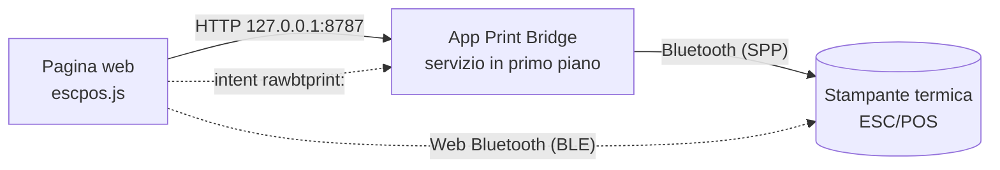

<p align="center">
  
</p>

# Print Bridge

**Stampa scontrini su stampanti termiche ESC/POS direttamente dalle pagine web, su
Android.** Una pagina (gestionale, cassa, sistema di voto, prenotazioni…) costruisce
lo scontrino e lo manda alla stampante Bluetooth vicina, senza driver e senza uscire
dal browser.

| | |
|---|---|
| **App Android** | [ultima Release](https://github.com/nb-camelot/raw-bt-print-bridge/releases/latest) (`app-release-<versione>.apk`) |
| **Pagina di test** | [nb-camelot.github.io/raw-bt-print-bridge](https://nb-camelot.github.io/raw-bt-print-bridge/), oppure `http://127.0.0.1:8787/` servita dall'app |
| **Stampa diretta BLE** | [pagina Web Bluetooth](https://nb-camelot.github.io/raw-bt-print-bridge/ble.html), senza app |
| **Client web** | `escpos.js`, pacchetto npm [`@nb-camelot/rawbt-print`](https://www.npmjs.com/package/@nb-camelot/rawbt-print) |
| **Novità** | [CHANGELOG.md](CHANGELOG.md) |

L'app si chiama **Raw BT Print Bridge** (package `com.rawbtprint.bridge`) e ha un
marchio proprio e neutro, **Print Bridge**. Il logo stampato in testa agli scontrini
è quello di chi la usa: si imposta da file, da URL o via API.

## Indice

- [Come funziona](#come-funziona)
- [Quale via scegliere](#quale-via-scegliere)
- [Avvio rapido](#avvio-rapido)
- [L'app Android](#lapp-android)
- [Stampa diretta via Web Bluetooth (BLE)](#stampa-diretta-via-web-bluetooth-ble)
- [Usare Print Bridge nelle proprie pagine](#usare-print-bridge-nelle-proprie-pagine)
- [Layout di stampa](#layout-di-stampa)
- [API HTTP locale dell'app](#api-http-locale-dellapp)
- [Risoluzione dei problemi](#risoluzione-dei-problemi)
- [Sviluppo](#sviluppo)

## Come funziona



1. La pagina include `escpos.js`, che costruisce i comandi ESC/POS (testo,
   grassetto, dimensioni, QR nativo, logo raster), anche da un
   [layout di stampa](#layout-di-stampa) riempito con i dati, oppure uno scontrino JSON.
2. **Via app**: la pagina chiama l'API locale dell'app su `127.0.0.1:8787`. L'app,
   tenuta viva da un servizio in primo piano, apre la connessione Bluetooth con la
   stampante accoppiata e stampa, restando dietro al browser.
3. **Via Web Bluetooth**: con una stampante **BLE** la pagina stampa da sola,
   tramite Chrome, senza nessuna app (vedi [sotto](#stampa-diretta-via-web-bluetooth-ble)).
4. **Ripiego**: se l'app non risponde, la pagina può aprirla con lo scheme
   `rawbtprint:base64,<dati>`, e allora stampa l'app in primo piano.

## Quale via scegliere

| | App Android (API locale) | Web Bluetooth (BLE) | Scheme `rawbtprint:` |
|---|---|---|---|
| Stampanti | qualsiasi stampante Bluetooth accoppiata (Classic SPP) | solo stampanti **BLE** compatibili | come l'app |
| Serve l'app | sì | **no** | sì |
| Browser | Chrome Android | Chrome Android (anche desktop) | Chrome Android |
| Esito della stampa | sì (`ok`, `bytes`, `error`) | sì (scrittura completata) | no |
| Resta nel browser | sì | sì | no, l'app va in primo piano |
| Permessi | «App sul dispositivo» per le pagine pubbliche | scelta della stampante, una volta per scheda | nessuno |
| Uso consigliato | **predefinito**, funziona con tutte le stampanti | stampanti BLE, postazioni senza app | ripiego |

## Avvio rapido

### Con l'app (tutte le stampanti Bluetooth)

1. Accoppia la stampante in **Impostazioni → Bluetooth** di Android.
2. Scarica e installa `app-release-<versione>.apk` dall'[ultima Release](https://github.com/nb-camelot/raw-bt-print-bridge/releases/latest).
3. Apri **Raw BT Print Bridge**, concedi il permesso Bluetooth e premi **Scegli stampante**.
4. **Disattiva l'ottimizzazione batteria** per l'app: l'app lo propone all'avvio,
   oppure premi **Risolvi** nel pannello di stato. Senza, Android può sospenderla
   quando passi al browser e le stampe restano in attesa (vedi
   [Batteria e sospensione](#batteria-e-sospensione-in-background-importante)).
5. Premi **Autotest completo**: tutte le voci devono essere ✓.
6. Apri in Chrome `http://127.0.0.1:8787/` (o la pagina su Pages) e prova una stampa.

### Senza app (stampanti BLE)

1. Apri in Chrome la [pagina di stampa diretta BLE](https://nb-camelot.github.io/raw-bt-print-bridge/ble.html).
2. Premi **Abbina stampante** e scegli la stampante dall'elenco di Chrome.
3. Stampa. Finché la scheda resta aperta non servono altre conferme. Dopo una
   ricarica basta **Riconnetti** (o un tocco su una stampa) e la scelta della
   stampante nell'elenco; con un'opzione di Chrome la pagina si ricollega da sola
   (vedi [Abbinamento](#abbinamento-una-volta-per-scheda)).

## L'app Android

Raw BT Print Bridge è un'app nativa minimale (Kotlin, nessuna libreria esterna,
Android 6+). Tiene attivo un **server HTTP locale** su `127.0.0.1:8787`, raggiungibile
solo dal tablet stesso, dentro un **servizio in primo piano** con notifica.

La schermata è divisa in card:

- **Stato del bridge**: quattro righe con pallino verde / ambra / rosso / grigio,
  aggiornate ogni 2 secondi.

  | Riga | Cosa dice |
  |---|---|
  | **Server API** | in ascolto da quanto, esito e durata dell'ultimo autotest (ogni 15 s), riavvii |
  | **Chiamate dal browser** | ultima chiamata (metodo, percorso, esito, ms, origine), richieste in corso, connessioni aperte senza richiesta, totale connessioni ricevute |
  | **Bluetooth e stampante** | Bluetooth acceso, stampante scelta e accoppiata, esito dell'ultima connessione |
  | **Batteria e sospensione in background** | ottimizzazione batteria, limitazioni, sospensione delle app, risparmio energetico |

  Sotto ci sono **Autotest completo**, **Riavvia server**, **Prova Bluetooth**
  (connessione senza stampare) e, se serve, **Risolvi**.
- **Stampante**: stampante scelta e stato della stampa; **Scegli stampante**,
  **Prova stampa (via API)**, **Dimentica stampante**.
- **Indirizzi di prova**, ognuno con **Copia** e **Apri**: pagina di test locale,
  stato e autotest in JSON, pagina su Pages, URL CDN del client web.
- **Carta e logo dello scontrino**: 58 mm (32 colonne) o 80 mm (48 colonne); logo
  da file, da URL, incluso o nessuno.
- **Registro**: le ultime 300 righe, comprese le chiamate ricevute mentre l'app era
  in background. Si copia con un tocco.

**Autoriparazione.** Ogni 15 secondi il servizio chiama `GET /status` su se stesso.
Se il server non è in ascolto o non risponde due volte di seguito, lo chiude e lo
riapre. Dopo tre tentativi falliti riprova una volta al minuto. La notifica mostra lo
stato reale.

**Autotest completo** (nell'app, con `GET /selftest` o dalla pagina di test)
controlla in un colpo solo:
- app e dispositivo;
- servizio, server e API;
- pagina di test e client web;
- Bluetooth e connessione alla stampante;
- batteria e sospensione;
- notifiche, compreso il canale del servizio;
- a scelta (solo dall'app), una stampa di prova via API.

Il riepilogo si copia per allegarlo a una segnalazione.

### Batteria e sospensione in background (importante)

Il server gira in un servizio in primo piano, ma alcune ROM (verificato su
LineageOS 18.1 / Android 11) sospendono comunque l'app quando non è davanti. Il
sintomo è preciso: dal browser la stampa, o `http://127.0.0.1:8787/status`, resta
in **caricamento infinito** e parte da sola appena si riapre l'app. Per evitarlo:

1. **Impostazioni → App → Raw BT Print Bridge → Batteria**: ottimizzazione batteria
   su **Non ottimizzare** (o «Senza restrizioni») e nessuna limitazione in background.
2. **Opzioni sviluppatore**, se attive: **«Sospendi esecuzione per app memorizzate
   nella cache»** disattivato. Su Android 11 il valore predefinito è spento, da
   Android 12 di solito è acceso.
3. Da Android 12, nelle impostazioni dell'app: **«Sospendi attività app se non in
   uso»** disattivato.
4. **Risparmio energetico** spento mentre si usa la stampante.

L'app controlla da sola questi punti:
- la riga **Batteria e sospensione** diventa rossa (problema che blocca l'app) o
  ambra (che può bloccarla);
- **Risolvi** dice cosa apre e porta all'impostazione giusta;
- all'avvio un avviso spiega il problema, ma non quando l'app è stata aperta dal
  browser per stampare;
- la notifica mette l'avviso in testa, e `/status` lo riporta nel campo `power`, che
  la pagina di test mostra.

C'è anche un **controllo sul sintomo**. Se il controllo periodico si ferma per più di
45 s con il tablet acceso, l'app è stata sospesa: il registro scrive «App sospesa dal
sistema per N s» e la riga resta rossa per mezz'ora, anche su ROM con impostazioni
proprie. Lo schermo spento non conta, perché il confronto usa il tempo di sistema che
non avanza nel sonno profondo.

### Marchio e logo dello scontrino

**Print Bridge** è il marchio dell'app: una stampante termica con lo scontrino in
uscita e il simbolo Bluetooth, in teal (`#0F766E`) su ardesia. Lo usano l'icona,
la notifica, l'intestazione, le pagine di test e il favicon. I file sorgente sono in
[`assets/brand/`](assets/brand/).

Il logo in testa agli scontrini non è legato al marchio dell'app:
- si imposta nell'app (**Da file**, **Da URL**) oppure via API con `POST /config`:
  `{"logoMode":"url","logoUrl":"https://…/logo.png"}`, `{"logoMode":"asset"}` per il
  logo incluso, `{"logoMode":"none"}` per toglierlo;
- il **logo incluso** è quello neutro «Print Bridge», in bianco e nero;
- i PNG con **sfondo trasparente** vanno bene: la trasparenza diventa il bianco della
  carta.

<!-- BLE -->
## Stampa diretta via Web Bluetooth (BLE)

Con una stampante **Bluetooth Low Energy** la pagina può stampare da sola, tramite
Chrome, senza installare nulla. La pagina pronta è
[`ble.html`](https://nb-camelot.github.io/raw-bt-print-bridge/ble.html) su Pages; per
le proprie pagine c'è `RawBT.ble` in `escpos.js` (dalla 1.9.0).

### Stampanti compatibili

Funziona con le stampanti termiche ESC/POS che espongono un **canale seriale BLE**.
La pagina prova questi profili, in ordine:

| Servizio | Caratteristica di scrittura | Dove si trova |
|---|---|---|
| `18f0` | `2af1` | il più diffuso: molte stampanti cinesi, spesso annunciate come «BlueTooth Printer» (per esempio le Netum NT-1809) |
| `e7810a71-73ae-499d-8c15-faa9aef0c3f2` | `bef8d6c9-9c21-4c9e-b632-bd58c1009f9f` | varie stampanti portatili |
| `49535343-fe7d-4ae5-8fa9-9fafd205e455` (ISSC) | `49535343-8841-43f4-a8d4-ecbe34729bb3` | moduli Microchip/ISSC |
| `ff00` | `ff02` | moduli economici |
| `ffe0` | `ffe1` | moduli HM-10 e simili |
| `6e400001-b5a3-f393-e0a9-e50e24dcca9e` (Nordic UART) | `6e400002-b5a3-f393-e0a9-e50e24dcca9e` | moduli Nordic |

Se il servizio c'è ma la caratteristica ha un altro UUID, la pagina usa la prima
caratteristica scrivibile dello stesso servizio. Le «cat printer» (servizio `ae30`)
non sono ESC/POS e vengono rifiutate con un messaggio chiaro.

- **Bluetooth 4 non vuol dire BLE.** Molte stampanti «Bluetooth 4.0» sono solo
  Classic (SPP): il browser non le vede e serve l'app. Le stampanti **doppia
  modalità** (dual mode) vanno bene, ma in BLE si presentano spesso con un altro
  nome.
- **Netum NT-1809DD**: è doppia modalità, ma non l'abbiamo provata direttamente. Se
  non stampa al primo colpo, apri **Avanzate → Diagnostica** in `ble.html`: mostra
  servizi e caratteristiche e permette di scegliere a mano quella giusta con **Usa
  questa** (la scelta resta ricordata per quella stampante).
- La diagnostica vede solo i servizi elencati sopra più `18f1`, `fff0`, `ffe6` e
  `fee7`. Web Bluetooth non mostra alla pagina i servizi che non ha dichiarato alla
  scelta del dispositivo.

### Abbinamento: una volta per scheda

La prima volta si sceglie la stampante nell'elenco di Chrome. Poi:

- **finché la scheda resta aperta** la pagina tiene la connessione e le stampe
  partono senza altre conferme; se la stampante va in standby, la pagina si
  ricollega da sola alla stampa successiva;
- **dopo una ricarica o una nuova visita** Chrome stabile non restituisce alla
  pagina le stampanti già scelte: la pagina ricorda il nome e mostra **Riconnetti
  «nome»**, che apre l'elenco filtrato su quella stampante. Anche un tocco
  direttamente su una stampa fa la stessa cosa;
- per **ricordarla tra le visite**, senza tocchi, attiva in Chrome
  `chrome://flags/#enable-web-bluetooth-new-permissions-backend` (Enabled, poi
  riavvia Chrome). La pagina se ne accorge (riga «Ricorda la stampante tra le
  visite») e si ricollega all'apertura.

Non serve accoppiare la stampante nelle impostazioni Bluetooth di Android.

### Come vengono inviati i dati

- Una scrittura alla volta, in coda: due stampe lanciate insieme escono una dopo
  l'altra, senza mescolarsi.
- **Automatica**: se la caratteristica accetta scritture con conferma, pezzi da 100
  byte con conferma (la conferma regola il flusso, così la stampante non perde
  byte). Se la stampante rifiuta il primo pezzo da 100, si passa da soli a 20 e la
  scelta resta ricordata. Se accetta solo scritture senza conferma, pezzi da 20
  byte con 20 ms di pausa e l'ultimo con conferma quando possibile.
- Le scritture fallite con «GATT operation failed for unknown reason» o «already in
  progress» non sono partite e si ritentano fino a 3 volte; gli altri errori
  interrompono la stampa, perché ritentare potrebbe stampare due volte.
- In **Avanzate** si può forzare una modalità (con conferma da 100 o da 20 byte,
  senza conferma da 20 byte), la larghezza della carta (58 o 80 mm) e la code page.
- Ogni stampa di `ble.html` comincia con `ESC @`, `FS .` (esce dalla modalità
  caratteri cinesi, attiva di default su molti firmware, che trasforma gli accenti
  in ideogrammi) e `ESC t 16` (Windows-1252, la codifica con cui `escpos.js` scrive
  il testo). I loghi sono alti al massimo 240 punti e spezzati in bande da 128
  righe, come nell'app.

### Usarla nelle proprie pagine

```html
<button id="stampa">Stampa</button>
<script src="https://cdn.jsdelivr.net/npm/@nb-camelot/rawbt-print@1/escpos.js"></script>
<script>
  document.getElementById('stampa').onclick = function () {
    var ble = RawBT.ble;
    // Nel gestore del tocco e prima di qualunque attesa: l'elenco di Chrome
    // si apre solo durante un gesto dell'utente.
    var pronta = ble.info().paired ? Promise.resolve() : ble.pair({ sameName: true });
    pronta.then(function () {
      var bytes = new EscPos().init().kanjiOff().codepage(16)
        .align('center').size(2, 2).line('GRAZIE').size(1, 1)
        .feed(3).cut().bytes();
      return ble.print(bytes, { onProgress: function (inviati, totali) {} });
    }).then(function (r) {
      console.log('inviati', r.bytes, 'byte in', r.ms, 'ms');
    }).catch(function (e) {
      var m = ble.explain(e);   // '' se l'utente ha chiuso l'elenco
      if (m) alert(m);
    });
  };
</script>
```

| Funzione | Cosa fa |
|---|---|
| `supported()` | Web Bluetooth disponibile (Chrome ed Edge; non Safari, iOS, Firefox) |
| `available()` | promessa: `true` se c'è la radio Bluetooth, `false` se no, `null` se non si sa |
| `canRemember()` | il browser può restituire le stampanti già scelte (opzione di Chrome attiva) |
| `pair({ sameName, all })` | apre l'elenco di Chrome (serve un gesto), si collega e sceglie il canale; `sameName` filtra sulla stampante già usata, `all` mostra tutti i dispositivi. Restituisce `info()` |
| `reconnect()` | senza gesto: si ricollega alla stampante di questa scheda o, con `canRemember()`, a quella ricordata; `null` se serve un tocco |
| `print(bytes, { onProgress })` | stampa in coda; `{ ok, bytes, ms, chunk, withResponse }` |
| `info()` / `on(fn)` | stato attuale / avvisi a ogni cambio: `status` (`idle`, `connecting`, `ready`, `printing`, `disconnected`, `error`), `name`, `paired`, `connected`, `profile`, `characteristic`, `writeMode`, `remembered`, `lastError` |
| `describe()` | servizi e caratteristiche visibili, con le proprietà |
| `useCharacteristic(servizio, caratteristica)` | sceglie a mano il canale, ricordato per quella stampante |
| `setWriteMode(modo)` | `auto`, `response-100`, `response-20`, `noresponse-20` |
| `disconnect()` / `forget()` | chiude la connessione / dimentica la stampante (anche nel browser, se supportato) |
| `explain(errore)` | spiegazione in italiano di un errore Web Bluetooth (`''` se annullato) |

La stampante ricordata e le scelte manuali stanno nel `localStorage` della pagina,
sotto la chiave `printbridge.ble`.

### Limiti

- Una stampante BLE accetta **una connessione alla volta** e, mentre è collegata a
  qualcosa (l'app, un altro telefono, un PC), di solito smette di farsi vedere:
  scollegala o spegnila e riaccendila.
- Su **Android 11 e precedenti** Chrome trova dispositivi Bluetooth solo con il
  permesso **Posizione** e la Localizzazione attiva.
- La pagina deve restare aperta durante la stampa; se va in background Chrome può
  chiudere la connessione, e la pagina la riapre alla stampa successiva.
- Serve una pagina in **https** (o `localhost`).

## Usare Print Bridge nelle proprie pagine

### Includere `escpos.js`

```html
<script src="https://cdn.jsdelivr.net/npm/@nb-camelot/rawbt-print@1/escpos.js"></script>
```

Lo script espone `EscPos` (costruisce i byte ESC/POS) e `RawBT` (li invia all'app
oppure, con `RawBT.ble`, [direttamente a una stampante BLE](#stampa-diretta-via-web-bluetooth-ble)).
In produzione conviene fissare la versione (`@1.9.0`) o servire il file dal proprio
dominio. Gli asset delle Release GitHub **non** si possono includere con
`<script src>`, perché sono serviti come download.

Configurazione facoltativa con meta tag:

```html
<meta name="rawbt-api-port" content="8787">
<meta name="rawbt-scheme" content="rawbtprint">
```

### Uno scontrino JSON (lo impagina l'app)

```html
<script>
  RawBT.sendReceipt({
    shop: "NEGOZIO DEMO", title: "RICEVUTA", code: "ABC123",
    items: [{ desc: "Caffe", qty: 2, price: 1.20 }],
    qr: "https://example.com/r/ABC123", footer: "Grazie"
  }).then(function (r) { console.log(r); });
</script>
```

### ESC/POS costruito nella pagina

```js
var bytes = new EscPos().init().codepage(0x10)
  .align('center').size(2, 2).line('PROVA').size(1, 1)
  .align('left').line('Totale: 2,40')
  .align('center').qr('https://example.com/r/ABC123', 6)
  .feed(3).cut().bytes();
RawBT.sendApi(bytes).then(function (r) { console.log(r); });
```

Metodi di `EscPos`: `init`, `codepage`, `kanjiOff` (`FS .`, per i firmware cinesi che
stampano gli accenti come ideogrammi), `align('left'|'center'|'right')`, `bold`,
`underline`, `size(w, h)`, `text`, `line`, `feed`, `cut`, `rule`, `qr(dati, modulo)`,
`image(raster)`, `bytes`; più `EscPos.loadImage(url)` ed
`EscPos.rasterize(img, larghezza, soglia, { maxHeight, band })` per i loghi.

### Funzioni di `RawBT`

| Funzione | Cosa fa | Risultato |
|---|---|---|
| `check(timeoutMs)` | `GET /status`, non rifiuta mai | `{ ok, ms, status }` oppure `{ ok:false, ms, reason, message }` con `reason` = `timeout` / `network` / `response` |
| `ping(timeoutMs)` | come `check`, per compatibilità | lo stato oppure `null` |
| `sendReceipt(spec)` | `POST /receipt` (JSON) | `{ ok, bytes, summary }` o `{ ok:false, error }` |
| `sendApi(bytes)` | `POST /print` (ESC/POS in base64) | `{ ok, bytes }` o `{ ok:false, error }` |
| `send(bytes)` | come `sendApi`, ma se la connessione è rifiutata subito apre l'app con lo scheme | `{ ok:true, fallback:true, confirmed:false, error }` col ripiego, `{ ok:false, timeout:true, error }` dopo un timeout |
| `selftest()` | `GET /selftest` | `{ ok, level, summary, ms, version, versionCode, device, items }` |
| `getConfig()` / `setConfig(obj)` | legge e cambia carta, logo e stampante | la configurazione |
| `localAccess()` / `localAccessHint(state)` | stato e istruzioni del permesso «App sul dispositivo» | `{ name, state }` / testo |
| `url(bytes)` / `navigate(url)` | scheme `rawbtprint:` per il ripiego manuale | — |

Tutte le chiamate hanno un timeout (`{ timeoutMs }`, 0 = nessuno). I default sono
5 s per `check`, 40 s per `sendApi`, 60 s per `sendReceipt`, 30 s per `selftest`,
10 s per la configurazione (45 s con `logoUrl`). Il timeout scatta anche dove `fetch`
ignora l'abort.

Tutte le chiamate usano `cache: 'no-store'`. Chrome mette in coda le GET identiche
dietro una ancora in corso, quindi senza questa opzione una sola `/status` appesa
bloccherebbe le successive, da qualunque scheda.

Dopo un ripiego sullo scheme l'esito della stampa non è noto, quindi la stampa non va
ritentata. Dopo un timeout `send` non apre l'app: la richiesta potrebbe essere già in
stampa, e Chrome aprirebbe l'app solo con un nuovo tocco dell'utente, per esempio un
pulsante che chiama `RawBT.navigate(RawBT.url(bytes))`.

### Permesso «App sul dispositivo» (Local Network Access)

Da Chrome 142, una pagina su un'origine pubblica (`https://…`) che chiama
`127.0.0.1` deve avere il permesso **«App sul dispositivo»** (`loopback-network`;
su Chrome 142-144 si chiamava «Accesso alla rete locale»):
- al primo tentativo Chrome mostra il prompt: premi **Consenti**;
- se l'hai negato: icona a sinistra dell'indirizzo → **Impostazioni sito** →
  **App sul dispositivo** → **Consenti**, poi ricarica;
- sui tablet gestiti si può pre-approvare con la policy `LocalNetworkAccessAllowedForUrls`.

La pagina servita dall'app (`http://127.0.0.1:8787/`) non ha bisogno del permesso,
perché chiama la sua stessa origine. `escpos.js` usa `targetAddressSpace: 'loopback'`,
e `RawBT.localAccess()` dice lo stato del permesso.

## Layout di stampa

Con `PrintBridge.render` (dalla 1.9.0) lo scontrino si descrive **una volta sola** in un
layout JSON: logo, intestazione, colonne, ripetizioni, QR. A ogni stampa si passano solo
i dati. Il risultato sono i byte ESC/POS, gli stessi per la stampa diretta BLE e per
l'app. Il layout è JSON puro, quindi può stare in un file o arrivare da un server.

```html
<button id="stampa">Stampa</button>
<script src="https://cdn.jsdelivr.net/npm/@nb-camelot/rawbt-print@1/escpos.js"></script>
<script>
  var LAYOUT = {
    paper: 58,
    codepage: 16,
    blocks: [
      { logo: 'logo.png', maxHeight: 160 },
      { text: '{{shop}}', align: 'center', bold: true, size: [2, 2] },
      { rule: true },
      { row: ['Ordine {{order}}', '{{date|date}}'] },
      { each: 'items', row: [{ text: '{{qty}} x {{name}}', wrap: true }, '{{price|euro}}'] },
      { rule: '=' },
      { row: ['TOTALE', '{{total|euro}}'], bold: true, size: [1, 2] },
      { if: 'qr', blocks: [{ feed: 1 }, { qr: '{{qr}}', size: 5 }] },
      { if: 'note', text: '{{note}}', align: 'center' },
      { feed: 3 },
      { cut: true }
    ]
  };

  document.getElementById('stampa').onclick = function () {
    var dati = {
      shop: 'Negozio Demo', order: 'A-042', date: true,
      items: [{ qty: 2, name: 'Caffè', price: 2.4 }, { qty: 1, name: 'Cornetto', price: 1.5 }],
      total: 3.9, qr: 'https://example.com/r/A-042'
    };
    // Nel gestore del tocco: con via 'ble' e nessuna stampante l'elenco di Chrome si apre subito.
    RawBT.printLayout(LAYOUT, dati, { via: 'ble' })        // oppure { via: 'app' }
      .then(function (r) { console.log('stampato', r); })
      .catch(function (e) {
        var m = RawBT.ble.explain(e);   // '' se l'utente ha chiuso l'elenco
        if (m) alert(m);
      });
  };
</script>
```

In `ble.html`, la card **Scontrino da layout** ha un esempio modificabile (layout e dati
in JSON). **Controlla senza stampare** prova il layout senza stampante, e il pulsante
**Scontrino da layout** lo stampa.

### Formato

| Campo | Cosa fa |
|---|---|
| `paper` | `58` (32 colonne, 384 punti) o `80` (48 colonne, 576 punti); vanno bene anche `384` e `576`. Predefinito 58 |
| `codepage` | numero per `ESC t`, predefinito 16 (Windows-1252, la codifica con cui `escpos.js` scrive il testo) |
| `defaults` | valori dei campi che mancano nei dati (o sono `null`) |
| `prepare` | nome di una preparazione dei dati in `PrintBridge.prepare`, per esempio `receipt` |
| `blocks` | i blocchi, in ordine |

`paper` e `codepage` passati nelle opzioni di `render` valgono più di quelli del layout,
perché dipendono dalla stampante e non dallo scontrino. Ogni stampa comincia con
`ESC @`, `FS .` e `ESC t <codepage>`.

### Blocchi

Ogni blocco può avere `if` (vedi sotto).

| Blocco | Esempio | Note |
|---|---|---|
| testo | `{ text: 'Ciao {{nome}}', align: 'center', size: [2, 1], bold: true, underline: true }` | va a capo sulle parole; `size: [larghezza, altezza]` da 1 a 8, oppure un numero solo |
| colonne | `{ row: ['{{desc}}', '{{price\|euro}}'] }` | vedi [Colonne](#colonne); accetta `bold`, `underline`, `size`, `gap`, `wrap` |
| ripetizione | `{ each: 'items', row: [...] }` oppure `{ each: 'items', blocks: [...] }` | dentro si leggono i campi dell'elemento (e, se mancano, quelli fuori); `{{.}}` per un elenco di testi; `{{@number}}` (da 1), `@index` (da 0), `@first`, `@last` |
| gruppo | `{ if: 'qr', blocks: [...] }` | più blocchi sotto una sola condizione |
| logo | `{ logo: 'logo.png', maxHeight: 240 }` | URL, data URL o segnaposto; `true` usa `opzioni.logo`; da JavaScript anche un'immagine della pagina o un raster già pronto. Centrato, in bande da 128 righe; `threshold` da 0 a 255 (140) |
| linea | `{ rule: true }`, `{ rule: '=' }` | larga quanto la carta |
| QR | `{ qr: '{{url}}', size: 6, ec: 'M' }` | `size` è il modulo (1-16), `ec` la correzione (`L`, `M`, `Q`, `H`); centrato salvo `align`; senza dati non si stampa |
| avanzamento | `{ feed: 3 }` | anche `'{{feed}}'` |
| taglio | `{ cut: true }`, `{ cut: 'partial' }` | |
| byte grezzi | `{ raw: [27, 112, 0, 25, 250] }` | inviati come sono, per esempio per aprire il cassetto |

Un blocco o un filtro sconosciuto, o un valore sbagliato, fanno fallire la promessa con
un errore che dice dove (`blocks[3]: blocco non riconosciuto`), invece di stampare a metà.

Le dimensioni dei caratteri usano `GS !`. Le colonne si contano su 32 o 48 caratteri, e
con larghezza 2 (`size: [2, x]`) diventano 16 o 24.

### Colonne

- `row: ['sinistra', 'destra']`: la prima colonna prende lo spazio che resta, le altre
  sono larghe quanto il loro testo e l'ultima è allineata a destra, con uno spazio tra
  una colonna e l'altra (`gap`). È lo stesso `pad()` dello scontrino dell'app: il testo
  troppo lungo a sinistra si tronca.
- Per colonne a misura ogni colonna è un oggetto `{ text, width, flex, align, wrap }`:
  `width: 4` è fissa, `width: 'auto'` è larga quanto il testo, senza `width` è
  flessibile (peso `flex`, predefinito 1). Con `wrap` la colonna va a capo invece di
  troncare, e la riga diventa più righe.

```js
{ row: [
  { text: '{{qty}}x', width: 4 },
  { text: '{{name}}', wrap: true },
  { text: '{{price|euro}}', width: 10, align: 'right' }
] }
```

### Segnaposto, filtri e condizioni

- `{{campo}}` e `{{cliente.nome}}`: un campo mancante diventa testo vuoto. Si leggono
  solo le proprietà dei dati (niente `constructor` o `__proto__`). I caratteri di
  controllo dei dati vengono tolti, così un dato non può diventare un comando per la
  stampante.
- Filtri, anche in catena (`{{nome|lower|upper}}`):

  | Filtro | Esempio |
  |---|---|
  | `euro` | `1234.5` → `1.234,50 €` (it-IT); `euro:0` senza decimali |
  | `num` | `1234.5` → `1234,50`, come gli importi dello scontrino dell'app; `num:3` per tre decimali |
  | `date` | `true` o `"now"` → adesso, `17/10/2026 09:05`; anche Date, millisecondi o testo ISO. Formato a scelta: `date:dd/MM/yy`, `date:HH:mm` (`yyyy`, `yy`, `MM`, `dd`, `HH`, `mm`, `ss`) |
  | `upper`, `lower` | maiuscole, minuscole |

  I numeri vanno bene anche come testo (`"2.5"`, `"2,50"`). Filtri propri:
  `PrintBridge.filters.nome = function (valore, argomento) { … }`, oppure
  `opzioni.filters` per una sola stampa.
- `if`: `'campo'`, `'!campo'`, `'a && b'`, `'a || b'` (`&&` prima di `||`). Sono falsi
  i campi mancanti, `''`, `0`, `false` e gli elenchi vuoti. Su un blocco `each` la
  condizione vale per tutto il blocco; per scegliere i singoli elementi si usa
  `blocks` con un `if` dentro.

Non c'è `eval` né `new Function`: un layout ricevuto da un server non esegue codice
nella pagina, e filtri e preparazioni sono solo quelli registrati dalla pagina.

### Lo scontrino dell'app, anche via BLE

`PrintBridge.layouts.receipt`, o semplicemente `'receipt'`, riproduce riga per riga lo
scontrino di [`POST /receipt`](#api-http-locale-dellapp): lo stesso JSON di
`RawBT.sendReceipt` si stampa anche via BLE.

```js
var scontrino = { shop: 'NEGOZIO DEMO', code: 'ABC123', logo: true,
  items: [{ desc: 'Caffe', qty: 2, price: 1.20 }],
  qr: 'https://example.com/r/ABC123', footer: 'Grazie' };
RawBT.sendReceipt(scontrino);                                            // lo impagina l'app
RawBT.printLayout('receipt', scontrino, { via: 'ble', logo: 'logo.png' }); // lo impagina la pagina
```

`prepare: 'receipt'` legge i dati come l'app: per ogni voce `qty` (predefinito 1),
`price` (predefinito 0) e `amount` = `qty × price`; `total`, se manca, è la somma. Per
uno scontrino simile ma proprio, partite da una copia di
`JSON.stringify(PrintBridge.layouts.receipt)`.

Differenze rispetto all'app:
- `logo: true` stampa `opzioni.logo` (nell'app è il logo configurato); senza
  `opzioni.logo` la stampa si ferma con un errore chiaro (`logo-missing`);
- la larghezza viene dalla carta (`opzioni.paper`), non da `width`; `printer` vale
  solo per l'app;
- i testi lunghi vanno a capo sulle parole, mentre l'app li lascia spezzare alla
  stampante;
- i caratteri grandi (nome del negozio, titolo, totale) usano `GS !`. L'app e
  `EscPos.size` usano `ESC !` con gli stessi valori, che secondo lo standard ESC/POS
  sceglie il font piccolo e la doppia altezza invece di ingrandire. Via layout il
  nome del negozio può quindi uscire più largo che dall'app.

### Logo e CORS

- Un logo da URL si carica con `crossOrigin = 'anonymous'` e passa per un canvas. Il
  browser lascia leggere i pixel di un'immagine di **un altro dominio** solo se il suo
  server risponde con `Access-Control-Allow-Origin` (CORS). Senza, `render` si ferma
  con un errore: «Logo non caricato…» (`logo-load`) per un URL, «canvas "tainted"»
  (`logo-cors`) per un'immagine della pagina caricata senza `crossOrigin`.
- Le soluzioni: servire il logo dallo stesso sito della pagina, abilitare CORS sul
  server del logo, oppure usare un data URL (`data:image/png;base64,…`) o un raster
  già pronto (`EscPos.rasterize`).
- Il logo è alto al massimo 240 punti (`maxHeight`), centrato su fondo bianco e inviato
  in bande da 128 righe, come nell'app. Immagini e raster restano in cache per URL (si
  svuota con `PrintBridge.clearCache()`); un caricamento fallito non resta in cache.
  Dopo 10 s senza risposta la stampa si ferma.

### Funzioni

| Funzione | Cosa fa |
|---|---|
| `PrintBridge.render(layout, dati, opzioni)` | promessa con i byte ESC/POS (array di numeri). `layout` è un oggetto, un testo JSON o un nome (`'receipt'`). Opzioni: `paper`, `codepage`, `logo`, `now` (la Date di `date`), `filters` |
| `RawBT.printLayout(layout, dati, opzioni)` | `render` più la stampa: `via: 'ble'` con `RawBT.ble.print` (accetta `onProgress`), oppure `via: 'app'` (predefinita) con `RawBT.send` (accetta `timeoutMs` e `fallback: false`). Va chiamata nel gestore del tocco |
| `PrintBridge.format(testo, dati)` | riempie un solo testo, per provare segnaposto e filtri |
| `PrintBridge.layouts`, `.filters`, `.prepare` | layout pronti, filtri, preparazioni dei dati; si possono aggiungere i propri |
| `PrintBridge.clearCache()` | svuota la cache dei loghi |

Gli errori hanno `name` uguale a `PrintBridgeLayoutError` e un `code`: `layout`,
`filter`, `logo-load`, `logo-cors`, `logo-missing` o `via`.

## API HTTP locale dell'app

Tutte su `http://127.0.0.1:8787`, con CORS aperto (`Access-Control-Allow-Origin: *`)
e risposte JSON.

| Metodo | Percorso | Descrizione |
|---|---|---|
| GET | `/`, `/test` | pagina di test (stessa origine: niente permesso né CORS) |
| GET | `/escpos.js` | il client web incluso nell'APK, della stessa versione |
| GET | `/status` | versione, stato di server, chiamate, Bluetooth e batteria, stampante, configurazione |
| GET | `/selftest` | autotest completo, senza stampa |
| GET | `/config` | configurazione corrente |
| POST | `/config` | larghezza carta, logo (`logoMode`, `logoUrl`), stampante (`printer`) |
| POST | `/receipt` | scontrino JSON, impaginato dall'app |
| POST | `/print` | ESC/POS già pronto, in base64 (o byte grezzi) |

Formato di `POST /receipt` (tutti i campi sono facoltativi):

```json
{
  "shop": "NEGOZIO DEMO",
  "title": "RICEVUTA",
  "subtitle": "Ordine 42",
  "code": "ABC123",
  "date": true,
  "lines": ["Buono regalo", "Uso entro 12 mesi"],
  "items": [{ "desc": "Caffe", "qty": 2, "price": 1.20 }],
  "total": "",
  "qr": "https://example.com/r/ABC123",
  "qrText": "Scansiona per la ricevuta",
  "footer": "Grazie e arrivederci",
  "logo": true,
  "width": 32,
  "cut": true,
  "feed": 3,
  "printer": "5A:4A:D5:BC:47:08"
}
```

`width` (16-64 colonne) sostituisce la larghezza impostata nell'app, `printer` la
stampante scelta. Risposta: `{"ok":true,"bytes":N,"summary":"…"}` oppure
`{"ok":false,"error":"…"}`.

## Risoluzione dei problemi

| Sintomo | Causa probabile | Cosa fare |
|---|---|---|
| Dal browser la stampa resta in caricamento e parte quando riapri l'app | Android sospende l'app in background | [Batteria e sospensione](#batteria-e-sospensione-in-background-importante): **Risolvi** nell'app |
| «App raggiungibile: no» dopo pochi ms (`network`) | app chiusa, server fermo o permesso negato | apri l'app; sulle pagine pubbliche concedi «App sul dispositivo» |
| «no: nessuna risposta» (`timeout`) | richiesta appesa | apri l'app: «Chiamate dal browser» e il registro dicono se è arrivata |
| `/status` aperto a mano resta in caricamento | un'altra scheda con un client vecchio (fino alla 1.6.x) tiene una richiesta appesa | chiudi le altre schede su `127.0.0.1:8787` |
| «Timeout connessione dopo 8 s» | stampante spenta, lontana o già connessa a un altro dispositivo | la SPP accetta una sola connessione: libera la stampante e riprova (**Prova Bluetooth**) |
| La stampante BLE non compare nell'elenco di Chrome | la stampante è solo Bluetooth Classic, è collegata a un altro dispositivo, oppure Bluetooth o Posizione spenti | vedi [Limiti](#limiti); prova «Non trovo la stampante nell'elenco»; con le stampanti Classic usa l'app |
| Stampa BLE interrotta o con caratteri a caso | la stampante perde byte | in `ble.html` → **Avanzate** scegli un invio più lento |
| Accenti stampati come ideogrammi o simboli | modalità caratteri cinesi attiva o code page sbagliata | `kanjiOff()` e `codepage(16)` in testa alla stampa; in `ble.html` imposta la code page in **Avanzate** |
| Il logo esce come un rettangolo nero | logo con trasparenza su versioni fino alla 1.8.0 | aggiorna l'app; dalla 1.8.1 la trasparenza diventa bianco |

## Sviluppo

### Struttura del repository

| Percorso | Contenuto |
|---|---|
| `android/` | app Android (`com.rawbtprint.bridge`): servizio, server HTTP, stampa Bluetooth, pannello di stato |
| `escpos.js` | client web (ESC/POS + trasporti verso app e BLE); la copia in `android/app/src/main/assets/` deve restare identica |
| `index.html` | pagina di test pubblicata su Pages; identica a `android/app/src/main/assets/test.html` salvo il percorso di `escpos.js` |
| `ble.html` | pagina di stampa diretta via Web Bluetooth (`web-ble-test*.html` rimandano qui) |
| `test/` | prove in Node, eseguite anche dalla CI: `RawBT.ble` con un Bluetooth finto (`node test/ble-test.js escpos.js`) e i layout di stampa, confrontati anche con lo scontrino di `Receipt.kt` (`node test/layout-test.js escpos.js`) |
| `assets/` | marchio (`assets/brand/`) e logo neutro per le prove da PC |
| `serve.ps1`, `print-logo-receipt.ps1` | prove dal PC (vedi sotto) |
| `.github/workflows/` | build, versioni, pubblicazione e sviluppo agentico |

### Build, versioni e pubblicazione

- **Pull request** verso `main`: `build-apk.yml` controlla la sintassi di `escpos.js`
  e delle pagine e l'allineamento delle copie, poi compila un **APK di prova**
  firmato (`<versione>-pr<N>`), scaricabile dagli artifact della run, **senza**
  Release. Le PR da fork sono firmate con la chiave debug.
- **Merge su `main`**: `bump-version.yml` calcola la nuova versione, aggiorna
  `versionName` e `versionCode`, fa il commit `chore(release): vX.Y.Z` e avvia
  `build-apk.yml` (Release con l'APK) e `publish-web.yml` (npm). Pages si pubblica
  dalla radice di `main`.
- **La versione dipende dall'ultimo commit**, quindi conviene lo **squash merge** con
  un titolo conventional commit:

  | Nel titolo o nel messaggio | Versione |
  |---|---|
  | `!:`, `BREAKING CHANGE` o `[semver:major]` | major |
  | `feat:` o `[semver:minor]` | minor |
  | tutto il resto (`fix:`, `docs:`…) | patch |
  | `[skip release]` | nessuna release |

  Il bump parte solo se cambia qualcosa in `android/` o c'è un `[semver:…]`. Si può
  forzare eseguendo `bump-version.yml` a mano con `release_type`.
- **Firma**: le Release sono firmate con una keystore stabile dai secret
  `SIGNING_KEYSTORE_BASE64`, `SIGNING_STORE_PASSWORD`, `SIGNING_KEY_ALIAS` e
  `SIGNING_KEY_PASSWORD`, così gli aggiornamenti si installano sopra.
- **npm**: `publish-web.yml` pubblica `@nb-camelot/rawbt-print` con trusted
  publishing (OIDC, nessun token). Configurazione una tantum su npmjs.org: *Package
  settings → Trusted Publisher → GitHub Actions*, repository
  `nb-camelot/raw-bt-print-bridge`, workflow `publish-web.yml`.

### Sviluppo agentico (OpenCode)

`opencode.yml` avvia un agente quando un commento di issue o PR contiene `/oc` o
`/opencode`, oppure a mano con *Run workflow*. Il flusso è autorizzazione → piano →
implementazione e review → PR → squash merge se il verdetto è `PASS` → release.

| Variabile | Default | Descrizione |
|---|---|---|
| `OPENCODE_ALLOWED_USERS` | *(vuoto)* | utenti extra autorizzati, separati da spazio |
| `OPENCODE_DEFAULT_MODEL` | `opencode/big-pickle` | modello predefinito |
| `OPENCODE_VISUAL_MODEL` | `opencode/space-bunny-free` | modello per issue con immagini |

Secret facoltativi per provider a pagamento: `OPENCODE_API_KEY`, `ANTHROPIC_API_KEY`,
`OPENAI_API_KEY`, `GEMINI_API_KEY`.

> **Attenzione**: il trigger cerca `/oc` ovunque nel testo, quindi anche un commento
> che contiene per esempio `application/octet-stream` avvia l'agente, che ha permessi
> di scrittura e può fare il merge. Evitate quella sequenza nei commenti che non sono
> comandi.

### Prove dal PC

```powershell
powershell -NoProfile -ExecutionPolicy Bypass -File .\serve.ps1                 # server su :8000
powershell -NoProfile -ExecutionPolicy Bypass -File .\print-logo-receipt.ps1 -Port COM9 -Code "DEMO-0001"
```

- `serve.ps1` serve `index.html` su `http://<ip-del-pc>:8000/` ed espone
  `GET /api/printer` (stato della stampante sul PC) e `POST /api/print` (ESC/POS in
  base64, scritto sulla porta seriale).
- `print-logo-receipt.ps1` stampa una ricevuta di prova con il logo neutro di
  `assets/logo.png`; `-Url` imposta il contenuto del QR.
