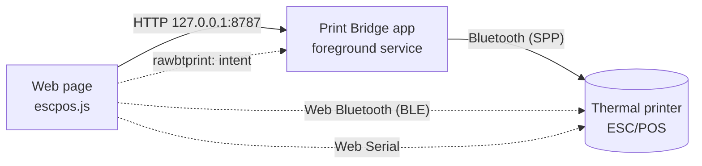

English | [Italiano](README.it.md)

<p align="center">
  
</p>

# Print Bridge

**Print receipts on thermal printers straight from web pages.** A page (back office,
till, voting system, bookings…) builds the receipt and sends it to a nearby printer,
without drivers and without leaving the browser: on Android through the Print Bridge app,
Web Bluetooth or Web Serial, on a computer through Web Bluetooth or Web Serial. It prints
on ESC/POS receipt printers (58 and 80 mm) and, for images, on the Phomemo M02 and M02 Pro.

| | |
|---|---|
| **Home page** | [nb-camelot.github.io/raw-bt-print-bridge](https://nb-camelot.github.io/raw-bt-print-bridge/), the landing page on Pages: what works on your device and which page to use |
| **Android app** | [latest Release](https://github.com/nb-camelot/raw-bt-print-bridge/releases/latest) (`app-release-<version>.apk`) |
| **App test page** | [app.html](https://nb-camelot.github.io/raw-bt-print-bridge/app.html) on Pages, or `http://127.0.0.1:8787/` served by the app |
| **Direct BLE printing** | [ble.html](https://nb-camelot.github.io/raw-bt-print-bridge/ble.html), Web Bluetooth, without the app |
| **Direct serial printing** | [serial.html](https://nb-camelot.github.io/raw-bt-print-bridge/serial.html), Web Serial, without the app: on a computer, or Bluetooth Classic printers from Chrome 138+ on Android |
| **Web client** | `escpos.js`, npm package [`@nb-camelot/rawbt-print`](https://www.npmjs.com/package/@nb-camelot/rawbt-print) |
| **For AI agents** | [llms.txt](https://nb-camelot.github.io/raw-bt-print-bridge/llms.txt) and [llms-full.txt](https://nb-camelot.github.io/raw-bt-print-bridge/llms-full.txt) on Pages (see [For AI agents](#for-ai-agents)) |
| **Agent skill** | [`skills/print-bridge/SKILL.md`](skills/print-bridge/SKILL.md) (also [on Pages](https://nb-camelot.github.io/raw-bt-print-bridge/skills/print-bridge/SKILL.md)): step-by-step instructions to add thermal printing to a web page |
| **What's new** | [CHANGELOG.md](CHANGELOG.md) |

The app is called **Raw BT Print Bridge** (package `com.rawbtprint.bridge`) and has its
own neutral brand, **Print Bridge**. The logo printed at the top of receipts belongs to
whoever uses it: it is set from a file, from a URL or through the API.

## Contents

- [How it works](#how-it-works)
- [Which way to choose](#which-way-to-choose)
- [Quick start](#quick-start)
- [Languages](#languages)
- [The Android app](#the-android-app)
- [Direct printing over Web Bluetooth (BLE)](#direct-printing-over-web-bluetooth-ble)
- [Direct printing over Web Serial](#direct-printing-over-web-serial)
- [Desktop](#desktop)
- [For AI agents](#for-ai-agents)
- [Using Print Bridge in your pages](#using-print-bridge-in-your-pages)
- [Print layouts](#print-layouts)
- [Images and printer drivers](#images-and-printer-drivers)
- [Local HTTP API of the app](#local-http-api-of-the-app)
- [Troubleshooting](#troubleshooting)
- [Development](#development)

## How it works



1. The page includes `escpos.js`, which builds the ESC/POS commands (text, bold, sizes,
   native QR code, raster logo), also from a [print layout](#print-layouts) filled with
   data or from an image and a [printer driver](#images-and-printer-drivers), or a JSON
   receipt.
2. **Through the app** (Android): the page calls the local API of the app on
   `127.0.0.1:8787`. The app, kept alive by a foreground service, opens the Bluetooth
   connection to the paired printer and prints, staying behind the browser.
3. **Through Web Bluetooth**: with a **BLE** printer the page prints by itself, through
   Chrome, without any app (see [below](#direct-printing-over-web-bluetooth-ble)).
4. **Through Web Serial**: with a USB-serial printer, or a Bluetooth Classic printer
   paired in the system, the page writes to the serial port by itself, without any app:
   Chrome and Edge on a computer, Firefox 151 or later on a computer, Chrome 138 or later
   on Android (Bluetooth Classic printers only; see [below](#direct-printing-over-web-serial)).
5. **Fallback** (Android only): if the app does not answer, the page can open it with the
   scheme `rawbtprint:base64,<data>`, and then the app prints in the foreground.

## Which way to choose

| | Android app (local API) | Web Bluetooth (BLE) | Web Serial | `rawbtprint:` scheme |
|---|---|---|---|---|
| Printers | any paired Bluetooth printer (Classic SPP) | compatible **BLE** printers only | USB-serial printers and Bluetooth Classic (SPP) printers paired in the system | as the app |
| Needs the app | yes | **no** | **no** | yes |
| Browser | Chrome on Android | Chrome on Android; Chrome and Edge on Windows, macOS and ChromeOS (Chrome on Linux only behind a flag) | Chrome and Edge on a computer; Firefox 151+ on a computer; Chrome 138+ on Android (Bluetooth Classic printers only, no USB) | Chrome on Android |
| Print outcome | yes (`ok`, `bytes`, `error`) | yes (write completed) | yes (write completed) | no |
| Stays in the browser | yes | yes | yes | no, the app comes to the front |
| Permissions | "Apps on device" for public pages | choosing the printer, once per tab | choosing the port, once per site (Chrome and Edge remember it); in Firefox, a site permission add-on first | none |
| Recommended use | **default** on Android, works with every Bluetooth Classic (SPP) printer | BLE printers (the only way for BLE-only printers), devices without the app | computers with a USB or Bluetooth Classic printer; Bluetooth Classic printers from Chrome 138+ on Android without the app | fallback |

Safari and the browsers on iPhone and iPad have neither Web Bluetooth nor Web Serial;
Firefox has no Web Bluetooth, and Firefox for Android no Web Serial.

Not sure which one fits? Open the [home page](https://nb-camelot.github.io/raw-bt-print-bridge/)
on the device: it shows what the browser supports and suggests the page to use.

## Quick start

### With the app (Bluetooth Classic printers)

1. Pair the printer in Android **Settings → Bluetooth**.
2. Download and install `app-release-<version>.apk` from the [latest Release](https://github.com/nb-camelot/raw-bt-print-bridge/releases/latest).
3. Open **Raw BT Print Bridge**, grant the Bluetooth permission and press **Choose printer**.
4. **Turn off battery optimization** for the app: the app offers it at start, or press
   **Fix** in the status panel. Without it, Android can suspend the app when you switch
   to the browser and prints stay waiting (see
   [Battery and background suspension](#battery-and-background-suspension-important)).
5. Press **Full self-test**: every item must be ✓.
6. Open `http://127.0.0.1:8787/` in Chrome (or [app.html](https://nb-camelot.github.io/raw-bt-print-bridge/app.html) on Pages) and try a print.

### Without the app (BLE printers)

1. Open the [direct BLE printing page](https://nb-camelot.github.io/raw-bt-print-bridge/ble.html)
   in Chrome on Android, or in Chrome or Edge on Windows, macOS and ChromeOS (on Linux only
   behind a Chrome flag).
2. Press **Pair printer** and choose the printer in Chrome's list.
3. Print. As long as the tab stays open no other confirmation is needed. After a reload,
   **Reconnect** (or a tap on a print) and choosing the printer in the list are enough;
   with a Chrome option the page reconnects by itself (see
   [Pairing](#pairing-once-per-tab)).

### On a computer (USB and Bluetooth Classic printers)

1. **USB printer**: plug it in; it must show up as a serial port (on Windows a COM port,
   for example "USB Serial Device"). **Bluetooth Classic printer**: pair it in the system
   first (Windows: Settings > Bluetooth & devices > Add device, the PIN is often 0000 or
   1234; macOS: System Settings > Bluetooth).
2. Open the [direct serial printing page](https://nb-camelot.github.io/raw-bt-print-bridge/serial.html)
   in Chrome or Edge, or in Firefox 151 or later: the first time Firefox asks to install a
   site permission add-on for the site, accept it.
3. Press **Choose port** and pick the printer's port. For a USB-serial printer set
   **Speed (baud rate)**: often 9600 or 115200, the printer's self-test page shows it.
4. Print a test. Chrome and Edge remember the port for the site: on the next visit the
   page reopens it without taps (see [Choosing the port](#choosing-the-port-once-per-site)).

BLE printers work on a computer too, from the BLE page in Chrome or Edge (on Linux only
behind a Chrome flag). On Android, without the app, Chrome 138 or later prints from
`serial.html` to Bluetooth Classic printers paired in the Android settings (not to USB
printers).

## Languages

Print Bridge speaks **English** and **Italian**.

- **Pages.** The home page (`index.html`), the app test page (`app.html`, and the copy
  served by the app), `ble.html` and `serial.html` are in English and Italian. They open
  in the language of `RawBT.language()` and have an **EN | IT** switch in the header,
  which calls `RawBT.setLanguage` and redraws the page. The choice is kept in the
  browser's `localStorage` under the key `printbridge.lang`, shared by the pages of the
  same site: choosing Italian on the home page also opens `ble.html` in Italian. The test
  page served by the app (`http://127.0.0.1:8787/`) is another site and keeps its own
  choice.
- **Messages of `escpos.js`.** Errors and explanations are in English or Italian: the
  `error` of the results of `RawBT.printLayout` and `RawBT.printCanvas`,
  `RawBT.ble.explain`, `RawBT.serial.explain`, the layout and image errors, the errors
  about the app.
  - `RawBT.language()` returns `'en'` or `'it'`: the language set with `setLanguage`,
    otherwise the first language of the browser that has a translation, otherwise
    English.
  - `RawBT.setLanguage('it' | 'en' | 'auto')` fixes the language and keeps it in
    `printbridge.lang`, so it also applies to the Print Bridge pages of the same site;
    `'auto'` (or `null`) follows the browser again. It returns the language in use. A
    region is ignored (`'it-IT'` is `'it'`); a language without a table throws an error
    with code `language`.
  - `PrintBridge.translations` has one table per language, `{ en, it }`, with the same
    keys and the same `{name}` placeholders; `PrintBridge.messages` is the English table.
    To add a language, add a table (for example `PrintBridge.translations.de = { … }`,
    then `RawBT.setLanguage('de')`): a key missing from it falls back to English.
  - What is printed is not translated: layouts and data belong to the page, and the
    `euro`, `num` and `date` filters keep their formats. The exception is the built-in
    `receipt` layout, which prints its labels, date and amounts in the language of
    `RawBT.language()`, as the app prints its receipt in the language of the device (see
    [The app receipt, laid out by the page](#the-app-receipt-laid-out-by-the-page)).
- **The Android app** is in English and Italian and follows the language of the device
  (see [App language](#app-language)).

## The Android app

Raw BT Print Bridge is a minimal native app (Kotlin, no external libraries, Android 6+).
It keeps a **local HTTP server** running on `127.0.0.1:8787`, reachable only from the
tablet itself, inside a **foreground service** with a notification. It is in English and
Italian.

The screen is divided into cards:

- **Bridge status**: four rows with a green / amber / red / grey dot, updated every 2
  seconds.

  | Row | What it says |
  |---|---|
  | **API server (127.0.0.1:8787)** | listening since when, outcome and duration of the last self-check (every 15 s), restarts |
  | **Browser calls** | last call (method, path, outcome, ms, origin), requests in progress, connections open without a request, total connections received |
  | **Bluetooth and printer** | Bluetooth on, printer chosen and paired, outcome of the last connection |
  | **Battery and background suspension** | battery optimization, restrictions, app suspension, Battery Saver |

  Below them are **Full self-test**, **Restart server**, **Test Bluetooth** (connects
  without printing) and, when needed, **Fix**.
- **Printer**: chosen printer and print state; **Choose printer**, **Test print (via
  API)**, **Forget printer**.
- **Test addresses**, each with **Copy** and **Open**: the test page served by the app,
  status and self-test in JSON, the test page on GitHub Pages (`app.html`), the CDN URL of
  the web client.
- **Receipt paper and logo**: 58 mm (32 columns) or 80 mm (48 columns); logo **From
  file**, **From URL**, or **Remove**. The bundled logo is set through the API (see
  [Receipt brand and logo](#receipt-brand-and-logo)).
- **Log**: the last 300 lines, including the calls received while the app was in the
  background. One tap copies it.

**Self-repair.** Every 15 seconds the service calls `GET /status` on itself. If the
server is not listening or does not answer twice in a row, it closes it and opens it
again. After three failed attempts it retries once a minute. The notification shows the
real state.

**Full self-test** (in the app, with `GET /selftest` or from the test page) checks in one
go:
- app and device;
- service, server and API;
- test page and web client;
- Bluetooth and connection to the printer;
- battery and suspension;
- notifications, including the channel of the service;
- optionally (from the app only), a test print through the API.

The summary can be copied to attach it to a report.

### Battery and background suspension (important)

The server runs in a foreground service, but some ROMs (verified on LineageOS 18.1 /
Android 11) suspend the app anyway when it is not in front. The symptom is precise: from
the browser the print, or `http://127.0.0.1:8787/status`, **keeps loading forever** and
starts by itself as soon as the app is reopened. To avoid it:

1. **Settings → Apps → Raw BT Print Bridge → Battery**: battery optimization set to
   **Don't optimize** (or "Unrestricted") and no background restriction.
2. **Developer options**, if enabled: **"Suspend execution for cached apps"** off. On
   Android 11 the default is off, from Android 12 it is usually on.
3. From Android 12, in the settings of the app: **"Pause app activity if unused"** off.
4. **Battery Saver** off while the printer is in use.

The app checks these points by itself:
- the **Battery and background suspension** row turns red (a problem that blocks the
  app) or amber (one that can block it);
- **Fix** says what it opens and leads to the right setting;
- at start a warning explains the problem, but not when the app was opened by the
  browser to print;
- the notification puts the warning first, and `/status` reports it in the `power`
  field, which the test page shows.

There is also a **check on the symptom**. If the periodic check stops for more than 45 s
while the tablet is on, the app was suspended: the log writes "App suspended by the
system for N s" and the row stays red for half an hour, also on ROMs with their own
settings. A screen turned off does not count, because the comparison uses the system
clock that does not advance in deep sleep.

### Receipt brand and logo

**Print Bridge** is the brand of the app: a thermal printer with the receipt coming out
and the Bluetooth symbol, in teal (`#0F766E`) on slate. The icon, the notification, the
header, the pages and the favicon use it. The source files are in
[`assets/brand/`](assets/brand/).

The logo at the top of receipts is not tied to the brand of the app:
- it is set in the app (**From file**, **From URL**) or through the API with
  `POST /config`: `{"logoMode":"url","logoUrl":"https://…/logo.png"}`,
  `{"logoMode":"asset"}` for the bundled logo, `{"logoMode":"none"}` to remove it;
- the **bundled logo** is the neutral "Print Bridge" one, in black and white;
- PNGs with a **transparent background** are fine: transparency becomes the white of the
  paper.

<!-- BLE -->
## Direct printing over Web Bluetooth (BLE)

With a **Bluetooth Low Energy** printer the page can print by itself, through Chrome,
without installing anything. The ready-made page is
[`ble.html`](https://nb-camelot.github.io/raw-bt-print-bridge/ble.html) on Pages; for your
own pages there is `RawBT.ble` in `escpos.js` (since 1.9.0).

### Compatible printers

It works with ESC/POS thermal printers that expose a **BLE serial channel**. The page
tries these profiles, in order:

| Service | Write characteristic | Where it is found |
|---|---|---|
| `18f0` | `2af1` | the most common: many Chinese printers, often advertised as "BlueTooth Printer" (for example the Netum NT-1809) |
| `e7810a71-73ae-499d-8c15-faa9aef0c3f2` | `bef8d6c9-9c21-4c9e-b632-bd58c1009f9f` | various portable printers |
| `49535343-fe7d-4ae5-8fa9-9fafd205e455` (ISSC) | `49535343-8841-43f4-a8d4-ecbe34729bb3` | Microchip/ISSC modules |
| `ff00` | `ff02` | cheap modules |
| `ffe0` | `ffe1` | HM-10 and similar modules |
| `6e400001-b5a3-f393-e0a9-e50e24dcca9e` (Nordic UART) | `6e400002-b5a3-f393-e0a9-e50e24dcca9e` | Nordic modules |

If the service is there but the characteristic has another UUID, the page uses the first
writable characteristic of the same service. "Cat printers" (service `ae30`) are not
ESC/POS and are refused with a clear message. The Phomemo M02 and M02 Pro have their own
drivers (see [Images and printer drivers](#images-and-printer-drivers)).

- **Bluetooth 4 does not mean BLE.** Many "Bluetooth 4.0" printers are Classic only
  (SPP): the browser does not see them over BLE, and they need the app or
  [Web Serial](#direct-printing-over-web-serial). **Dual mode** printers are
  fine, but over BLE they often show up with another name.
- **Netum NT-1809DD**: it is dual mode, but we have not tried it directly. If it does
  not print at the first attempt, open **Advanced → Diagnostics** in `ble.html`: it shows
  services and characteristics and lets you choose the right one by hand with **Use this
  one** (the choice is remembered for that printer, and the channel is reported as profile
  `'manual'`, shown as "chosen by hand").
- Diagnostics sees only the services listed above plus `18f1`, `fff0`, `ffe6` and
  `fee7`. Web Bluetooth does not show the page the services it did not declare when the
  device was chosen.

### Pairing: once per tab

The first time, choose the printer in Chrome's list. Then:

- **as long as the tab stays open** the page keeps the connection and prints start
  without other confirmations; if the printer goes into standby, the page reconnects by
  itself at the next print;
- **after a reload or a new visit** stable Chrome does not give the page back the
  printers chosen earlier: the page remembers the name and shows **Reconnect "name"**,
  which opens the list filtered on that printer. A tap directly on a print does the same;
- to **remember it between visits**, without taps, enable in Chrome
  `chrome://flags/#enable-web-bluetooth-new-permissions-backend` (Enabled, then restart
  Chrome). The page notices it (row "Remembers the printer between visits") and
  reconnects when it opens.

There is no need to pair the printer in the Android Bluetooth settings.

### How the data is sent

- One write at a time, queued: two prints launched together come out one after the
  other, without mixing.
- **Automatic**: if the characteristic accepts writes with response, 100-byte chunks with
  response (the response paces the flow, so the printer does not lose bytes). If the
  printer refuses the first 100-byte chunk, the page switches to 20 by itself and
  remembers the choice. If it accepts only writes without response, 20-byte chunks with
  20 ms pauses and the last one with response when possible.
- Writes that fail with "GATT operation failed for unknown reason" or "already in
  progress" did not start and are retried up to 3 times; other errors stop the print,
  because retrying could print twice.
- In **Advanced** you can force a sending mode (with response in 100- or 20-byte chunks,
  without response in 20-byte chunks), the paper width (58 or 80 mm) and the code page.
- Every print of `ble.html` starts with `ESC @`, `FS .` (leaves the Chinese character
  mode, on by default on many firmwares, which turns accented letters into ideograms)
  and `ESC t` with the code page of **Advanced** (16 by default: Windows-1252, the
  encoding `escpos.js` writes text in). Logos are at
  most 240 dots high and split into bands of 128 rows, as in the app.

### `RawBT.ble` in your pages

```html
<button id="print">Print</button>
<script src="https://cdn.jsdelivr.net/npm/@nb-camelot/rawbt-print@1/escpos.js"></script>
<script>
  document.getElementById('print').onclick = function () {
    var ble = RawBT.ble;
    // In the tap handler and before any wait: Chrome's list opens only during a user
    // gesture.
    var ready = ble.info().paired ? Promise.resolve() : ble.pair({ sameName: true });
    ready.then(function () {
      var bytes = new EscPos().init().kanjiOff().codepage(16)
        .align('center').size(2, 2).line('THANK YOU').size(1, 1)
        .feed(3).cut().bytes();
      return ble.print(bytes, { onProgress: function (sent, total) {} });
    }).then(function (r) {
      console.log('sent', r.bytes, 'bytes in', r.ms, 'ms');
    }).catch(function (e) {
      var m = ble.explain(e);   // '' when the person closed the list
      if (m) alert(m);
    });
  };
</script>
```

| Function | What it does |
|---|---|
| `supported()` | Web Bluetooth is available (Chrome and Edge; on Linux only behind a Chrome flag; not Safari, iOS, Firefox) |
| `available()` | promise: `true` if there is a Bluetooth radio, `false` if not, `null` if unknown |
| `canRemember()` | the browser can give back the printers chosen earlier (Chrome option enabled) |
| `pair({ sameName, all })` | opens Chrome's list (needs a gesture), connects and chooses the channel; `sameName` filters on the printer used before, `all` shows every device. Returns `info()` |
| `reconnect()` | without a gesture: reconnects to the printer of this tab or, with `canRemember()`, to the remembered one; `null` when a tap is needed |
| `print(bytes, { onProgress })` | prints, queued; `{ ok, bytes, ms, chunk, withResponse }` |
| `info()` / `on(fn)` | current state / notification on every change: `status` (`idle`, `connecting`, `connected` after `describe()` while no print channel is chosen, `ready`, `printing`, `disconnected`, `error`), `name`, `paired`, `connected`, `profile` (the channel in use: a known profile such as `18F0`, or `'manual'` for the one chosen with `useCharacteristic`), `characteristic`, `writeMode`, `remembered`, `lastError` |
| `describe()` | visible services and characteristics, with their properties |
| `useCharacteristic(service, characteristic)` | chooses the channel by hand, remembered for that printer; `info().profile` is then `'manual'` (`'scelto a mano'` in 1.12.0 and earlier), which the pages translate |
| `setWriteMode(mode)` | `auto`, `response-100`, `response-20`, `noresponse-20` |
| `disconnect()` / `forget()` | closes the connection / forgets the printer (also in the browser, if supported) |
| `explain(error)` | explanation of a Web Bluetooth error in the current [language](#languages) (`''` if cancelled) |

The remembered printer and the manual choices are kept in the page's `localStorage`,
under the key `printbridge.ble`.

### BLE limits

- A BLE printer accepts **one connection at a time** and, while it is connected to
  something (the app, another phone, a PC), it usually stops advertising: disconnect it,
  or turn it off and on again.
- On **Android 11 and earlier** Chrome finds Bluetooth devices only with the
  **Location** permission and Location turned on.
- The page must stay open while printing; if it goes into the background Chrome can
  close the connection, and the page opens it again at the next print.
- It needs a page in **https** (or `localhost`).

## Direct printing over Web Serial

Web Serial opens **serial ports**: printers behind a USB-serial chip and **Bluetooth
Classic** printers paired in the system (Serial Port Profile, SPP, over RFCOMM). The page
prints by itself, without installing anything. The ready-made page is
[`serial.html`](https://nb-camelot.github.io/raw-bt-print-bridge/serial.html) on Pages; for
your own pages there is `RawBT.serial` in `escpos.js`. The bytes are the same ESC/POS as
for the app and BLE.

| Browser | USB-serial printers | Bluetooth Classic (SPP) printers |
|---|---|---|
| Chrome and Edge on a computer (Windows, macOS, Linux, ChromeOS) | yes | yes, since 117 |
| Firefox 151 or later on a computer | yes, after a site permission add-on that Firefox offers the first time | not documented |
| Chrome 138 or later on Android | not yet | yes, printers paired in the Android settings |
| Safari, iPhone and iPad, Firefox for Android | no | no |

### Which printers

- **USB printers with a serial chip** (CH340, PL2303, FTDI, CP210x): on Windows they show
  up as "USB Serial Device" or as a COM port in Device Manager. On Windows the chip may
  need the driver of its maker. Computers only: Chrome on Android does not open USB serial
  ports yet.
- **Bluetooth Classic (SPP) printers**, the same the Android app uses: pair them in the
  operating system first (Windows: Settings > Bluetooth & devices > Add device; macOS:
  System Settings > Bluetooth; Android: Settings > Bluetooth, or Connected devices, > Pair
  new device). On a computer the printer then becomes a serial port (on Windows a COM
  port, "Standard Serial over Bluetooth link"), and Chrome and Edge 117 or later also list
  paired Bluetooth printers directly; on Android, Chrome lists the paired printers.
- **Not reachable**: a USB printer that the system installed with its own driver (on
  Windows it is listed in "Printers & scanners", not as a COM port) and Ethernet or Wi-Fi
  printers (port 9100). They are not serial ports, and Web Serial sees only those: see
  [Desktop](#desktop).
- BLE printers go through [Web Bluetooth](#direct-printing-over-web-bluetooth-ble), on a
  computer too. The Phomemo drivers are BLE only.

### Choosing the port: once per site

- The first time, press **Choose port** in `serial.html` (or call `RawBT.serial.pair()`
  in a tap handler) and pick the port in the browser's list.
- Chrome and Edge **remember** the ports allowed for the site: on the next visit the page
  reopens the port by itself, without taps (`RawBT.serial.reconnect()`). Some USB
  adapters without a serial number must be chosen again after being unplugged.
- Only **one program at a time** can use a serial port: close the printer utility, cash
  register programs and the other tabs of the page, then press **Reconnect**. A Bluetooth
  printer takes one connection at a time: on Android, also close the Print Bridge app or
  any other app connected to it. **Disconnect** frees the port for other programs;
  **Forget** also removes the permission from the browser when the browser supports it.
- After unplugging the printer, plug it in again and press **Reconnect** (or **Choose
  port**). When a port goes away the page drops it but keeps what it remembers, so
  `RawBT.serial.reconnect()` finds the printer plugged in again among the ports the
  browser allows for the site, without the chooser.

### Sending and speed

- One print at a time, queued: two prints launched together come out one after the
  other.
- 256-byte chunks with 25 ms pauses, as the app writes over SPP: cheap printers have a
  serial link without flow control and drop bytes that arrive too fast.
- A chunk that is not written within 10 s (printer off, out of paper or holding the line)
  is aborted: the print fails with code `write` and the next one in the queue goes on.
- **Speed** (baud rate): 9600 (default), 19200, 38400, 57600 or 115200. Only USB-serial
  printers use it (the self-test page of the printer shows it, often 9600 or 115200);
  Bluetooth ports ignore it. Random characters from a USB-serial printer usually mean the
  wrong speed. In `serial.html` the speed is in the **Printer** card, and an open port
  reopens at once with the new one.
- In `serial.html`, **Advanced** sets the paper width (58 or 80 mm) and the code page:
  text is sent in Windows-1252, almost always code page 16.

### `RawBT.serial` in your pages

```html
<button id="print">Print</button>
<script src="https://cdn.jsdelivr.net/npm/@nb-camelot/rawbt-print@1/escpos.js"></script>
<script>
  var serial = RawBT.serial;
  // When the page loads: reopens the port the browser remembers for this site, without a tap.
  if (serial.supported()) serial.reconnect().catch(function () { /* a tap will choose it */ });

  document.getElementById('print').onclick = function () {
    // In the tap handler and before any wait: the browser's port chooser opens only during
    // a user gesture.
    var ready = serial.info().paired ? Promise.resolve() : serial.pair({ baudRate: 9600 });
    ready.then(function () {
      var bytes = new EscPos().init().kanjiOff().codepage(16)
        .align('center').size(2, 2).line('THANK YOU').size(1, 1)
        .feed(3).cut().bytes();
      return serial.print(bytes);
    }).then(function (r) {
      console.log('sent', r.bytes, 'bytes in', r.ms, 'ms');
    }).catch(function (e) {
      var m = serial.explain(e);   // '' when the person closed the chooser
      if (m) alert(m);
    });
  };
</script>
```

| Function | What it does |
|---|---|
| `supported()` | Web Serial is available: Chrome and Edge on a computer, Firefox 151+ on a computer, Chrome 138+ on Android (see [the table above](#direct-printing-over-web-serial)) |
| `pair({ filters, bluetoothServiceClassIds, baudRate })` | opens the browser's port chooser (needs a gesture), opens the port and returns `info()`; rejects on failure (`explain(e)`). `filters` as in the Web Serial API (`usbVendorId`, `usbProductId`); the Serial Port Profile (`RawBT.serial.spp`) is always allowed, `bluetoothServiceClassIds` adds other Bluetooth services; `baudRate` is one of `RawBT.serial.bauds` |
| `reconnect()` | without a gesture: reopens the port of this tab or the one the browser remembers for this site (the one used last time, or the only one allowed); `null` when a tap is needed |
| `print(bytes, { onProgress })` | prints, queued; `{ ok, bytes, ms, chunk }` |
| `info()` / `on(fn)` | current state / notification on every change: `status` (`idle`, `connecting`, `ready`, `printing`, `disconnected`, `error`), `paired`, `connected`, `label` (`USB VVVV:PPPP` with the vendor and product ids, `Bluetooth SPP`, or "serial port"), `baudRate`, `remembered`, `lastError`. `on` returns a function that removes the listener |
| `saved()` | what the page remembers (the port and the speed), or `null` |
| `setBaudRate(n)` | speed, one of `RawBT.serial.bauds` (9600, 19200, 38400, 57600, 115200); closes the port, which reopens at the next print with the new speed |
| `disconnect()` / `forget()` | closes the port after the queued prints (it stays chosen for `reconnect()`) / closes it and forgets it, also in the browser when supported |
| `explain(error)` | explanation of a Web Serial error in the current [language](#languages) (`''` if the person closed the chooser) |

The remembered port (its USB ids or Bluetooth service) and the speed are kept in the
page's `localStorage`, under the key `printbridge.serial`. Errors of `RawBT.serial` have
`name` `PrintBridgeSerialError` and a `code`: `unsupported`, `baud`, `no-port`, `open`,
`write` or `closed`.

### Serial limits

- **Browsers**: Chrome and Edge on a computer; Firefox 151 or later on a computer, after
  the site permission add-on; Chrome 138 or later on Android, for Bluetooth Classic
  printers paired in Android only (no USB yet). Not Safari, not Firefox for Android, and
  no browser on iPhone and iPad, which have neither Web Serial nor Web Bluetooth.
- On a computer, Bluetooth Classic ports need Chrome or Edge 117 or later and a printer
  paired in the system.
- The open port belongs to the tab: closing the tab closes the port, and the next visit
  reopens it.
- It needs a page in **https** (or `localhost`).

## Desktop

On a computer, Chrome and Edge already print without installing anything: BLE printers
over [Web Bluetooth](#direct-printing-over-web-bluetooth-ble) (on Linux only behind a
Chrome flag), USB-serial and paired Bluetooth Classic printers over
[Web Serial](#direct-printing-over-web-serial). Firefox 151 or later prints over Web
Serial too (it has no Web Bluetooth). Some cases stay out of reach: USB printers installed
in the system with the vendor's driver and network printers on raw TCP (port 9100), which
no browser can write to, and browsers without these APIs, such as Safari.

For those, a native **companion app** for Windows, macOS and Linux, answering the same
local API as the Android app on `127.0.0.1:8787`, is a **proposal, not implemented**.
[`docs/desktop-companion.md`](docs/desktop-companion.md) describes what it would do and
why, what it would cost and the decisions it needs (Italian:
[`docs/desktop-companion.it.md`](docs/desktop-companion.it.md)).

## For AI agents

To add Print Bridge to a web app with an AI coding agent, give the agent one of these
files (all three are served on Pages as they are, next to the pages):

- [`llms.txt`](https://nb-camelot.github.io/raw-bt-print-bridge/llms.txt): the short
  index for LLMs, with the rules that break integrations most often and the links to the
  rest;
- [`llms-full.txt`](https://nb-camelot.github.io/raw-bt-print-bridge/llms-full.txt): a
  self-contained integration reference: the four ways and the platform matrix, `EscPos`,
  layouts, image drivers, `RawBT.ble`, `RawBT.serial`, the local API of the app, results
  and error codes;
- the agent skill
  [`skills/print-bridge/SKILL.md`](https://nb-camelot.github.io/raw-bt-print-bridge/skills/print-bridge/SKILL.md)
  ([in the repository](skills/print-bridge/SKILL.md)), in the Agent Skills format:
  step-by-step instructions and code templates (find the platform and the printer, pick
  the way, include the script, write the print handler, set the language). An agent that
  supports skills uses it from a copy of the `skills/print-bridge/` folder in its skills
  directory.

They are distilled from `escpos.js`, this README, the pages and the docs; when they and
`escpos.js` disagree, the code wins.

## Using Print Bridge in your pages

### Including `escpos.js`

```html
<script src="https://cdn.jsdelivr.net/npm/@nb-camelot/rawbt-print@1/escpos.js"></script>
```

The script exposes `EscPos` (builds the ESC/POS bytes), `RawBT` (sends them to the app
or, with `RawBT.ble` and `RawBT.serial`, directly to a
[BLE printer](#direct-printing-over-web-bluetooth-ble) or a
[serial port](#direct-printing-over-web-serial)) and `PrintBridge` (layouts,
image drivers, messages). In production pin the version (for example `@1.13.0`) or serve
the file from your own domain. `RawBT.serial`, the messages in two languages
(`RawBT.setLanguage`), the `receipt` layout that follows the language, the scheme fallback
of `RawBT.send` limited to Android and the BLE profile `'manual'` need 1.13.0 or later
(`npm view @nb-camelot/rawbt-print version` prints the latest version). GitHub Release
assets **cannot** be included with `<script src>`, because they are served as downloads.
The
[home page](https://nb-camelot.github.io/raw-bt-print-bridge/) has a complete example to
copy.

Optional configuration with meta tags:

```html
<meta name="rawbt-api-port" content="8787">
<meta name="rawbt-scheme" content="rawbtprint">
```

### A JSON receipt (laid out by the app)

```html
<script>
  RawBT.sendReceipt({
    shop: "DEMO SHOP", title: "RECEIPT", code: "ABC123",
    items: [{ desc: "Coffee", qty: 2, price: 1.20 }],
    qr: "https://example.com/r/ABC123", footer: "Thank you"
  }).then(function (r) { console.log(r); });
</script>
```

### ESC/POS built in the page

```js
var bytes = new EscPos().init().codepage(0x10)
  .align('center').size(2, 2).line('TEST').size(1, 1)
  .align('left').line('Total: 2.40')
  .align('center').qr('https://example.com/r/ABC123', 6)
  .feed(3).cut().bytes();
RawBT.sendApi(bytes).then(function (r) { console.log(r); });
```

The methods of `EscPos`: `init`, `codepage`, `kanjiOff` (`FS .`, for the Chinese
firmwares that print accented letters as ideograms), `align('left'|'center'|'right')`,
`bold`, `underline`, `size(w, h)`, `text`, `line`, `feed`, `cut`, `rule`,
`qr(data, module)`, `image(raster)`, `bytes`; plus `EscPos.loadImage(url)` and
`EscPos.rasterize(img, width, threshold, { maxHeight, band })` for logos.

### `RawBT` functions

| Function | What it does | Result |
|---|---|---|
| `check(timeoutMs)` | `GET /status`, never rejects | `{ ok, ms, status }` or `{ ok:false, ms, reason, message }` with `reason` = `timeout` / `network` / `response` |
| `ping(timeoutMs)` | like `check`, for compatibility | the status or `null` |
| `sendReceipt(spec)` | `POST /receipt` (JSON) | `{ ok, bytes, summary }` or `{ ok:false, error }` |
| `sendApi(bytes)` | `POST /print` (ESC/POS in base64) | `{ ok, bytes }` or `{ ok:false, error }` |
| `send(bytes)` | like `sendApi`, but on Android, if the connection is refused within 3 s, it opens the app with the scheme; elsewhere no app handles the scheme, so it returns the error. `{ fallback: false }` turns the fallback off | `{ ok:true, fallback:true, confirmed:false, error }` with the fallback, `{ ok:false, error }` without it, `{ ok:false, timeout:true, error }` after a timeout |
| `selftest()` | `GET /selftest` | `{ ok, level, summary, ms, version, versionCode, device, items }` |
| `getConfig()` / `setConfig(obj)` | reads and changes paper, logo and printer | the configuration |
| `localAccess()` / `localAccessHint(state)` | state and instructions of the "Apps on device" permission | `{ name, state }` / text |
| `url(bytes)` / `navigate(url)` | `rawbtprint:` scheme for the manual fallback | — |

Every call has a timeout (`{ timeoutMs }`, 0 = none). The defaults are 5 s for `check`,
40 s for `sendApi`, 60 s for `sendReceipt`, 30 s for `selftest`, 10 s for the
configuration (45 s with `logoUrl`). The timeout fires even where `fetch` ignores the
abort.

Every call uses `cache: 'no-store'`. Chrome queues identical GETs behind one still in
progress, so without this option a single hanging `/status` would block the following
ones, from any tab.

`send` recognises Android from `navigator.userAgentData.platform` or, where that is
missing, from the user agent. After a fallback to the scheme the outcome of the print is
not known, so the print must not be retried. After a timeout `send` does not open the
app: the request may already be printing, and Chrome would open the app only with a new
tap of the user, for example a button that calls `RawBT.navigate(RawBT.url(bytes))`.

### "Apps on device" permission (Local Network Access)

Since Chrome 142, a page on a public origin (`https://…`) that calls `127.0.0.1` needs
the **"Apps on device"** permission (`loopback-network`; in Chrome 142-144 it was called
"Local network access"):
- at the first attempt Chrome shows the prompt: press **Allow**;
- if you denied it: icon on the left of the address → **Site settings** → **Apps on
  device** → **Allow**, then reload;
- on managed tablets it can be pre-approved with the policy
  `LocalNetworkAccessAllowedForUrls`.

The page served by the app (`http://127.0.0.1:8787/`) does not need the permission,
because it calls its own origin. `escpos.js` uses `targetAddressSpace: 'loopback'`, and
`RawBT.localAccess()` tells the state of the permission. The home page asks the app only
when you press its **Check the app on this device** button, so it never triggers the
prompt by itself.

## Print layouts

With `PrintBridge.render` (since 1.10.0) a receipt is described **once**, in a JSON
layout: logo, header, columns, repetitions, QR code. Every print passes only the data.
The result is the ESC/POS bytes, the same for direct BLE printing, for Web Serial and for
the app, and `RawBT.printLayout` sends them the right way. A layout is plain JSON, so it
can live in a file or come from a server.

```html
<button id="print">Print</button>
<script src="https://cdn.jsdelivr.net/npm/@nb-camelot/rawbt-print@1/escpos.js"></script>
<script>
  var LAYOUT = {
    paper: 58,
    codepage: 16,
    blocks: [
      { logo: 'logo.png', maxHeight: 160 },
      { text: '{{shop}}', align: 'center', bold: true, size: [2, 2] },
      { rule: true },
      { row: ['Order {{order}}', '{{date|date}}'] },
      { each: 'items', row: [{ text: '{{qty}} x {{name}}', wrap: true }, '{{price|euro}}'] },
      { rule: '=' },
      { row: ['TOTAL', '{{total|euro}}'], bold: true, size: [1, 2] },
      { if: 'qr', blocks: [{ feed: 1 }, { qr: '{{qr}}', size: 5 }] },
      { if: 'note', text: '{{note}}', align: 'center' },
      { feed: 3 },
      { cut: true }
    ]
  };

  // When the page loads, not in the tap handler: lets 'auto' pick the app if it answers.
  RawBT.check();

  document.getElementById('print').onclick = function () {
    var data = {
      shop: 'Demo Shop', order: 'A-042', date: true,
      items: [{ qty: 2, name: 'Espresso', price: 2.4 }, { qty: 1, name: 'Croissant', price: 1.5 }],
      total: 3.9, qr: 'https://example.com/r/A-042'
    };
    // In the tap handler, before any wait: if the way is BLE or serial and nothing is ready
    // in this tab, the browser's chooser opens at once.
    RawBT.printLayout(LAYOUT, data).then(function (r) {
      if (r.ok) console.log('printed via', r.via, r.bytes, 'bytes in', r.ms, 'ms');
      else if (!r.cancelled) alert(r.error);
    });
  };
</script>
```

In `ble.html`, the **Layout receipt** card has an editable example (layout and data in
JSON): **Check without printing** tries the layout without a printer, and the **Layout
receipt** button prints it. In `serial.html` the **Layout receipt** button prints the
built-in `receipt` layout.

### Format

| Field | What it does |
|---|---|
| `paper` | `58` (32 columns, 384 dots) or `80` (48 columns, 576 dots); `384` and `576` work too. Default 58 |
| `columns` | number of columns (16-64) instead of those of the paper, or a placeholder such as `'{{width}}'`; the dots stay those of the paper |
| `codepage` | number for `ESC t`, default 16 (Windows-1252, the encoding `escpos.js` writes text in) |
| `defaults` | values of the fields that are missing from the data (or `null`) |
| `prepare` | name of a data preparation in `PrintBridge.prepare`, for example `receipt` |
| `blocks` | the blocks, in order |

`paper` and `codepage` passed in the options of `render` win over those of the layout,
because they belong to the printer, not to the receipt. Every print starts with `ESC @`,
`FS .` and `ESC t <codepage>`.

### Blocks

Every block can have an `if` (see below).

| Block | Example | Notes |
|---|---|---|
| text | `{ text: 'Hello {{name}}', align: 'center', size: [2, 1], bold: true, underline: true }` | wraps on words; `size: [width, height]` from 1 to 8, or a single number |
| columns | `{ row: ['{{desc}}', '{{price\|euro}}'] }` | see [Columns](#columns); takes `bold`, `underline`, `size`, `gap`, `wrap` |
| repetition | `{ each: 'items', row: [...] }` or `{ each: 'items', blocks: [...] }` | inside, the fields of the element (and, when missing, those outside); `{{.}}` for a list of texts; `{{@number}}` (from 1), `@index` (from 0), `@first`, `@last` |
| group | `{ if: 'qr', blocks: [...] }` | several blocks under one condition |
| logo | `{ logo: 'logo.png', maxHeight: 240 }` | URL, data URL or placeholder; `true` uses `options.logo`; from JavaScript also an image of the page or a ready-made raster. Centered, in 128-row bands; `threshold` from 0 to 255 (140) |
| rule | `{ rule: true }`, `{ rule: '=' }` | as wide as the paper |
| QR code | `{ qr: '{{url}}', size: 6, ec: 'M' }` | `size` is the module (1-16), `ec` the error correction (`L`, `M`, `Q`, `H`); centered unless `align`; not printed without data |
| feed | `{ feed: 3 }` | also `'{{feed}}'` |
| cut | `{ cut: true }`, `{ cut: 'partial' }` | |
| raw bytes | `{ raw: [27, 112, 0, 25, 250] }` | sent as they are, for example to open the cash drawer |

An unknown block or filter, or a wrong value, rejects the promise with an error that says
where (`blocks[3]: unknown block`) instead of printing half a receipt.

Character sizes use `GS !`. Columns are counted on 32 or 48 characters, and with width 2
(`size: [2, x]`) they become 16 or 24.

### Columns

- `row: ['left', 'right']`: the first column takes the space left, the others are as
  wide as their text and the last one is right-aligned, with one space between columns
  (`gap`). It is the same `pad()` as the app receipt: text too long on the left is cut.
- For columns made to measure, every column is an object `{ text, width, flex, align,
  wrap }`: `width: 4` is fixed, `width: 'auto'` is as wide as the text, no `width` is
  flexible (weight `flex`, default 1). With `wrap` the column wraps instead of cutting,
  and the row becomes several lines.

```js
{ row: [
  { text: '{{qty}}x', width: 4 },
  { text: '{{name}}', wrap: true },
  { text: '{{price|euro}}', width: 10, align: 'right' }
] }
```

### Placeholders, filters and conditions

- `{{field}}` and `{{customer.name}}`: a missing field becomes empty text. Only the data's
  own properties are read (no `constructor` or `__proto__`). Control characters in the
  data are dropped, so a field cannot turn into a printer command.
- Filters, chained too (`{{name|lower|upper}}`):

  | Filter | Example |
  |---|---|
  | `euro` | `1234.5` → `1.234,50 €` (it-IT); `euro:0` without decimals |
  | `num` | `1234.5` → `1234,50`, like the amounts on the app receipt; `num:3` for three decimals |
  | `date` | `true` or `"now"` → now, `17/10/2026 09:05`; also a Date, milliseconds or ISO text. Custom format: `date:dd/MM/yy`, `date:HH:mm` (`yyyy`, `yy`, `MM`, `dd`, `HH`, `mm`, `ss`) |
  | `upper`, `lower` | upper case, lower case |

  Numbers can also be text (`"2.5"`, `"2,50"`). Your own filters:
  `PrintBridge.filters.name = function (value, argument) { … }`, or `options.filters` for
  one print. The formats do not change with the [language](#languages).
- `if`: `'field'`, `'!field'`, `'a && b'`, `'a || b'` (`&&` before `||`). Missing fields,
  `''`, `0`, `false` and empty lists are false. On an `each` block the condition applies
  to the whole block; to pick single elements use `blocks` with an `if` inside.

There is no `eval` and no `new Function`: a layout received from a server runs no code in
the page, and filters and data preparations are only those registered by the page.

### The app receipt, laid out by the page

`PrintBridge.layouts.receipt`, or just `'receipt'`, reproduces line by line the receipt
of [`POST /receipt`](#local-http-api-of-the-app) as the app prints it, labels and
language included: the same JSON as `RawBT.sendReceipt` prints the same way over BLE or a
serial port. `sendReceipt` stays as it is, for the logo configured in the app.

```js
var receipt = { shop: 'DEMO SHOP', code: 'ABC123', logo: true,
  items: [{ desc: 'Coffee', qty: 2, price: 1.20 }],
  qr: 'https://example.com/r/ABC123', footer: 'Thank you' };
RawBT.sendReceipt(receipt);                                     // laid out by the app
RawBT.printLayout('receipt', receipt, { logo: 'logo.png' });    // laid out by the page
```

`prepare: 'receipt'` reads the data as the app does: for every item `qty` (default 1),
`price` (default 0) and `amount` = `qty × price`; a missing `total` is the sum. `width`
sets the columns, as in the app. For a similar receipt of your own, start from a copy of
`JSON.stringify(PrintBridge.layouts.receipt)`.

The texts follow the language of the messages, `RawBT.language()` (see
[Languages](#languages)), with the labels and formats of the app receipt in that language:

| `RawBT.language()` | Number | Total | Date | Amounts |
|---|---|---|---|---|
| `'en'` | "Receipt no. ABC123" | "TOTAL EUR" | `yyyy-MM-dd HH:mm` | `2.40` |
| `'it'` | "Ricevuta n. ABC123" | "TOTALE EUR" | `dd/MM/yyyy HH:mm` | `2,40` |

The separator applies to the item amounts and to the total computed from them; a `total`
given in the data is printed as it is. `labels` fixes the labels whatever the language, as
in the app:
`labels.code` goes before the number, followed by a space (trailing spaces are dropped,
and an empty string prints the number only); `labels.total` replaces the total label. The
defaults are the messages `receiptCode`, `receiptTotal` and `receiptDate` of
`PrintBridge.translations`.

Differences from the app:
- the page prints in its own language, `RawBT.language()`, while the app follows the
  language of the device (see [App language](#app-language)): when the two must match,
  fix the page's one with `RawBT.setLanguage`;
- `logo: true` prints `options.logo` (in the app it is the configured logo); without
  `options.logo` the print stops with a clear error (`logo-missing`);
- `printer` only applies to the app;
- long texts wrap on words, while the app lets the printer break them.

### Logo and CORS

- A logo from a URL is loaded with `crossOrigin = 'anonymous'` and goes through a canvas.
  The browser lets the page read the pixels of an image from **another domain** only if
  its server answers with `Access-Control-Allow-Origin` (CORS). Without it `render` stops
  with an error: "Logo not loaded…" (`logo-load`) for a URL, "tainted canvas"
  (`logo-cors`) for an image of the page loaded without `crossOrigin`.
- The fixes: serve the logo from the same site as the page, enable CORS on the logo's
  server, or use a data URL (`data:image/png;base64,…`) or a ready-made raster
  (`EscPos.rasterize`).
- The logo is at most 240 dots high (`maxHeight`), centered on white and sent in bands of
  128 rows, as in the app. Images and rasters are cached by URL (`PrintBridge.clearCache()`
  empties the cache); a failed load is not cached. After 10 s without an answer the print
  stops.

### Printing: one entry point and the way (`via`)

`RawBT.printLayout(layout, data, options)` (also `PrintBridge.print`) renders the layout
and prints it:

| `via` | Goes to |
|---|---|
| `'ble'` | `RawBT.ble.print` (takes `onProgress`); with no printer paired in this tab, Chrome's chooser opens at once, filtered on the printer used last time |
| `'serial'` | `RawBT.serial.print` (takes `onProgress`); with no port open in this tab, the port the browser remembers for this site is reopened without a tap, otherwise the browser's port chooser opens at once |
| `'app'` | `RawBT.sendApi` (takes `timeoutMs`) |
| `'auto'` (default) | the first that applies, see below |

`'auto'` decides **synchronously**, with what is already known: Chrome opens the BLE and
serial choosers only while the tap is still valid, so waiting for `RawBT.check()` in the
tap handler would end in a `SecurityError`. The order:

1. the preference saved with `RawBT.setVia('app' | 'ble' | 'serial')` (in
   `localStorage`, key `printbridge.via`; `RawBT.setVia('auto')` clears it);
2. a BLE printer paired in this tab → BLE;
3. a serial port open in this tab → serial;
4. an app that answered `RawBT.check()` (`RawBT.lastCheck.ok`) → app;
5. a BLE printer used on an earlier visit, with Web Bluetooth available → BLE, and
   Chrome's chooser opens in the same tap;
6. a serial port used on an earlier visit, with Web Serial available → serial: the port
   the browser remembers is reopened, or the port chooser opens in the same tap;
7. otherwise the app; if it does not answer, the error suggests opening the app or
   pairing a BLE printer.

`RawBT.chooseVia(options)` returns the decision without printing, `{ via, reason,
needsPairing }`, with `reason` = `option`, `preference`, `paired`, `serial-open`,
`app-ok`, `remembered`, `serial-remembered` or `default`. A page can show it next to the
print button.

The result does not depend on the way, and the promise never rejects:

| Outcome | Result |
|---|---|
| printed | `{ ok: true, via, reason, bytes, ms, result }`: `bytes` is the number of bytes sent, `result` the transport's own answer |
| not printed | `{ ok: false, via, reason, bytes, ms, error, code, cause }`: `error` is a readable message in the current [language](#languages), `cause` the original error, `cancelled: true` when the person closed the browser's printer or port chooser |

`code` is that of the layout error (`layout`, `filter`, `logo-load`, `logo-cors`,
`logo-missing`), `via` for a wrong `via`, `app` when the app answered but could not print,
`timeout`, `network` or `response` when the app did not answer, the code or name of the
BLE error (`no-device`, `timeout`, `NetworkError`…) for BLE, and the code of the serial
error (`open`, `write`, `closed`…) or its name (`NotFoundError`, `SecurityError`) for
serial.

Two things to keep in mind:
- **`RawBT.check()` and the permission.** On a public page (`https://…`) the call to
  `127.0.0.1` can make Chrome ask for the "Apps on device" permission (see
  [above](#apps-on-device-permission-local-network-access)). A page that prints only over
  BLE or a serial port can avoid it: no `RawBT.check()`, and `via: 'ble'` or
  `via: 'serial'` (or `RawBT.setVia`).
- **One way per printer.** A dual-mode printer connected to the app (Bluetooth Classic,
  SPP) stops advertising over BLE, one connected over BLE is busy for the app, and a
  serial port open in a tab is busy for other programs. Use one way for each printer, and
  fix it with `RawBT.setVia` on that device.

### Functions

| Function | What it does |
|---|---|
| `PrintBridge.render(layout, data, options)` | promise with the ESC/POS bytes (array of numbers). `layout` is an object, a JSON text or a name (`'receipt'`). Options: `paper`, `codepage`, `logo`, `now` (the Date of `date`), `filters` |
| `RawBT.printLayout(layout, data, options)`, `PrintBridge.print` | `render` plus printing, with `via` and the options of the transport (see above). Call it in the tap handler |
| `RawBT.chooseVia(options)` | the way `printLayout` would take, without printing |
| `RawBT.setVia(via)` | `'app'`, `'ble'` or `'serial'` fixes the way for `'auto'`; `'auto'` clears it |
| `RawBT.language()`, `RawBT.setLanguage(lang)` | the language of the messages, and the way to fix it (see [Languages](#languages)) |
| `PrintBridge.format(text, data)` | fills one text, to try placeholders and filters |
| `PrintBridge.layouts`, `.filters`, `.prepare` | built-in layouts, filters, data preparations; you can add your own |
| `PrintBridge.translations`, `PrintBridge.messages` | the texts of the errors, by key (`{name}` is a value): one table per language, and the English table |
| `PrintBridge.clearCache()` | empties the logo cache |

`render` rejects with errors whose `name` is `PrintBridgeLayoutError` and whose `code` is
`layout`, `filter`, `logo-load`, `logo-cors` or `logo-missing`.

## Images and printer drivers

Since 1.12.0 `escpos.js` also prints **images**: a canvas, an image or pixels drawn by the
page. A **printer driver** turns the image into the bytes of one printer family and says
how to send them. ESC/POS printers have a driver, and so do two pocket printers that need
their own job and their own pacing: the **Phomemo M02** and **M02 Pro**.

> **Not yet tested on a real Phomemo printer.** The Phomemo drivers follow the protocol
> notes in [`docs/phomemo-m02.md`](docs/phomemo-m02.md), where every byte is checked
> against open-source projects that printed on a real M02 Pro. Those projects are native
> apps: no source has printed on an M02 Pro from a Chrome page, and this code has not
> printed on a Phomemo yet.

### Drivers

| Driver | Printers | dpi | Width in dots | Way |
|---|---|---|---|---|
| `escpos` | ESC/POS thermal printers, 58 and 80 mm (Netum and the like) | 203 | 384 by default, up to 576 (80 mm: pass `width: 576`) | BLE with the usual write modes, a serial port, or the app |
| `phomemo-m02` | Phomemo M02 | 203 | 384 | BLE only |
| `phomemo-m02pro` | Phomemo M02 Pro | 300 | 576 by default, up to 624 (see [Width of the M02 Pro](#width-of-the-m02-pro-576-or-624-dots)) | BLE only |

All drivers, in `PrintBridge.drivers`, have the same shape:

```js
{
  id: 'phomemo-m02pro', label: 'Phomemo M02 Pro', family: 'phomemo',
  dpi: 300,
  dots: 576,              // default width
  widths: [576, 624],     // a width option may be any multiple of 8 up to the largest one
  encode: function (bitmap, options) { /* returns the bytes, an array of numbers */ },
  transport: { /* channel, pacing, end of print; null = the ESC/POS write modes of RawBT.ble */ }
}
```

What each one sends:

- **`escpos`**: `ESC @`, the image with `GS v 0` in bands of 128 rows (as the logos), `ESC d`
  with the `feed` (default 3), then `GS V 0` with `cut: true` or `GS V B 0` with
  `cut: 'partial'`. Over BLE it uses the [usual write modes](#how-the-data-is-sent);
  it is also the driver for the app and for serial ports.
- **Phomemo**: `ESC @`, `1F 11 02 NN` (density), `ESC a` (`01` centre, `00` with
  `align: 'left'`, `02` with `align: 'right'`, not yet tried on a Phomemo), the image with
  `GS v 0` in blocks of at most 255 rows, each with its exact row count, then `ESC d` with
  the `feed` (default 3, at most 10). See [Phomemo M02 and M02 Pro](#phomemo-m02-and-m02-pro)
  for how the bytes travel.

Another printer family is another entry in `PrintBridge.drivers`, used by its id.

### From a canvas to dots

`PrintBridge.toBitmap(src, { width, dither, threshold, align })` turns the source into a
1-bit bitmap `{ width, height, bytesPerRow, data }`: `data` is a `Uint8Array` with one bit
per dot, the most significant bit is the leftmost dot, 1 is black.

- **Sources**: a canvas, an `OffscreenCanvas`, an image or an `ImageBitmap` are drawn on a
  white canvas and **scaled down** to `width` when wider, never scaled up. `ImageData`, or any
  `{ width, height, data }` with RGBA pixels, is used as it is, and is an error if wider than
  `width`.
- **Transparency** is paper: transparent pixels print white.
- **`width`**: dots, a multiple of 8 (default 384 when `toBitmap` is called directly; with a
  driver, the driver's `dots`). An image narrower than `width` is placed by `align`:
  `'center'` (default), `'left'` or `'right'`.
- **`dither`**: `'floyd-steinberg'` (default) spreads the error of every dot to its
  neighbours, for photos and shades of grey; `'threshold'` gives clean edges, for text,
  lines and QR codes. `threshold` (0-255, default 128): pixels darker than it are black.
- An image from **another domain** needs CORS, as [logos](#logo-and-cors) do: without it
  the browser does not let the page read the pixels, and the error has code `image-cors`.

For sharp text, draw the canvas at the width of the paper, `PrintBridge.drivers[id].dots`:
a wider canvas is scaled down and its letters get blurred.

### Printing an image: `RawBT.printCanvas`

```html
<button id="print">Print</button>
<script src="https://cdn.jsdelivr.net/npm/@nb-camelot/rawbt-print@1/escpos.js"></script>
<script>
  var DRIVER = 'phomemo-m02pro';

  // A canvas as wide as the paper: 576 dots on the M02 Pro.
  function drawLabel(text) {
    var dots = PrintBridge.drivers[DRIVER].dots;
    var canvas = document.createElement('canvas');
    canvas.width = dots;
    canvas.height = 160;
    var ctx = canvas.getContext('2d');
    ctx.fillStyle = '#fff';
    ctx.fillRect(0, 0, canvas.width, canvas.height);
    ctx.fillStyle = '#000';
    ctx.font = 'bold 72px sans-serif';
    ctx.textAlign = 'center';
    ctx.textBaseline = 'middle';
    ctx.fillText(text, dots / 2, 80);
    return canvas;
  }

  document.getElementById('print').onclick = function () {
    // In the tap handler, before any wait: with no printer paired in this tab, Chrome's
    // chooser opens at once.
    RawBT.printCanvas(drawLabel('Hello'), { driver: DRIVER, dither: 'threshold' }).then(function (r) {
      if (r.ok) console.log(r.rows, 'rows,', r.bytes, 'bytes in', r.ms, 'ms; print complete:', r.result.done);
      else if (!r.cancelled) alert(r.error);
    });
  };
</script>
```

`RawBT.printCanvas(src, options)` (also `PrintBridge.printCanvas`) works like
[`printLayout`](#printing-one-entry-point-and-the-way-via): call it in the tap handler, it
chooses the way synchronously, it opens the browser's chooser at once when needed (for BLE
`RawBT.ble.pair({ sameName: true })`, filtered on the printer used last time; for serial
the port chooser) and its promise never rejects. Because of that filter, to switch to
another BLE printer pair it first with `RawBT.ble.pair()`, from a tap.

| Option | What it does |
|---|---|
| `driver` | `'auto'` (default): from the name of the BLE printer (`PrintBridge.driverFor`), and `escpos` when the way is the app or a serial port; or the id of a driver |
| `via` | `'auto'` (default), `'ble'`, `'serial'` or `'app'`, as in `printLayout`. A driver with its own transport (Phomemo) prints only over BLE: chosen by id, it always goes over BLE (`reason: 'driver'`), and `via: 'app'` or `via: 'serial'` is an error |
| `width`, `dither`, `threshold`, `align` | as in `toBitmap`; `width` defaults to the driver's `dots` and may not exceed the largest of its `widths` |
| `feed` | lines fed at the end, default 3 |
| `cut` | `escpos` only: `true` (full) or `'partial'` |
| `density` | Phomemo only: `1`, `2` or `4` (default 4, the vendor value and the only one tested on a printer) |
| `pacing` | Phomemo only: `'standard'` (default), `'slow'` or `'credits'`, see [below](#phomemo-m02-and-m02-pro) |
| `escape0A` | Phomemo only: replaces the data bytes `0x0A` with `0x14`, as some Phomemo tools do. Off by default; turn it on only if rows come out shifted |
| `onProgress(sent, total)` | BLE and serial |
| `timeoutMs` | app only, as in `RawBT.sendApi` |

| Outcome | Result |
|---|---|
| printed | `{ ok: true, via, reason, driver, bytes, rows, ms, result }`: `driver` is the id used, `rows` the height of the image in dots, `result` the transport's own answer |
| not printed | `{ ok: false, via, reason, driver, bytes, rows, ms, error, code, cause }`, with `cancelled: true` when the person closed the printer or port chooser |

`code` is `image` (invalid source or `width`, `dither`, `align`; image too wide),
`image-cors`, `driver` (unknown driver, `density` or `pacing`, or a printer name starting
with `M02` that is not an M02 or an M02 Pro), `via` (a wrong `via`, or a Phomemo driver
with `via: 'app'` or `'serial'`), `no-channel` (a printer without the Phomemo channel), and
otherwise the codes of `printLayout` (`timeout`, `network`, `response`, `app`, the BLE and
serial errors). The messages are in `PrintBridge.translations`, in English and Italian.

Two more functions give the pieces without printing:

- `PrintBridge.encodeImage(src, driver, options)` returns `{ driver, bitmap, bytes }`: the
  bitmap and the bytes for a driver (an id), with the options of `printCanvas` that shape
  the image and the job (`width`, `dither`, `threshold`, `align`, `feed`, `cut`, `density`,
  `escape0A`). For ESC/POS the bytes can go to `RawBT.sendApi`, `RawBT.ble.print` or
  `RawBT.serial.print`; a Phomemo job needs its transport:
  `RawBT.ble.print(job.bytes, { transport: PrintBridge.drivers[job.driver].transport, rows: job.bitmap.height })`
  sends it with the `standard` pacing.
- `PrintBridge.driverFor(name)` returns the driver for a BLE name: `'M02 Pro'` or `'M02PRO'`
  (spaces, `-` and `_` ignored, any case) → `phomemo-m02pro`, `'M02'` → `phomemo-m02`,
  another name starting with `M02` → `null` (its width is not known: choose the driver by
  hand), anything else → `escpos`.

### Phomemo M02 and M02 Pro

- **Found by name.** These printers advertise only the service `FEE7`, never `FF00`, so
  Chrome's chooser lists them with the filter `namePrefix: 'M02'` (in `RawBT.ble.pair()`,
  so also in `ble.html`), and `FF00` is among the optional services. The M02 Pro
  advertises `M02 Pro`. A printer with another name does not show up: pair it with
  `RawBT.ble.pair({ all: true })` and pass the driver by id.
- **Channel.** The job is written on `FF02` in service `FF00`, without response (with
  response only if the characteristic has no write without response), whatever channel was
  chosen when pairing. Before the first write the page subscribes to notifications on `FF03`: the
  printer answers there with credits, status and "print complete".
- **Notifications can be refused**: on some systems they need the printer paired in the
  system's Bluetooth settings. The print still goes, on timers: `notifications: false` and
  a fixed wait of 2 s after the last write.
- **Pacing** (`pacing`, the values are in `PrintBridge.pacings`):

  | `pacing` | How | Why |
  |---|---|---|
  | `'standard'` (default) | 128 B chunks, 20 ms after each, about 6.4 KB/s | the pacing [danielgormly/phomo](https://github.com/danielgormly/phomo) printed with on a real M02 Pro; [s04/phomemo](https://github.com/s04/phomemo) uses the same 20 ms pause with larger, MTU-sized chunks (up to 244 B) |
  | `'slow'` | 60 B chunks, 20 ms after each, about 3 KB/s | to try if the standard pace drops data |
  | `'credits'` | up to 182 B per `01 01` credit the printer sends on `FF03`, 4 to start | faster and smoother in a native test (about 9.5 KB/s), untested in Chrome. Without notifications it falls back to the tested 128 B chunks with a 20 ms pause; with no credit for 1.5 s it does the same for the rest of the job (`flow: 'credits+delay'`) |

  **Why not tiny chunks**, as for the ESC/POS printers? The M02 Pro prints 10-15 mm/s,
  8.5-12.8 KB/s of image at 72 bytes per row, so even 128 B / 20 ms is below the speed of
  the head and the paper stutters. 20 B every 20 ms is about 1 KB/s: a 576 × 1000 image
  (72,000 bytes) would take over a minute. 182 B is the largest packet the printer announces
  (`02 B6 00`) and is never exceeded; Web Bluetooth does not tell the page the MTU.
- **"Print complete".** After the last write the page waits for `1A 0F 0C` on `FF03`, which
  comes 1.5-3 s after the data, for at most 10 s + 40 ms per row; only frames that arrive
  after the last write count. Disconnecting earlier can drop the last rows, and the next
  print in the queue waits. The result of `RawBT.ble.print` (`r.result` for `printCanvas`)
  adds `flow` (`delay`, `credits` or `credits+delay`), `notifications`, `done` (`true`,
  `false` when the signal did not come in time, `null` without notifications), `warnings`
  and `frames` (the number of notifications received).
- **Warnings.** `1A 06 88` (paper out), `1A 05 99` (cover open) and `1A 03 A9` (too hot)
  sent during the print end up in `warnings` as `paper-out`, `cover-open`, `too-hot`. They
  do not make the print fail: the data has been sent, so check them.
- **Status.** `RawBT.ble.phomemoStatus()`, with a printer already paired (it does not open
  the chooser) and queued like a print, sends the five read-only status queries `1F 11 07`,
  `08`, `11`, `12` and `13`, 300 ms apart, and resolves to `{ firmware, battery, paper,
  cover, temperature, raw }`: for example `'2.0.6'`, `80` (percent), `'ok'` or `'out'`,
  `'closed'` or `'open'`, `'ok'` or `'hot'`, `null` for what did not answer, and `raw`
  with all the bytes received. It needs notifications: otherwise it rejects with code
  `no-notify` (`RawBT.ble.explain` suggests pairing the printer in the system settings).
- **Nothing else is sent.** A job is only `ESC @`, `1F 11 02 NN` with NN 1, 2 or 4, `ESC a`,
  `GS v 0` and `ESC d`; the status only the five queries above. No other `1F 11` command
  is ever sent and none is built from the page's input: probing unknown `1F 11` opcodes has
  been reported to brick an M02X. There is no speed command, because none is known for the
  M02 family.
- **One connection at a time**: close the Phomemo app before printing from the page.

#### Width of the M02 Pro: 576 or 624 dots

Two tests on real printers disagree: one prints 576 dots (72 bytes per row), centred; the
other measured the print reaching both paper edges at 624 dots (78 bytes). 576 is the
default because it fails safe: a narrower image prints centred and clean, while a row too
wide for the head risks being clipped or skewed.

To calibrate your printer, use the ruler in `ble.html`. The method is that of
[`docs/phomemo-m02.md`](docs/phomemo-m02.md) (section 8): print a ruler aligned to the left
(`align: 'left'`, which also sends `ESC a 0`) at `width: 576` and then at `width: 624`, and
look at which ticks reach the paper edge. If the 624-dot ruler prints whole, pass
`width: 624`.

### Limits of images and drivers

- **Not yet tested on a real Phomemo printer**, and no source has printed on an M02 Pro
  from a Chrome page: the implementations tested on the printer are native apps. Before
  relying on it, follow the test plan in [`docs/phomemo-m02.md`](docs/phomemo-m02.md).
- **Text layouts are not rendered for Phomemo yet.** `PrintBridge.render` and
  `RawBT.printLayout` produce ESC/POS text commands. For a Phomemo, draw the receipt on a
  canvas and print it with `RawBT.printCanvas`.
- The Phomemo drivers print only over Bluetooth LE, not through the app or a serial port.
- Other M02 models (M02S, M02X…) have no driver: their width is not known.
- Keep the tab in the foreground while printing: Chrome slows down timers in background
  tabs, and with them the pacing.

## Local HTTP API of the app

All on `http://127.0.0.1:8787`, with open CORS (`Access-Control-Allow-Origin: *`) and
JSON answers.

| Method | Path | Description |
|---|---|---|
| GET | `/`, `/test` | test page (same origin: no permission and no CORS needed) |
| GET | `/escpos.js` | the web client bundled in the APK, of the same version |
| GET | `/status` | version, state of server, calls, Bluetooth and battery, printer, configuration |
| GET | `/selftest` | full self-test, without printing |
| GET | `/config` | current configuration |
| POST | `/config` | paper width, logo (`logoMode`, `logoUrl`), printer (`printer`) |
| POST | `/receipt` | JSON receipt, laid out by the app |
| POST | `/print` | ready-made ESC/POS, in base64 (or raw bytes) |

Format of `POST /receipt` (every field is optional):

```json
{
  "shop": "DEMO SHOP",
  "title": "RECEIPT",
  "subtitle": "Order 42",
  "code": "ABC123",
  "date": true,
  "lines": ["Gift voucher", "Use within 12 months"],
  "items": [{ "desc": "Coffee", "qty": 2, "price": 1.20 }],
  "total": "",
  "qr": "https://example.com/r/ABC123",
  "qrText": "Scan for the receipt",
  "footer": "Thank you, goodbye",
  "logo": true,
  "width": 32,
  "cut": true,
  "feed": 3,
  "printer": "5A:4A:D5:BC:47:08",
  "labels": { "code": "Order no.", "total": "TOTAL" }
}
```

`width` (16-64 columns) replaces the width set in the app, `printer` the chosen printer.
Answer: `{"ok":true,"bytes":N,"summary":"…"}` or `{"ok":false,"error":"…"}`.

The texts of the receipt follow the language of the app:

| Language | Number | Total | Date | Amounts |
|---|---|---|---|---|
| English | "Receipt no. ABC123" | "TOTAL EUR" | `yyyy-MM-dd HH:mm` | `2.40` |
| Italian | "Ricevuta n. ABC123" | "TOTALE EUR" | `dd/MM/yyyy HH:mm` | `2,40` |

`labels` fixes them whatever the language:
- `code` goes before the number, followed by a space; with an empty string only the
  number is printed;
- `total` replaces the total label ("TOTAL EUR" or "TOTALE EUR").

On a tablet in Italian the receipt stays identical to earlier versions.

### App language

The app is in English and Italian and follows the language of the device; for languages
without a translation it uses English. From Android 13 the language can be chosen for the
app alone, in **Settings → Apps → Raw BT Print Bridge → Language**.

The language applies to the interface, the notification, the log, the self-test and the
messages of the API (`message`, `detail`, `summary`, `error`). JSON fields and technical
values do not change, such as the levels `ok`, `warn`, `error` and the code `not found`.
The test page served by the app has its own EN | IT switch (see [Languages](#languages)).

## Troubleshooting

| Symptom | Likely cause | What to do |
|---|---|---|
| From the browser the print keeps loading and starts when you reopen the app | Android suspends the app in the background | [Battery and background suspension](#battery-and-background-suspension-important): **Fix** in the app |
| "App reachable: no" after a few ms (`network`) | app closed, server stopped or permission denied | open the app; on public pages allow "Apps on device" |
| "no: no answer" (`timeout`) | the request hangs | open the app: "Browser calls" and the log say whether it arrived |
| `/status` opened by hand keeps loading | another tab with an old client (up to 1.6.x) holds a hanging request | close the other tabs on `127.0.0.1:8787` |
| "Connection timed out after 8s" | printer off, far away or already connected to another device | SPP accepts only one connection: free the printer and try again (**Test Bluetooth**) |
| The BLE printer does not appear in Chrome's list | the printer is Bluetooth Classic only, it is connected to another device, or Bluetooth or Location are off | see [BLE limits](#ble-limits); try "I can't find the printer in the list"; for Classic printers use the app or [Web Serial](#direct-printing-over-web-serial) |
| BLE print interrupted or with random characters | the printer loses bytes | in `ble.html` → **Advanced** choose a slower sending mode |
| The printer is not in the browser's port list | Bluetooth printer not paired in the system, or a printer that is not a serial port (installed with a driver, network) | pair it in the system first; see [Which printers](#which-printers) and [Desktop](#desktop) |
| The serial port does not open | another program or tab uses it | close printer utilities, cash register programs and other tabs of the page, then **Reconnect**; **Disconnect** frees the port |
| A USB-serial printer prints random characters or nothing | wrong speed (baud rate) | choose another speed in the **Printer** card of `serial.html` (`RawBT.serial.setBaudRate`) |
| Accents printed as ideograms or symbols | Chinese character mode on, or wrong code page | `kanjiOff()` and `codepage(16)` at the start of the print; in `ble.html` and `serial.html` set the code page in **Advanced** |
| The logo comes out as a black rectangle | logo with transparency on versions up to 1.8.0 | update the app; since 1.8.1 transparency becomes white |

## Development

### Repository layout

| Path | Content |
|---|---|
| `android/` | Android app (`com.rawbtprint.bridge`): service, HTTP server, Bluetooth printing, status panel |
| `android/app/src/main/res/values*/strings.xml` | texts of the app: `values/` in English (default), `values-it/` in Italian |
| `escpos.js` | web client (ESC/POS, layouts, image drivers, messages in English and Italian, transports to the app, BLE and serial ports), ES5 and ASCII only; the copy in `android/app/src/main/assets/` must stay identical |
| `index.html` | landing page, the home page on Pages: what Print Bridge is, what works on this device, the pages, an example to copy |
| `app.html` | app test page on Pages (until 1.12.0 it was `index.html`); identical to `android/app/src/main/assets/test.html`, the page the app serves, except the `src` of `escpos.js` (`escpos.js` here, `/escpos.js` in the app) |
| `ble.html` | direct printing over Web Bluetooth (the old `web-ble-test.html` and `web-ble-test2.html` redirects are gone) |
| `serial.html` | direct printing over Web Serial |
| `llms.txt` | index of the documentation for LLMs and coding agents, served on Pages (see [For AI agents](#for-ai-agents)) |
| `llms-full.txt` | self-contained integration reference for LLMs, served on Pages |
| `skills/` | [`skills/print-bridge/SKILL.md`](skills/print-bridge/SKILL.md): the Print Bridge agent skill (Agent Skills format), to add thermal printing to a web page |
| `docs/` | [`docs/phomemo-m02.md`](docs/phomemo-m02.md): the Phomemo M02 / M02 Pro print job over Web Bluetooth, every byte checked against its sources; [`docs/desktop-companion.md`](docs/desktop-companion.md) (and `.it.md`): design of a desktop companion app, a proposal |
| `test/` | Node tests, also run by CI, without a printer: `RawBT.ble` with a fake Bluetooth (`node test/ble-test.js escpos.js`); the print layouts, also compared with the receipt of `Receipt.kt`, and the ASCII-only ES5 source (`node test/layout-test.js escpos.js`); the image drivers (`node test/driver-test.js escpos.js`); `RawBT.serial` with a fake Web Serial (`node test/serial-test.js escpos.js`); the languages of `escpos.js` (`node test/i18n-test.js escpos.js`); the texts of the app in English and Italian (`node test/strings-check.js`) |
| `assets/` | brand (`assets/brand/`) and the neutral logo for the tests from the PC |
| `serve.ps1`, `print-logo-receipt.ps1` | tests from the PC (see below) |
| `.github/workflows/` | build, versions, publishing and agentic development |

### Build, versions and publishing

- **Pull requests** to `main`: `build-apk.yml` checks the syntax of `escpos.js` and of the
  inline scripts of `index.html`, `app.html`, `android/app/src/main/assets/test.html`,
  `ble.html` and `serial.html` (each inline `<script>` and `</script>` alone on its line),
  runs the Node tests, checks that the copies match (`escpos.js` in the assets, `app.html`
  and `test.html`), then builds a signed **test APK** (`<version>-pr<N>`), downloadable
  from the artifacts of the run, **without** a Release. PRs from forks are signed with the
  debug key.
- **Merge to `main`**: `bump-version.yml` computes the new version, updates `versionName`
  and `versionCode`, makes the commit `chore(release): vX.Y.Z` and starts `build-apk.yml`
  (Release with the APK) and `publish-web.yml` (npm). Pages is published from the root of
  `main`.
- **The version depends on the last commit**, so **squash merge** with a conventional
  commit title is the way to go:

  | In the title or the message | Version |
  |---|---|
  | `!:`, `BREAKING CHANGE` or `[semver:major]` | major |
  | `feat:` or `[semver:minor]` | minor |
  | everything else (`fix:`, `docs:`…) | patch |
  | `[skip release]` | no release |

  The bump runs only if something changes in `android/` or there is a `[semver:…]`. It
  can be forced by running `bump-version.yml` by hand with `release_type`.
- **Signing**: Releases are signed with a stable keystore from the secrets
  `SIGNING_KEYSTORE_BASE64`, `SIGNING_STORE_PASSWORD`, `SIGNING_KEY_ALIAS` and
  `SIGNING_KEY_PASSWORD`, so updates install over the previous version.
- **npm**: `publish-web.yml` publishes `@nb-camelot/rawbt-print` with trusted publishing
  (OIDC, no token). One-time setup on npmjs.org: *Package settings → Trusted Publisher →
  GitHub Actions*, repository `nb-camelot/raw-bt-print-bridge`, workflow
  `publish-web.yml`.

### Agentic development (OpenCode)

`opencode.yml` starts an agent when a new issue, an issue or PR comment or a PR review
comment contains the command `/opencode` or its two-letter short form (a slash followed
by "oc"), or by hand with *Run workflow*. The flow is authorization → plan →
implementation and review → PR → squash merge if the verdict is `PASS` → release.

| Variable | Default | Description |
|---|---|---|
| `OPENCODE_ALLOWED_USERS` | *(empty)* | extra authorized users, separated by spaces |
| `OPENCODE_DEFAULT_MODEL` | `opencode/big-pickle` | default model |
| `OPENCODE_VISUAL_MODEL` | `opencode/space-bunny-free` | model for issues with images |

Optional secrets for paid providers: `OPENCODE_API_KEY`, `ANTHROPIC_API_KEY`,
`OPENAI_API_KEY`, `GEMINI_API_KEY`.

> **Warning**: the trigger looks for the short form anywhere in the text, so even a
> comment that contains it by chance, for example inside a file path or a MIME type,
> starts the agent, which has write permissions and can merge. Avoid that sequence in
> comments that are not commands.

### Tests from the PC

```powershell
powershell -NoProfile -ExecutionPolicy Bypass -File .\serve.ps1                 # server on :8000
powershell -NoProfile -ExecutionPolicy Bypass -File .\print-logo-receipt.ps1 -Port COM9 -Code "DEMO-0001"
```

- `serve.ps1` serves the repository folder on `http://<pc-ip>:8000/` (`/` is the landing
  page `index.html`, the app test page is at `/app.html`, the other pages at `/ble.html`
  and `/serial.html`) and
  exposes `GET /api/printer` (state of the printer on the PC) and `POST /api/print`
  (ESC/POS in base64, written to the serial port `-PrinterPort`, default `COM9`). Web
  Bluetooth and Web Serial work at `http://localhost:8000/`, which browsers treat as
  secure, not through the IP address of the PC.
- `print-logo-receipt.ps1` prints a test receipt with the neutral logo of
  `assets/logo.png`; `-Url` sets the content of the QR code.
