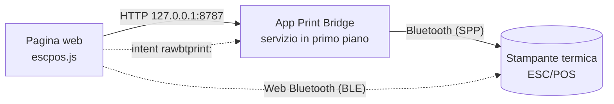

<p align="center">
  
</p>

# Print Bridge

**Stampa scontrini su stampanti termiche ESC/POS direttamente dalle pagine web, su
Android.** Una pagina (gestionale, cassa, sistema di voto, prenotazioni…) costruisce
lo scontrino e lo manda alla stampante Bluetooth vicina, senza driver e senza uscire
dal browser.

| | |
|---|---|
| **App Android** | [ultima Release](https://github.com/nb-camelot/raw-bt-print-bridge/releases/latest) (`app-release-<versione>.apk`) |
| **Pagina di test** | [nb-camelot.github.io/raw-bt-print-bridge](https://nb-camelot.github.io/raw-bt-print-bridge/), oppure `http://127.0.0.1:8787/` servita dall'app |
| **Stampa diretta BLE** | [pagina Web Bluetooth](https://nb-camelot.github.io/raw-bt-print-bridge/ble.html), senza app |
| **Client web** | `escpos.js`, pacchetto npm [`@nb-camelot/rawbt-print`](https://www.npmjs.com/package/@nb-camelot/rawbt-print) |
| **Novità** | [CHANGELOG.md](CHANGELOG.md) |

L'app si chiama **Raw BT Print Bridge** (package `com.rawbtprint.bridge`) e ha un
marchio proprio e neutro, **Print Bridge**. Il logo stampato in testa agli scontrini
è quello di chi la usa: si imposta da file, da URL o via API.

## Indice

- [Come funziona](#come-funziona)
- [Quale via scegliere](#quale-via-scegliere)
- [Avvio rapido](#avvio-rapido)
- [L'app Android](#lapp-android)
- [Stampa diretta via Web Bluetooth (BLE)](#stampa-diretta-via-web-bluetooth-ble)
- [Usare Print Bridge nelle proprie pagine](#usare-print-bridge-nelle-proprie-pagine)
- [Print layouts](#print-layouts)
- [API HTTP locale dell'app](#api-http-locale-dellapp)
- [Risoluzione dei problemi](#risoluzione-dei-problemi)
- [Sviluppo](#sviluppo)

## Come funziona



1. La pagina include `escpos.js`, che costruisce i comandi ESC/POS (testo,
   grassetto, dimensioni, QR nativo, logo raster), anche da un
   [layout di stampa](#print-layouts) riempito con i dati, oppure uno scontrino JSON.
2. **Via app**: la pagina chiama l'API locale dell'app su `127.0.0.1:8787`. L'app,
   tenuta viva da un servizio in primo piano, apre la connessione Bluetooth con la
   stampante accoppiata e stampa, restando dietro al browser.
3. **Via Web Bluetooth**: con una stampante **BLE** la pagina stampa da sola,
   tramite Chrome, senza nessuna app (vedi [sotto](#stampa-diretta-via-web-bluetooth-ble)).
4. **Ripiego**: se l'app non risponde, la pagina può aprirla con lo scheme
   `rawbtprint:base64,<dati>`, e allora stampa l'app in primo piano.

## Quale via scegliere

| | App Android (API locale) | Web Bluetooth (BLE) | Scheme `rawbtprint:` |
|---|---|---|---|
| Stampanti | qualsiasi stampante Bluetooth accoppiata (Classic SPP) | solo stampanti **BLE** compatibili | come l'app |
| Serve l'app | sì | **no** | sì |
| Browser | Chrome Android | Chrome Android (anche desktop) | Chrome Android |
| Esito della stampa | sì (`ok`, `bytes`, `error`) | sì (scrittura completata) | no |
| Resta nel browser | sì | sì | no, l'app va in primo piano |
| Permessi | «App sul dispositivo» per le pagine pubbliche | scelta della stampante, una volta per scheda | nessuno |
| Uso consigliato | **predefinito**, funziona con tutte le stampanti | stampanti BLE, postazioni senza app | ripiego |

## Avvio rapido

### Con l'app (tutte le stampanti Bluetooth)

1. Accoppia la stampante in **Impostazioni → Bluetooth** di Android.
2. Scarica e installa `app-release-<versione>.apk` dall'[ultima Release](https://github.com/nb-camelot/raw-bt-print-bridge/releases/latest).
3. Apri **Raw BT Print Bridge**, concedi il permesso Bluetooth e premi **Scegli stampante**.
4. **Disattiva l'ottimizzazione batteria** per l'app: l'app lo propone all'avvio,
   oppure premi **Risolvi** nel pannello di stato. Senza, Android può sospenderla
   quando passi al browser e le stampe restano in attesa (vedi
   [Batteria e sospensione](#batteria-e-sospensione-in-background-importante)).
5. Premi **Autotest completo**: tutte le voci devono essere ✓.
6. Apri in Chrome `http://127.0.0.1:8787/` (o la pagina su Pages) e prova una stampa.

### Senza app (stampanti BLE)

1. Apri in Chrome la [pagina di stampa diretta BLE](https://nb-camelot.github.io/raw-bt-print-bridge/ble.html).
2. Premi **Abbina stampante** e scegli la stampante dall'elenco di Chrome.
3. Stampa. Finché la scheda resta aperta non servono altre conferme. Dopo una
   ricarica basta **Riconnetti** (o un tocco su una stampa) e la scelta della
   stampante nell'elenco; con un'opzione di Chrome la pagina si ricollega da sola
   (vedi [Abbinamento](#abbinamento-una-volta-per-scheda)).

## L'app Android

Raw BT Print Bridge è un'app nativa minimale (Kotlin, nessuna libreria esterna,
Android 6+). Tiene attivo un **server HTTP locale** su `127.0.0.1:8787`, raggiungibile
solo dal tablet stesso, dentro un **servizio in primo piano** con notifica.

La schermata è divisa in card:

- **Stato del bridge**: quattro righe con pallino verde / ambra / rosso / grigio,
  aggiornate ogni 2 secondi.

  | Riga | Cosa dice |
  |---|---|
  | **Server API** | in ascolto da quanto, esito e durata dell'ultimo autotest (ogni 15 s), riavvii |
  | **Chiamate dal browser** | ultima chiamata (metodo, percorso, esito, ms, origine), richieste in corso, connessioni aperte senza richiesta, totale connessioni ricevute |
  | **Bluetooth e stampante** | Bluetooth acceso, stampante scelta e accoppiata, esito dell'ultima connessione |
  | **Batteria e sospensione in background** | ottimizzazione batteria, limitazioni, sospensione delle app, risparmio energetico |

  Sotto ci sono **Autotest completo**, **Riavvia server**, **Prova Bluetooth**
  (connessione senza stampare) e, se serve, **Risolvi**.
- **Stampante**: stampante scelta e stato della stampa; **Scegli stampante**,
  **Prova stampa (via API)**, **Dimentica stampante**.
- **Indirizzi di prova**, ognuno con **Copia** e **Apri**: pagina di test locale,
  stato e autotest in JSON, pagina su Pages, URL CDN del client web.
- **Carta e logo dello scontrino**: 58 mm (32 colonne) o 80 mm (48 colonne); logo
  da file, da URL, incluso o nessuno.
- **Registro**: le ultime 300 righe, comprese le chiamate ricevute mentre l'app era
  in background. Si copia con un tocco.

**Autoriparazione.** Ogni 15 secondi il servizio chiama `GET /status` su se stesso.
Se il server non è in ascolto o non risponde due volte di seguito, lo chiude e lo
riapre. Dopo tre tentativi falliti riprova una volta al minuto. La notifica mostra lo
stato reale.

**Autotest completo** (nell'app, con `GET /selftest` o dalla pagina di test)
controlla in un colpo solo:
- app e dispositivo;
- servizio, server e API;
- pagina di test e client web;
- Bluetooth e connessione alla stampante;
- batteria e sospensione;
- notifiche, compreso il canale del servizio;
- a scelta (solo dall'app), una stampa di prova via API.

Il riepilogo si copia per allegarlo a una segnalazione.

### Batteria e sospensione in background (importante)

Il server gira in un servizio in primo piano, ma alcune ROM (verificato su
LineageOS 18.1 / Android 11) sospendono comunque l'app quando non è davanti. Il
sintomo è preciso: dal browser la stampa, o `http://127.0.0.1:8787/status`, resta
in **caricamento infinito** e parte da sola appena si riapre l'app. Per evitarlo:

1. **Impostazioni → App → Raw BT Print Bridge → Batteria**: ottimizzazione batteria
   su **Non ottimizzare** (o «Senza restrizioni») e nessuna limitazione in background.
2. **Opzioni sviluppatore**, se attive: **«Sospendi esecuzione per app memorizzate
   nella cache»** disattivato. Su Android 11 il valore predefinito è spento, da
   Android 12 di solito è acceso.
3. Da Android 12, nelle impostazioni dell'app: **«Sospendi attività app se non in
   uso»** disattivato.
4. **Risparmio energetico** spento mentre si usa la stampante.

L'app controlla da sola questi punti:
- la riga **Batteria e sospensione** diventa rossa (problema che blocca l'app) o
  ambra (che può bloccarla);
- **Risolvi** dice cosa apre e porta all'impostazione giusta;
- all'avvio un avviso spiega il problema, ma non quando l'app è stata aperta dal
  browser per stampare;
- la notifica mette l'avviso in testa, e `/status` lo riporta nel campo `power`, che
  la pagina di test mostra.

C'è anche un **controllo sul sintomo**. Se il controllo periodico si ferma per più di
45 s con il tablet acceso, l'app è stata sospesa: il registro scrive «App sospesa dal
sistema per N s» e la riga resta rossa per mezz'ora, anche su ROM con impostazioni
proprie. Lo schermo spento non conta, perché il confronto usa il tempo di sistema che
non avanza nel sonno profondo.

### Marchio e logo dello scontrino

**Print Bridge** è il marchio dell'app: una stampante termica con lo scontrino in
uscita e il simbolo Bluetooth, in teal (`#0F766E`) su ardesia. Lo usano l'icona,
la notifica, l'intestazione, le pagine di test e il favicon. I file sorgente sono in
[`assets/brand/`](assets/brand/).

Il logo in testa agli scontrini non è legato al marchio dell'app:
- si imposta nell'app (**Da file**, **Da URL**) oppure via API con `POST /config`:
  `{"logoMode":"url","logoUrl":"https://…/logo.png"}`, `{"logoMode":"asset"}` per il
  logo incluso, `{"logoMode":"none"}` per toglierlo;
- il **logo incluso** è quello neutro «Print Bridge», in bianco e nero;
- i PNG con **sfondo trasparente** vanno bene: la trasparenza diventa il bianco della
  carta.

<!-- BLE -->
## Stampa diretta via Web Bluetooth (BLE)

Con una stampante **Bluetooth Low Energy** la pagina può stampare da sola, tramite
Chrome, senza installare nulla. La pagina pronta è
[`ble.html`](https://nb-camelot.github.io/raw-bt-print-bridge/ble.html) su Pages; per
le proprie pagine c'è `RawBT.ble` in `escpos.js` (dalla 1.9.0).

### Stampanti compatibili

Funziona con le stampanti termiche ESC/POS che espongono un **canale seriale BLE**.
La pagina prova questi profili, in ordine:

| Servizio | Caratteristica di scrittura | Dove si trova |
|---|---|---|
| `18f0` | `2af1` | il più diffuso: molte stampanti cinesi, spesso annunciate come «BlueTooth Printer» (per esempio le Netum NT-1809) |
| `e7810a71-73ae-499d-8c15-faa9aef0c3f2` | `bef8d6c9-9c21-4c9e-b632-bd58c1009f9f` | varie stampanti portatili |
| `49535343-fe7d-4ae5-8fa9-9fafd205e455` (ISSC) | `49535343-8841-43f4-a8d4-ecbe34729bb3` | moduli Microchip/ISSC |
| `ff00` | `ff02` | moduli economici |
| `ffe0` | `ffe1` | moduli HM-10 e simili |
| `6e400001-b5a3-f393-e0a9-e50e24dcca9e` (Nordic UART) | `6e400002-b5a3-f393-e0a9-e50e24dcca9e` | moduli Nordic |

Se il servizio c'è ma la caratteristica ha un altro UUID, la pagina usa la prima
caratteristica scrivibile dello stesso servizio. Le «cat printer» (servizio `ae30`)
non sono ESC/POS e vengono rifiutate con un messaggio chiaro.

- **Bluetooth 4 non vuol dire BLE.** Molte stampanti «Bluetooth 4.0» sono solo
  Classic (SPP): il browser non le vede e serve l'app. Le stampanti **doppia
  modalità** (dual mode) vanno bene, ma in BLE si presentano spesso con un altro
  nome.
- **Netum NT-1809DD**: è doppia modalità, ma non l'abbiamo provata direttamente. Se
  non stampa al primo colpo, apri **Avanzate → Diagnostica** in `ble.html`: mostra
  servizi e caratteristiche e permette di scegliere a mano quella giusta con **Usa
  questa** (la scelta resta ricordata per quella stampante).
- La diagnostica vede solo i servizi elencati sopra più `18f1`, `fff0`, `ffe6` e
  `fee7`. Web Bluetooth non mostra alla pagina i servizi che non ha dichiarato alla
  scelta del dispositivo.

### Abbinamento: una volta per scheda

La prima volta si sceglie la stampante nell'elenco di Chrome. Poi:

- **finché la scheda resta aperta** la pagina tiene la connessione e le stampe
  partono senza altre conferme; se la stampante va in standby, la pagina si
  ricollega da sola alla stampa successiva;
- **dopo una ricarica o una nuova visita** Chrome stabile non restituisce alla
  pagina le stampanti già scelte: la pagina ricorda il nome e mostra **Riconnetti
  «nome»**, che apre l'elenco filtrato su quella stampante. Anche un tocco
  direttamente su una stampa fa la stessa cosa;
- per **ricordarla tra le visite**, senza tocchi, attiva in Chrome
  `chrome://flags/#enable-web-bluetooth-new-permissions-backend` (Enabled, poi
  riavvia Chrome). La pagina se ne accorge (riga «Ricorda la stampante tra le
  visite») e si ricollega all'apertura.

Non serve accoppiare la stampante nelle impostazioni Bluetooth di Android.

### Come vengono inviati i dati

- Una scrittura alla volta, in coda: due stampe lanciate insieme escono una dopo
  l'altra, senza mescolarsi.
- **Automatica**: se la caratteristica accetta scritture con conferma, pezzi da 100
  byte con conferma (la conferma regola il flusso, così la stampante non perde
  byte). Se la stampante rifiuta il primo pezzo da 100, si passa da soli a 20 e la
  scelta resta ricordata. Se accetta solo scritture senza conferma, pezzi da 20
  byte con 20 ms di pausa e l'ultimo con conferma quando possibile.
- Le scritture fallite con «GATT operation failed for unknown reason» o «already in
  progress» non sono partite e si ritentano fino a 3 volte; gli altri errori
  interrompono la stampa, perché ritentare potrebbe stampare due volte.
- In **Avanzate** si può forzare una modalità (con conferma da 100 o da 20 byte,
  senza conferma da 20 byte), la larghezza della carta (58 o 80 mm) e la code page.
- Ogni stampa di `ble.html` comincia con `ESC @`, `FS .` (esce dalla modalità
  caratteri cinesi, attiva di default su molti firmware, che trasforma gli accenti
  in ideogrammi) e `ESC t 16` (Windows-1252, la codifica con cui `escpos.js` scrive
  il testo). I loghi sono alti al massimo 240 punti e spezzati in bande da 128
  righe, come nell'app.

### Usarla nelle proprie pagine

```html
<button id="stampa">Stampa</button>
<script src="https://cdn.jsdelivr.net/npm/@nb-camelot/rawbt-print@1/escpos.js"></script>
<script>
  document.getElementById('stampa').onclick = function () {
    var ble = RawBT.ble;
    // Nel gestore del tocco e prima di qualunque attesa: l'elenco di Chrome
    // si apre solo durante un gesto dell'utente.
    var pronta = ble.info().paired ? Promise.resolve() : ble.pair({ sameName: true });
    pronta.then(function () {
      var bytes = new EscPos().init().kanjiOff().codepage(16)
        .align('center').size(2, 2).line('GRAZIE').size(1, 1)
        .feed(3).cut().bytes();
      return ble.print(bytes, { onProgress: function (inviati, totali) {} });
    }).then(function (r) {
      console.log('inviati', r.bytes, 'byte in', r.ms, 'ms');
    }).catch(function (e) {
      var m = ble.explain(e);   // '' se l'utente ha chiuso l'elenco
      if (m) alert(m);
    });
  };
</script>
```

| Funzione | Cosa fa |
|---|---|
| `supported()` | Web Bluetooth disponibile (Chrome ed Edge; non Safari, iOS, Firefox) |
| `available()` | promessa: `true` se c'è la radio Bluetooth, `false` se no, `null` se non si sa |
| `canRemember()` | il browser può restituire le stampanti già scelte (opzione di Chrome attiva) |
| `pair({ sameName, all })` | apre l'elenco di Chrome (serve un gesto), si collega e sceglie il canale; `sameName` filtra sulla stampante già usata, `all` mostra tutti i dispositivi. Restituisce `info()` |
| `reconnect()` | senza gesto: si ricollega alla stampante di questa scheda o, con `canRemember()`, a quella ricordata; `null` se serve un tocco |
| `print(bytes, { onProgress })` | stampa in coda; `{ ok, bytes, ms, chunk, withResponse }` |
| `info()` / `on(fn)` | stato attuale / avvisi a ogni cambio: `status` (`idle`, `connecting`, `ready`, `printing`, `disconnected`, `error`), `name`, `paired`, `connected`, `profile`, `characteristic`, `writeMode`, `remembered`, `lastError` |
| `describe()` | servizi e caratteristiche visibili, con le proprietà |
| `useCharacteristic(servizio, caratteristica)` | sceglie a mano il canale, ricordato per quella stampante |
| `setWriteMode(modo)` | `auto`, `response-100`, `response-20`, `noresponse-20` |
| `disconnect()` / `forget()` | chiude la connessione / dimentica la stampante (anche nel browser, se supportato) |
| `explain(errore)` | spiegazione in italiano di un errore Web Bluetooth (`''` se annullato) |

La stampante ricordata e le scelte manuali stanno nel `localStorage` della pagina,
sotto la chiave `printbridge.ble`.

### Limiti

- Una stampante BLE accetta **una connessione alla volta** e, mentre è collegata a
  qualcosa (l'app, un altro telefono, un PC), di solito smette di farsi vedere:
  scollegala o spegnila e riaccendila.
- Su **Android 11 e precedenti** Chrome trova dispositivi Bluetooth solo con il
  permesso **Posizione** e la Localizzazione attiva.
- La pagina deve restare aperta durante la stampa; se va in background Chrome può
  chiudere la connessione, e la pagina la riapre alla stampa successiva.
- Serve una pagina in **https** (o `localhost`).

## Usare Print Bridge nelle proprie pagine

### Includere `escpos.js`

```html
<script src="https://cdn.jsdelivr.net/npm/@nb-camelot/rawbt-print@1/escpos.js"></script>
```

Lo script espone `EscPos` (costruisce i byte ESC/POS) e `RawBT` (li invia all'app
oppure, con `RawBT.ble`, [direttamente a una stampante BLE](#stampa-diretta-via-web-bluetooth-ble)).
In produzione conviene fissare la versione (`@1.9.0`) o servire il file dal proprio
dominio. Gli asset delle Release GitHub **non** si possono includere con
`<script src>`, perché sono serviti come download.

Configurazione facoltativa con meta tag:

```html
<meta name="rawbt-api-port" content="8787">
<meta name="rawbt-scheme" content="rawbtprint">
```

### Uno scontrino JSON (lo impagina l'app)

```html
<script>
  RawBT.sendReceipt({
    shop: "NEGOZIO DEMO", title: "RICEVUTA", code: "ABC123",
    items: [{ desc: "Caffe", qty: 2, price: 1.20 }],
    qr: "https://example.com/r/ABC123", footer: "Grazie"
  }).then(function (r) { console.log(r); });
</script>
```

### ESC/POS costruito nella pagina

```js
var bytes = new EscPos().init().codepage(0x10)
  .align('center').size(2, 2).line('PROVA').size(1, 1)
  .align('left').line('Totale: 2,40')
  .align('center').qr('https://example.com/r/ABC123', 6)
  .feed(3).cut().bytes();
RawBT.sendApi(bytes).then(function (r) { console.log(r); });
```

Metodi di `EscPos`: `init`, `codepage`, `kanjiOff` (`FS .`, per i firmware cinesi che
stampano gli accenti come ideogrammi), `align('left'|'center'|'right')`, `bold`,
`underline`, `size(w, h)`, `text`, `line`, `feed`, `cut`, `rule`, `qr(dati, modulo)`,
`image(raster)`, `bytes`; più `EscPos.loadImage(url)` ed
`EscPos.rasterize(img, larghezza, soglia, { maxHeight, band })` per i loghi.

### Funzioni di `RawBT`

| Funzione | Cosa fa | Risultato |
|---|---|---|
| `check(timeoutMs)` | `GET /status`, non rifiuta mai | `{ ok, ms, status }` oppure `{ ok:false, ms, reason, message }` con `reason` = `timeout` / `network` / `response` |
| `ping(timeoutMs)` | come `check`, per compatibilità | lo stato oppure `null` |
| `sendReceipt(spec)` | `POST /receipt` (JSON) | `{ ok, bytes, summary }` o `{ ok:false, error }` |
| `sendApi(bytes)` | `POST /print` (ESC/POS in base64) | `{ ok, bytes }` o `{ ok:false, error }` |
| `send(bytes)` | come `sendApi`, ma se la connessione è rifiutata subito apre l'app con lo scheme | `{ ok:true, fallback:true, confirmed:false, error }` col ripiego, `{ ok:false, timeout:true, error }` dopo un timeout |
| `selftest()` | `GET /selftest` | `{ ok, level, summary, ms, version, versionCode, device, items }` |
| `getConfig()` / `setConfig(obj)` | legge e cambia carta, logo e stampante | la configurazione |
| `localAccess()` / `localAccessHint(state)` | stato e istruzioni del permesso «App sul dispositivo» | `{ name, state }` / testo |
| `url(bytes)` / `navigate(url)` | scheme `rawbtprint:` per il ripiego manuale | — |

Tutte le chiamate hanno un timeout (`{ timeoutMs }`, 0 = nessuno). I default sono
5 s per `check`, 40 s per `sendApi`, 60 s per `sendReceipt`, 30 s per `selftest`,
10 s per la configurazione (45 s con `logoUrl`). Il timeout scatta anche dove `fetch`
ignora l'abort.

Tutte le chiamate usano `cache: 'no-store'`. Chrome mette in coda le GET identiche
dietro una ancora in corso, quindi senza questa opzione una sola `/status` appesa
bloccherebbe le successive, da qualunque scheda.

Dopo un ripiego sullo scheme l'esito della stampa non è noto, quindi la stampa non va
ritentata. Dopo un timeout `send` non apre l'app: la richiesta potrebbe essere già in
stampa, e Chrome aprirebbe l'app solo con un nuovo tocco dell'utente, per esempio un
pulsante che chiama `RawBT.navigate(RawBT.url(bytes))`.

### Permesso «App sul dispositivo» (Local Network Access)

Da Chrome 142, una pagina su un'origine pubblica (`https://…`) che chiama
`127.0.0.1` deve avere il permesso **«App sul dispositivo»** (`loopback-network`;
su Chrome 142-144 si chiamava «Accesso alla rete locale»):
- al primo tentativo Chrome mostra il prompt: premi **Consenti**;
- se l'hai negato: icona a sinistra dell'indirizzo → **Impostazioni sito** →
  **App sul dispositivo** → **Consenti**, poi ricarica;
- sui tablet gestiti si può pre-approvare con la policy `LocalNetworkAccessAllowedForUrls`.

La pagina servita dall'app (`http://127.0.0.1:8787/`) non ha bisogno del permesso,
perché chiama la sua stessa origine. `escpos.js` usa `targetAddressSpace: 'loopback'`,
e `RawBT.localAccess()` dice lo stato del permesso.

## Print layouts

With `PrintBridge.render` (since 1.10.0) a receipt is described **once**, in a JSON
layout: logo, header, columns, repetitions, QR code. Every print passes only the data.
The result is the ESC/POS bytes, the same for direct BLE printing and for the app, and
`RawBT.printLayout` sends them the right way. A layout is plain JSON, so it can live in
a file or come from a server.

```html
<button id="print">Print</button>
<script src="https://cdn.jsdelivr.net/npm/@nb-camelot/rawbt-print@1/escpos.js"></script>
<script>
  var LAYOUT = {
    paper: 58,
    codepage: 16,
    blocks: [
      { logo: 'logo.png', maxHeight: 160 },
      { text: '{{shop}}', align: 'center', bold: true, size: [2, 2] },
      { rule: true },
      { row: ['Order {{order}}', '{{date|date}}'] },
      { each: 'items', row: [{ text: '{{qty}} x {{name}}', wrap: true }, '{{price|euro}}'] },
      { rule: '=' },
      { row: ['TOTAL', '{{total|euro}}'], bold: true, size: [1, 2] },
      { if: 'qr', blocks: [{ feed: 1 }, { qr: '{{qr}}', size: 5 }] },
      { if: 'note', text: '{{note}}', align: 'center' },
      { feed: 3 },
      { cut: true }
    ]
  };

  // When the page loads, not in the tap handler: lets 'auto' pick the app if it answers.
  RawBT.check();

  document.getElementById('print').onclick = function () {
    var data = {
      shop: 'Demo Shop', order: 'A-042', date: true,
      items: [{ qty: 2, name: 'Espresso', price: 2.4 }, { qty: 1, name: 'Croissant', price: 1.5 }],
      total: 3.9, qr: 'https://example.com/r/A-042'
    };
    // In the tap handler, before any wait: if the way is BLE and no printer is paired in
    // this tab, Chrome's chooser opens at once.
    RawBT.printLayout(LAYOUT, data).then(function (r) {
      if (r.ok) console.log('printed via', r.via, r.bytes, 'bytes in', r.ms, 'ms');
      else if (!r.cancelled) alert(r.error);
    });
  };
</script>
```

In `ble.html`, the **Layout receipt** card has an editable example (layout and data in
JSON): **Check without printing** tries the layout without a printer, and the **Layout
receipt** button prints it.

### Format

| Field | What it does |
|---|---|
| `paper` | `58` (32 columns, 384 dots) or `80` (48 columns, 576 dots); `384` and `576` work too. Default 58 |
| `columns` | number of columns (16-64) instead of those of the paper, or a placeholder such as `'{{width}}'`; the dots stay those of the paper |
| `codepage` | number for `ESC t`, default 16 (Windows-1252, the encoding `escpos.js` writes text in) |
| `defaults` | values of the fields that are missing from the data (or `null`) |
| `prepare` | name of a data preparation in `PrintBridge.prepare`, for example `receipt` |
| `blocks` | the blocks, in order |

`paper` and `codepage` passed in the options of `render` win over those of the layout,
because they belong to the printer, not to the receipt. Every print starts with `ESC @`,
`FS .` and `ESC t <codepage>`.

### Blocks

Every block can have an `if` (see below).

| Block | Example | Notes |
|---|---|---|
| text | `{ text: 'Hello {{name}}', align: 'center', size: [2, 1], bold: true, underline: true }` | wraps on words; `size: [width, height]` from 1 to 8, or a single number |
| columns | `{ row: ['{{desc}}', '{{price\|euro}}'] }` | see [Columns](#columns); takes `bold`, `underline`, `size`, `gap`, `wrap` |
| repetition | `{ each: 'items', row: [...] }` or `{ each: 'items', blocks: [...] }` | inside, the fields of the element (and, when missing, those outside); `{{.}}` for a list of texts; `{{@number}}` (from 1), `@index` (from 0), `@first`, `@last` |
| group | `{ if: 'qr', blocks: [...] }` | several blocks under one condition |
| logo | `{ logo: 'logo.png', maxHeight: 240 }` | URL, data URL or placeholder; `true` uses `options.logo`; from JavaScript also an image of the page or a ready-made raster. Centered, in 128-row bands; `threshold` from 0 to 255 (140) |
| rule | `{ rule: true }`, `{ rule: '=' }` | as wide as the paper |
| QR code | `{ qr: '{{url}}', size: 6, ec: 'M' }` | `size` is the module (1-16), `ec` the error correction (`L`, `M`, `Q`, `H`); centered unless `align`; not printed without data |
| feed | `{ feed: 3 }` | also `'{{feed}}'` |
| cut | `{ cut: true }`, `{ cut: 'partial' }` | |
| raw bytes | `{ raw: [27, 112, 0, 25, 250] }` | sent as they are, for example to open the cash drawer |

An unknown block or filter, or a wrong value, rejects the promise with an error that says
where (`blocks[3]: unknown block`) instead of printing half a receipt.

Character sizes use `GS !`. Columns are counted on 32 or 48 characters, and with width 2
(`size: [2, x]`) they become 16 or 24.

### Columns

- `row: ['left', 'right']`: the first column takes the space left, the others are as
  wide as their text and the last one is right-aligned, with one space between columns
  (`gap`). It is the same `pad()` as the app receipt: text too long on the left is cut.
- For columns made to measure, every column is an object `{ text, width, flex, align,
  wrap }`: `width: 4` is fixed, `width: 'auto'` is as wide as the text, no `width` is
  flexible (weight `flex`, default 1). With `wrap` the column wraps instead of cutting,
  and the row becomes several lines.

```js
{ row: [
  { text: '{{qty}}x', width: 4 },
  { text: '{{name}}', wrap: true },
  { text: '{{price|euro}}', width: 10, align: 'right' }
] }
```

### Placeholders, filters and conditions

- `{{field}}` and `{{customer.name}}`: a missing field becomes empty text. Only the data's
  own properties are read (no `constructor` or `__proto__`). Control characters in the
  data are dropped, so a field cannot turn into a printer command.
- Filters, chained too (`{{name|lower|upper}}`):

  | Filter | Example |
  |---|---|
  | `euro` | `1234.5` → `1.234,50 €` (it-IT); `euro:0` without decimals |
  | `num` | `1234.5` → `1234,50`, like the amounts on the app receipt; `num:3` for three decimals |
  | `date` | `true` or `"now"` → now, `17/10/2026 09:05`; also a Date, milliseconds or ISO text. Custom format: `date:dd/MM/yy`, `date:HH:mm` (`yyyy`, `yy`, `MM`, `dd`, `HH`, `mm`, `ss`) |
  | `upper`, `lower` | upper case, lower case |

  Numbers can also be text (`"2.5"`, `"2,50"`). Your own filters:
  `PrintBridge.filters.name = function (value, argument) { … }`, or `options.filters` for
  one print.
- `if`: `'field'`, `'!field'`, `'a && b'`, `'a || b'` (`&&` before `||`). Missing fields,
  `''`, `0`, `false` and empty lists are false. On an `each` block the condition applies
  to the whole block; to pick single elements use `blocks` with an `if` inside.

There is no `eval` and no `new Function`: a layout received from a server runs no code in
the page, and filters and data preparations are only those registered by the page.

### The app receipt, over BLE too

`PrintBridge.layouts.receipt`, or just `'receipt'`, reproduces line by line the receipt of
[`POST /receipt`](#api-http-locale-dellapp), labels included: the same JSON as
`RawBT.sendReceipt` prints the same way over BLE. `sendReceipt` stays as it is, for the
logo configured in the app.

```js
var receipt = { shop: 'DEMO SHOP', code: 'ABC123', logo: true,
  items: [{ desc: 'Coffee', qty: 2, price: 1.20 }],
  qr: 'https://example.com/r/ABC123', footer: 'Thank you' };
RawBT.sendReceipt(receipt);                                     // laid out by the app
RawBT.printLayout('receipt', receipt, { logo: 'logo.png' });    // laid out by the page
```

`prepare: 'receipt'` reads the data as the app does: for every item `qty` (default 1),
`price` (default 0) and `amount` = `qty × price`; a missing `total` is the sum. `width`
sets the columns, as in the app. For a similar receipt of your own, start from a copy of
`JSON.stringify(PrintBridge.layouts.receipt)`.

Differences from the app:
- `logo: true` prints `options.logo` (in the app it is the configured logo); without
  `options.logo` the print stops with a clear error (`logo-missing`);
- `printer` only applies to the app;
- long texts wrap on words, while the app lets the printer break them;
- big characters (shop name, title, total) use `GS !`. The app and `EscPos.size` use
  `ESC !` with the same values, which by the ESC/POS standard selects the small font and
  double height instead of enlarging. Through a layout the shop name may therefore come
  out wider than from the app.

### Logo and CORS

- A logo from a URL is loaded with `crossOrigin = 'anonymous'` and goes through a canvas.
  The browser lets the page read the pixels of an image from **another domain** only if
  its server answers with `Access-Control-Allow-Origin` (CORS). Without it `render` stops
  with an error: «Logo not loaded…» (`logo-load`) for a URL, «tainted canvas»
  (`logo-cors`) for an image of the page loaded without `crossOrigin`.
- The fixes: serve the logo from the same site as the page, enable CORS on the logo's
  server, or use a data URL (`data:image/png;base64,…`) or a ready-made raster
  (`EscPos.rasterize`).
- The logo is at most 240 dots high (`maxHeight`), centered on white and sent in bands of
  128 rows, as in the app. Images and rasters are cached by URL (`PrintBridge.clearCache()`
  empties the cache); a failed load is not cached. After 10 s without an answer the print
  stops.

### Printing: one entry point and the way (`via`)

`RawBT.printLayout(layout, data, options)` (also `PrintBridge.print`) renders the layout
and prints it:

| `via` | Goes to |
|---|---|
| `'ble'` | `RawBT.ble.print` (takes `onProgress`); with no printer paired in this tab, Chrome's chooser opens at once, filtered on the printer used last time |
| `'app'` | `RawBT.sendApi` (takes `timeoutMs`) |
| `'auto'` (default) | the first that applies, see below |

`'auto'` decides **synchronously**, with what is already known: Chrome opens the BLE
chooser only while the tap is still valid, so waiting for `RawBT.check()` in the tap
handler would end in a `SecurityError`. The order:

1. the preference saved with `RawBT.setVia('app' | 'ble')` (in `localStorage`, key
   `printbridge.via`; `RawBT.setVia('auto')` clears it);
2. a BLE printer paired in this tab → BLE;
3. an app that answered `RawBT.check()` (`RawBT.lastCheck.ok`) → app;
4. a BLE printer used on an earlier visit, with Web Bluetooth available → BLE, and
   Chrome's chooser opens in the same tap;
5. otherwise the app; if it does not answer, the error suggests both ways.

`RawBT.chooseVia(options)` returns the decision without printing, `{ via, reason,
needsPairing }`, with `reason` = `option`, `preference`, `paired`, `app-ok`, `remembered`
or `default`. A page can show it next to the print button.

The result does not depend on the way, and the promise never rejects:

| Outcome | Result |
|---|---|
| printed | `{ ok: true, via, reason, bytes, ms, result }`: `bytes` is the number of bytes sent, `result` the transport's own answer |
| not printed | `{ ok: false, via, reason, bytes, ms, error, code, cause }`: `error` is a readable message, `cause` the original error, `cancelled: true` when the person closed Chrome's chooser |

`code` is that of the layout error (`layout`, `filter`, `logo-load`, `logo-cors`,
`logo-missing`), `via` for a wrong `via`, `app` when the app answered but could not print,
`timeout`, `network` or `response` when the app did not answer, and the code or name of
the BLE error (`no-device`, `timeout`, `NetworkError`…) for BLE.

Two things to keep in mind:
- **`RawBT.check()` and the permission.** On a public page (`https://…`) the call to
  `127.0.0.1` can make Chrome ask for the «App sul dispositivo» permission (see
  [above](#permesso-app-sul-dispositivo-local-network-access)). A page that prints only
  over BLE can avoid it: no `RawBT.check()`, and `via: 'ble'` (or `RawBT.setVia('ble')`).
- **One way per printer.** A dual-mode printer connected to the app (Bluetooth Classic,
  SPP) stops advertising over BLE, and one connected over BLE is busy for the app. Use
  one way for each printer, and fix it with `RawBT.setVia` on that device.

### Functions

| Function | What it does |
|---|---|
| `PrintBridge.render(layout, data, options)` | promise with the ESC/POS bytes (array of numbers). `layout` is an object, a JSON text or a name (`'receipt'`). Options: `paper`, `codepage`, `logo`, `now` (the Date of `date`), `filters` |
| `RawBT.printLayout(layout, data, options)`, `PrintBridge.print` | `render` plus printing, with `via` and the options of the transport (see above). Call it in the tap handler |
| `RawBT.chooseVia(options)` | the way `printLayout` would take, without printing |
| `RawBT.setVia(via)` | `'app'` or `'ble'` fixes the way for `'auto'`; `'auto'` clears it |
| `PrintBridge.format(text, data)` | fills one text, to try placeholders and filters |
| `PrintBridge.layouts`, `.filters`, `.prepare` | built-in layouts, filters, data preparations; you can add your own |
| `PrintBridge.messages` | the texts of the errors, by key (`{name}` is a value), to translate them |
| `PrintBridge.clearCache()` | empties the logo cache |

`render` rejects with errors whose `name` is `PrintBridgeLayoutError` and whose `code` is
`layout`, `filter`, `logo-load`, `logo-cors` or `logo-missing`.

## API HTTP locale dell'app

Tutte su `http://127.0.0.1:8787`, con CORS aperto (`Access-Control-Allow-Origin: *`)
e risposte JSON.

| Metodo | Percorso | Descrizione |
|---|---|---|
| GET | `/`, `/test` | pagina di test (stessa origine: niente permesso né CORS) |
| GET | `/escpos.js` | il client web incluso nell'APK, della stessa versione |
| GET | `/status` | versione, stato di server, chiamate, Bluetooth e batteria, stampante, configurazione |
| GET | `/selftest` | autotest completo, senza stampa |
| GET | `/config` | configurazione corrente |
| POST | `/config` | larghezza carta, logo (`logoMode`, `logoUrl`), stampante (`printer`) |
| POST | `/receipt` | scontrino JSON, impaginato dall'app |
| POST | `/print` | ESC/POS già pronto, in base64 (o byte grezzi) |

Formato di `POST /receipt` (tutti i campi sono facoltativi):

```json
{
  "shop": "NEGOZIO DEMO",
  "title": "RICEVUTA",
  "subtitle": "Ordine 42",
  "code": "ABC123",
  "date": true,
  "lines": ["Buono regalo", "Uso entro 12 mesi"],
  "items": [{ "desc": "Caffe", "qty": 2, "price": 1.20 }],
  "total": "",
  "qr": "https://example.com/r/ABC123",
  "qrText": "Scansiona per la ricevuta",
  "footer": "Grazie e arrivederci",
  "logo": true,
  "width": 32,
  "cut": true,
  "feed": 3,
  "printer": "5A:4A:D5:BC:47:08"
}
```

`width` (16-64 colonne) sostituisce la larghezza impostata nell'app, `printer` la
stampante scelta. Risposta: `{"ok":true,"bytes":N,"summary":"…"}` oppure
`{"ok":false,"error":"…"}`.

## Risoluzione dei problemi

| Sintomo | Causa probabile | Cosa fare |
|---|---|---|
| Dal browser la stampa resta in caricamento e parte quando riapri l'app | Android sospende l'app in background | [Batteria e sospensione](#batteria-e-sospensione-in-background-importante): **Risolvi** nell'app |
| «App raggiungibile: no» dopo pochi ms (`network`) | app chiusa, server fermo o permesso negato | apri l'app; sulle pagine pubbliche concedi «App sul dispositivo» |
| «no: nessuna risposta» (`timeout`) | richiesta appesa | apri l'app: «Chiamate dal browser» e il registro dicono se è arrivata |
| `/status` aperto a mano resta in caricamento | un'altra scheda con un client vecchio (fino alla 1.6.x) tiene una richiesta appesa | chiudi le altre schede su `127.0.0.1:8787` |
| «Timeout connessione dopo 8 s» | stampante spenta, lontana o già connessa a un altro dispositivo | la SPP accetta una sola connessione: libera la stampante e riprova (**Prova Bluetooth**) |
| La stampante BLE non compare nell'elenco di Chrome | la stampante è solo Bluetooth Classic, è collegata a un altro dispositivo, oppure Bluetooth o Posizione spenti | vedi [Limiti](#limiti); prova «Non trovo la stampante nell'elenco»; con le stampanti Classic usa l'app |
| Stampa BLE interrotta o con caratteri a caso | la stampante perde byte | in `ble.html` → **Avanzate** scegli un invio più lento |
| Accenti stampati come ideogrammi o simboli | modalità caratteri cinesi attiva o code page sbagliata | `kanjiOff()` e `codepage(16)` in testa alla stampa; in `ble.html` imposta la code page in **Avanzate** |
| Il logo esce come un rettangolo nero | logo con trasparenza su versioni fino alla 1.8.0 | aggiorna l'app; dalla 1.8.1 la trasparenza diventa bianco |

## Sviluppo

### Struttura del repository

| Percorso | Contenuto |
|---|---|
| `android/` | app Android (`com.rawbtprint.bridge`): servizio, server HTTP, stampa Bluetooth, pannello di stato |
| `escpos.js` | client web (ESC/POS + trasporti verso app e BLE); la copia in `android/app/src/main/assets/` deve restare identica |
| `index.html` | pagina di test pubblicata su Pages; identica a `android/app/src/main/assets/test.html` salvo il percorso di `escpos.js` |
| `ble.html` | pagina di stampa diretta via Web Bluetooth (`web-ble-test*.html` rimandano qui) |
| `test/` | prove in Node, eseguite anche dalla CI: `RawBT.ble` con un Bluetooth finto (`node test/ble-test.js escpos.js`) e i layout di stampa, confrontati anche con lo scontrino di `Receipt.kt` (`node test/layout-test.js escpos.js`) |
| `assets/` | marchio (`assets/brand/`) e logo neutro per le prove da PC |
| `serve.ps1`, `print-logo-receipt.ps1` | prove dal PC (vedi sotto) |
| `.github/workflows/` | build, versioni, pubblicazione e sviluppo agentico |

### Build, versioni e pubblicazione

- **Pull request** verso `main`: `build-apk.yml` controlla la sintassi di `escpos.js`
  e delle pagine e l'allineamento delle copie, poi compila un **APK di prova**
  firmato (`<versione>-pr<N>`), scaricabile dagli artifact della run, **senza**
  Release. Le PR da fork sono firmate con la chiave debug.
- **Merge su `main`**: `bump-version.yml` calcola la nuova versione, aggiorna
  `versionName` e `versionCode`, fa il commit `chore(release): vX.Y.Z` e avvia
  `build-apk.yml` (Release con l'APK) e `publish-web.yml` (npm). Pages si pubblica
  dalla radice di `main`.
- **La versione dipende dall'ultimo commit**, quindi conviene lo **squash merge** con
  un titolo conventional commit:

  | Nel titolo o nel messaggio | Versione |
  |---|---|
  | `!:`, `BREAKING CHANGE` o `[semver:major]` | major |
  | `feat:` o `[semver:minor]` | minor |
  | tutto il resto (`fix:`, `docs:`…) | patch |
  | `[skip release]` | nessuna release |

  Il bump parte solo se cambia qualcosa in `android/` o c'è un `[semver:…]`. Si può
  forzare eseguendo `bump-version.yml` a mano con `release_type`.
- **Firma**: le Release sono firmate con una keystore stabile dai secret
  `SIGNING_KEYSTORE_BASE64`, `SIGNING_STORE_PASSWORD`, `SIGNING_KEY_ALIAS` e
  `SIGNING_KEY_PASSWORD`, così gli aggiornamenti si installano sopra.
- **npm**: `publish-web.yml` pubblica `@nb-camelot/rawbt-print` con trusted
  publishing (OIDC, nessun token). Configurazione una tantum su npmjs.org: *Package
  settings → Trusted Publisher → GitHub Actions*, repository
  `nb-camelot/raw-bt-print-bridge`, workflow `publish-web.yml`.

### Sviluppo agentico (OpenCode)

`opencode.yml` avvia un agente quando un commento di issue o PR contiene `/oc` o
`/opencode`, oppure a mano con *Run workflow*. Il flusso è autorizzazione → piano →
implementazione e review → PR → squash merge se il verdetto è `PASS` → release.

| Variabile | Default | Descrizione |
|---|---|---|
| `OPENCODE_ALLOWED_USERS` | *(vuoto)* | utenti extra autorizzati, separati da spazio |
| `OPENCODE_DEFAULT_MODEL` | `opencode/big-pickle` | modello predefinito |
| `OPENCODE_VISUAL_MODEL` | `opencode/space-bunny-free` | modello per issue con immagini |

Secret facoltativi per provider a pagamento: `OPENCODE_API_KEY`, `ANTHROPIC_API_KEY`,
`OPENAI_API_KEY`, `GEMINI_API_KEY`.

> **Attenzione**: il trigger cerca `/oc` ovunque nel testo, quindi anche un commento
> che contiene per esempio `application/octet-stream` avvia l'agente, che ha permessi
> di scrittura e può fare il merge. Evitate quella sequenza nei commenti che non sono
> comandi.

### Prove dal PC

```powershell
powershell -NoProfile -ExecutionPolicy Bypass -File .\serve.ps1                 # server su :8000
powershell -NoProfile -ExecutionPolicy Bypass -File .\print-logo-receipt.ps1 -Port COM9 -Code "DEMO-0001"
```

- `serve.ps1` serve `index.html` su `http://<ip-del-pc>:8000/` ed espone
  `GET /api/printer` (stato della stampante sul PC) e `POST /api/print` (ESC/POS in
  base64, scritto sulla porta seriale).
- `print-logo-receipt.ps1` stampa una ricevuta di prova con il logo neutro di
  `assets/logo.png`; `-Url` imposta il contenuto del QR.
