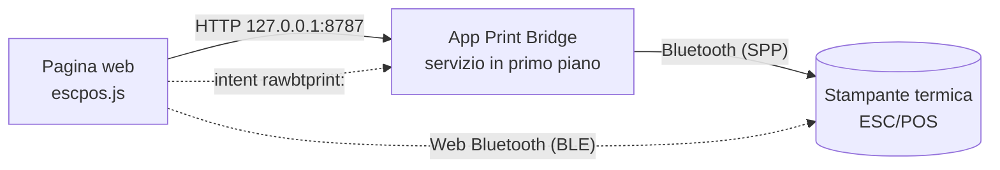

<p align="center">
  
</p>

# Print Bridge

**Stampa scontrini su stampanti termiche ESC/POS direttamente dalle pagine web, su
Android.** Una pagina (gestionale, cassa, sistema di voto, prenotazioni…) costruisce
lo scontrino e lo manda alla stampante Bluetooth vicina, senza driver e senza uscire
dal browser.

| | |
|---|---|
| **App Android** | [ultima Release](https://github.com/nb-camelot/raw-bt-print-bridge/releases/latest) (`app-release-<versione>.apk`) |
| **Pagina di test** | [nb-camelot.github.io/raw-bt-print-bridge](https://nb-camelot.github.io/raw-bt-print-bridge/), oppure `http://127.0.0.1:8787/` servita dall'app |
| **Stampa diretta BLE** | [pagina Web Bluetooth](https://nb-camelot.github.io/raw-bt-print-bridge/ble.html), senza app |
| **Client web** | `escpos.js`, pacchetto npm [`@nb-camelot/rawbt-print`](https://www.npmjs.com/package/@nb-camelot/rawbt-print) |
| **Novità** | [CHANGELOG.md](CHANGELOG.md) |

L'app si chiama **Raw BT Print Bridge** (package `com.rawbtprint.bridge`) e ha un
marchio proprio e neutro, **Print Bridge**. Il logo stampato in testa agli scontrini
è quello di chi la usa: si imposta da file, da URL o via API.

## Indice

- [Come funziona](#come-funziona)
- [Quale via scegliere](#quale-via-scegliere)
- [Avvio rapido](#avvio-rapido)
- [L'app Android](#lapp-android)
- [Stampa diretta via Web Bluetooth (BLE)](#stampa-diretta-via-web-bluetooth-ble)
- [Usare Print Bridge nelle proprie pagine](#usare-print-bridge-nelle-proprie-pagine)
- [API HTTP locale dell'app](#api-http-locale-dellapp)
- [Risoluzione dei problemi](#risoluzione-dei-problemi)
- [Sviluppo](#sviluppo)

## Come funziona



1. La pagina include `escpos.js`, che costruisce i comandi ESC/POS (testo,
   grassetto, dimensioni, QR nativo, logo raster) oppure uno scontrino JSON.
2. **Via app**: la pagina chiama l'API locale dell'app su `127.0.0.1:8787`. L'app,
   tenuta viva da un servizio in primo piano, apre la connessione Bluetooth con la
   stampante accoppiata e stampa, restando dietro al browser.
3. **Via Web Bluetooth**: con una stampante **BLE** la pagina stampa da sola,
   tramite Chrome, senza nessuna app (vedi [sotto](#stampa-diretta-via-web-bluetooth-ble)).
4. **Ripiego**: se l'app non risponde, la pagina può aprirla con lo scheme
   `rawbtprint:base64,<dati>`, e allora stampa l'app in primo piano.

## Quale via scegliere

| | App Android (API locale) | Web Bluetooth (BLE) | Scheme `rawbtprint:` |
|---|---|---|---|
| Stampanti | qualsiasi stampante Bluetooth accoppiata (Classic SPP) | solo stampanti **BLE** compatibili | come l'app |
| Serve l'app | sì | **no** | sì |
| Browser | Chrome Android | Chrome Android (anche desktop) | Chrome Android |
| Esito della stampa | sì (`ok`, `bytes`, `error`) | sì (scrittura completata) | no |
| Resta nel browser | sì | sì | no, l'app va in primo piano |
| Permessi | «App sul dispositivo» per le pagine pubbliche | scelta della stampante, una volta | nessuno |
| Uso consigliato | **predefinito**, funziona con tutte le stampanti | stampanti BLE, postazioni senza app | ripiego |

## Avvio rapido

### Con l'app (tutte le stampanti Bluetooth)

1. Accoppia la stampante in **Impostazioni → Bluetooth** di Android.
2. Scarica e installa `app-release-<versione>.apk` dall'[ultima Release](https://github.com/nb-camelot/raw-bt-print-bridge/releases/latest).
3. Apri **Raw BT Print Bridge**, concedi il permesso Bluetooth e premi **Scegli stampante**.
4. **Disattiva l'ottimizzazione batteria** per l'app: l'app lo propone all'avvio,
   oppure premi **Risolvi** nel pannello di stato. Senza, Android può sospenderla
   quando passi al browser e le stampe restano in attesa (vedi
   [Batteria e sospensione](#batteria-e-sospensione-in-background-importante)).
5. Premi **Autotest completo**: tutte le voci devono essere ✓.
6. Apri in Chrome `http://127.0.0.1:8787/` (o la pagina su Pages) e prova una stampa.

### Senza app (stampanti BLE)

1. Apri in Chrome la [pagina di stampa diretta BLE](https://nb-camelot.github.io/raw-bt-print-bridge/ble.html).
2. Premi **Abbina stampante** e scegli la stampante dall'elenco di Chrome: serve una
   volta sola.
3. Stampa. Alle visite successive la pagina si ricollega da sola.

## L'app Android

Raw BT Print Bridge è un'app nativa minimale (Kotlin, nessuna libreria esterna,
Android 6+). Tiene attivo un **server HTTP locale** su `127.0.0.1:8787`, raggiungibile
solo dal tablet stesso, dentro un **servizio in primo piano** con notifica.

La schermata è divisa in card:

- **Stato del bridge**: quattro righe con pallino verde / ambra / rosso / grigio,
  aggiornate ogni 2 secondi.

  | Riga | Cosa dice |
  |---|---|
  | **Server API** | in ascolto da quanto, esito e durata dell'ultimo autotest (ogni 15 s), riavvii |
  | **Chiamate dal browser** | ultima chiamata (metodo, percorso, esito, ms, origine), richieste in corso, connessioni aperte senza richiesta, totale connessioni ricevute |
  | **Bluetooth e stampante** | Bluetooth acceso, stampante scelta e accoppiata, esito dell'ultima connessione |
  | **Batteria e sospensione in background** | ottimizzazione batteria, limitazioni, sospensione delle app, risparmio energetico |

  Sotto ci sono **Autotest completo**, **Riavvia server**, **Prova Bluetooth**
  (connessione senza stampare) e, se serve, **Risolvi**.
- **Stampante**: stampante scelta e stato della stampa; **Scegli stampante**,
  **Prova stampa (via API)**, **Dimentica stampante**.
- **Indirizzi di prova**, ognuno con **Copia** e **Apri**: pagina di test locale,
  stato e autotest in JSON, pagina su Pages, URL CDN del client web.
- **Carta e logo dello scontrino**: 58 mm (32 colonne) o 80 mm (48 colonne); logo
  da file, da URL, incluso o nessuno.
- **Registro**: le ultime 300 righe, comprese le chiamate ricevute mentre l'app era
  in background. Si copia con un tocco.

**Autoriparazione.** Ogni 15 secondi il servizio chiama `GET /status` su se stesso.
Se il server non è in ascolto o non risponde due volte di seguito, lo chiude e lo
riapre. Dopo tre tentativi falliti riprova una volta al minuto. La notifica mostra lo
stato reale.

**Autotest completo** (nell'app, con `GET /selftest` o dalla pagina di test)
controlla in un colpo solo:
- app e dispositivo;
- servizio, server e API;
- pagina di test e client web;
- Bluetooth e connessione alla stampante;
- batteria e sospensione;
- notifiche, compreso il canale del servizio;
- a scelta (solo dall'app), una stampa di prova via API.

Il riepilogo si copia per allegarlo a una segnalazione.

### Batteria e sospensione in background (importante)

Il server gira in un servizio in primo piano, ma alcune ROM (verificato su
LineageOS 18.1 / Android 11) sospendono comunque l'app quando non è davanti. Il
sintomo è preciso: dal browser la stampa, o `http://127.0.0.1:8787/status`, resta
in **caricamento infinito** e parte da sola appena si riapre l'app. Per evitarlo:

1. **Impostazioni → App → Raw BT Print Bridge → Batteria**: ottimizzazione batteria
   su **Non ottimizzare** (o «Senza restrizioni») e nessuna limitazione in background.
2. **Opzioni sviluppatore**, se attive: **«Sospendi esecuzione per app memorizzate
   nella cache»** disattivato. Su Android 11 il valore predefinito è spento, da
   Android 12 di solito è acceso.
3. Da Android 12, nelle impostazioni dell'app: **«Sospendi attività app se non in
   uso»** disattivato.
4. **Risparmio energetico** spento mentre si usa la stampante.

L'app controlla da sola questi punti:
- la riga **Batteria e sospensione** diventa rossa (problema che blocca l'app) o
  ambra (che può bloccarla);
- **Risolvi** dice cosa apre e porta all'impostazione giusta;
- all'avvio un avviso spiega il problema, ma non quando l'app è stata aperta dal
  browser per stampare;
- la notifica mette l'avviso in testa, e `/status` lo riporta nel campo `power`, che
  la pagina di test mostra.

C'è anche un **controllo sul sintomo**. Se il controllo periodico si ferma per più di
45 s con il tablet acceso, l'app è stata sospesa: il registro scrive «App sospesa dal
sistema per N s» e la riga resta rossa per mezz'ora, anche su ROM con impostazioni
proprie. Lo schermo spento non conta, perché il confronto usa il tempo di sistema che
non avanza nel sonno profondo.

### Marchio e logo dello scontrino

**Print Bridge** è il marchio dell'app: una stampante termica con lo scontrino in
uscita e il simbolo Bluetooth, in teal (`#0F766E`) su ardesia. Lo usano l'icona,
la notifica, l'intestazione, le pagine di test e il favicon. I file sorgente sono in
[`assets/brand/`](assets/brand/).

Il logo in testa agli scontrini non è legato al marchio dell'app:
- si imposta nell'app (**Da file**, **Da URL**) oppure via API con `POST /config`:
  `{"logoMode":"url","logoUrl":"https://…/logo.png"}`, `{"logoMode":"asset"}` per il
  logo incluso, `{"logoMode":"none"}` per toglierlo;
- il **logo incluso** è quello neutro «Print Bridge», in bianco e nero;
- i PNG con **sfondo trasparente** vanno bene: la trasparenza diventa il bianco della
  carta.

<!-- BLE -->
## Stampa diretta via Web Bluetooth (BLE)

*In preparazione.*

## Usare Print Bridge nelle proprie pagine

### Includere `escpos.js`

```html
<script src="https://cdn.jsdelivr.net/npm/@nb-camelot/rawbt-print@1/escpos.js"></script>
```

Lo script espone `EscPos` (costruisce i byte ESC/POS) e `RawBT` (li invia all'app).
In produzione conviene fissare la versione (`@1.8.1`) o servire il file dal proprio
dominio. Gli asset delle Release GitHub **non** si possono includere con
`<script src>`, perché sono serviti come download.

Configurazione facoltativa con meta tag:

```html
<meta name="rawbt-api-port" content="8787">
<meta name="rawbt-scheme" content="rawbtprint">
```

### Uno scontrino JSON (lo impagina l'app)

```html
<script>
  RawBT.sendReceipt({
    shop: "NEGOZIO DEMO", title: "RICEVUTA", code: "ABC123",
    items: [{ desc: "Caffe", qty: 2, price: 1.20 }],
    qr: "https://example.com/r/ABC123", footer: "Grazie"
  }).then(function (r) { console.log(r); });
</script>
```

### ESC/POS costruito nella pagina

```js
var bytes = new EscPos().init().codepage(0x10)
  .align('center').size(2, 2).line('PROVA').size(1, 1)
  .align('left').line('Totale: 2,40')
  .align('center').qr('https://example.com/r/ABC123', 6)
  .feed(3).cut().bytes();
RawBT.sendApi(bytes).then(function (r) { console.log(r); });
```

Metodi di `EscPos`: `init`, `codepage`, `align('left'|'center'|'right')`, `bold`,
`underline`, `size(w, h)`, `text`, `line`, `feed`, `cut`, `rule`, `qr(dati, modulo)`,
`image(raster)`, `bytes`; più `EscPos.loadImage(url)` ed `EscPos.rasterize(img, larghezza)`
per i loghi.

### Funzioni di `RawBT`

| Funzione | Cosa fa | Risultato |
|---|---|---|
| `check(timeoutMs)` | `GET /status`, non rifiuta mai | `{ ok, ms, status }` oppure `{ ok:false, ms, reason, message }` con `reason` = `timeout` / `network` / `response` |
| `ping(timeoutMs)` | come `check`, per compatibilità | lo stato oppure `null` |
| `sendReceipt(spec)` | `POST /receipt` (JSON) | `{ ok, bytes, summary }` o `{ ok:false, error }` |
| `sendApi(bytes)` | `POST /print` (ESC/POS in base64) | `{ ok, bytes }` o `{ ok:false, error }` |
| `send(bytes)` | come `sendApi`, ma se la connessione è rifiutata subito apre l'app con lo scheme | `{ ok:true, fallback:true, confirmed:false, error }` col ripiego, `{ ok:false, timeout:true, error }` dopo un timeout |
| `selftest()` | `GET /selftest` | `{ ok, level, summary, ms, version, versionCode, device, items }` |
| `getConfig()` / `setConfig(obj)` | legge e cambia carta, logo e stampante | la configurazione |
| `localAccess()` / `localAccessHint(state)` | stato e istruzioni del permesso «App sul dispositivo» | `{ name, state }` / testo |
| `url(bytes)` / `navigate(url)` | scheme `rawbtprint:` per il ripiego manuale | — |

Tutte le chiamate hanno un timeout (`{ timeoutMs }`, 0 = nessuno). I default sono
5 s per `check`, 40 s per `sendApi`, 60 s per `sendReceipt`, 30 s per `selftest`,
10 s per la configurazione (45 s con `logoUrl`). Il timeout scatta anche dove `fetch`
ignora l'abort.

Tutte le chiamate usano `cache: 'no-store'`. Chrome mette in coda le GET identiche
dietro una ancora in corso, quindi senza questa opzione una sola `/status` appesa
bloccherebbe le successive, da qualunque scheda.

Dopo un ripiego sullo scheme l'esito della stampa non è noto, quindi la stampa non va
ritentata. Dopo un timeout `send` non apre l'app: la richiesta potrebbe essere già in
stampa, e Chrome aprirebbe l'app solo con un nuovo tocco dell'utente, per esempio un
pulsante che chiama `RawBT.navigate(RawBT.url(bytes))`.

### Permesso «App sul dispositivo» (Local Network Access)

Da Chrome 142, una pagina su un'origine pubblica (`https://…`) che chiama
`127.0.0.1` deve avere il permesso **«App sul dispositivo»** (`loopback-network`;
su Chrome 142-144 si chiamava «Accesso alla rete locale»):
- al primo tentativo Chrome mostra il prompt: premi **Consenti**;
- se l'hai negato: icona a sinistra dell'indirizzo → **Impostazioni sito** →
  **App sul dispositivo** → **Consenti**, poi ricarica;
- sui tablet gestiti si può pre-approvare con la policy `LocalNetworkAccessAllowedForUrls`.

La pagina servita dall'app (`http://127.0.0.1:8787/`) non ha bisogno del permesso,
perché chiama la sua stessa origine. `escpos.js` usa `targetAddressSpace: 'loopback'`,
e `RawBT.localAccess()` dice lo stato del permesso.

## API HTTP locale dell'app

Tutte su `http://127.0.0.1:8787`, con CORS aperto (`Access-Control-Allow-Origin: *`)
e risposte JSON.

| Metodo | Percorso | Descrizione |
|---|---|---|
| GET | `/`, `/test` | pagina di test (stessa origine: niente permesso né CORS) |
| GET | `/escpos.js` | il client web incluso nell'APK, della stessa versione |
| GET | `/status` | versione, stato di server, chiamate, Bluetooth e batteria, stampante, configurazione |
| GET | `/selftest` | autotest completo, senza stampa |
| GET | `/config` | configurazione corrente |
| POST | `/config` | larghezza carta, logo (`logoMode`, `logoUrl`), stampante (`printer`) |
| POST | `/receipt` | scontrino JSON, impaginato dall'app |
| POST | `/print` | ESC/POS già pronto, in base64 (o byte grezzi) |

Formato di `POST /receipt` (tutti i campi sono facoltativi):

```json
{
  "shop": "NEGOZIO DEMO",
  "title": "RICEVUTA",
  "subtitle": "Ordine 42",
  "code": "ABC123",
  "date": true,
  "lines": ["Buono regalo", "Uso entro 12 mesi"],
  "items": [{ "desc": "Caffe", "qty": 2, "price": 1.20 }],
  "total": "",
  "qr": "https://example.com/r/ABC123",
  "qrText": "Scansiona per la ricevuta",
  "footer": "Grazie e arrivederci",
  "logo": true,
  "width": 32,
  "cut": true,
  "feed": 3,
  "printer": "5A:4A:D5:BC:47:08"
}
```

`width` (16-64 colonne) sostituisce la larghezza impostata nell'app, `printer` la
stampante scelta. Risposta: `{"ok":true,"bytes":N,"summary":"…"}` oppure
`{"ok":false,"error":"…"}`.

## Risoluzione dei problemi

| Sintomo | Causa probabile | Cosa fare |
|---|---|---|
| Dal browser la stampa resta in caricamento e parte quando riapri l'app | Android sospende l'app in background | [Batteria e sospensione](#batteria-e-sospensione-in-background-importante): **Risolvi** nell'app |
| «App raggiungibile: no» dopo pochi ms (`network`) | app chiusa, server fermo o permesso negato | apri l'app; sulle pagine pubbliche concedi «App sul dispositivo» |
| «no: nessuna risposta» (`timeout`) | richiesta appesa | apri l'app: «Chiamate dal browser» e il registro dicono se è arrivata |
| `/status` aperto a mano resta in caricamento | un'altra scheda con un client vecchio (fino alla 1.6.x) tiene una richiesta appesa | chiudi le altre schede su `127.0.0.1:8787` |
| «Timeout connessione dopo 8 s» | stampante spenta, lontana o già connessa a un altro dispositivo | la SPP accetta una sola connessione: libera la stampante e riprova (**Prova Bluetooth**) |
| La stampante BLE non compare nell'elenco di Chrome | la stampante è solo Bluetooth Classic, oppure Bluetooth o Posizione spenti | vedi [Stampa diretta BLE](#stampa-diretta-via-web-bluetooth-ble); con le stampanti Classic usa l'app |
| Il logo esce come un rettangolo nero | logo con trasparenza su versioni fino alla 1.8.0 | aggiorna l'app; dalla 1.8.1 la trasparenza diventa bianco |

## Sviluppo

### Struttura del repository

| Percorso | Contenuto |
|---|---|
| `android/` | app Android (`com.rawbtprint.bridge`): servizio, server HTTP, stampa Bluetooth, pannello di stato |
| `escpos.js` | client web (ESC/POS + trasporti verso app e BLE); la copia in `android/app/src/main/assets/` deve restare identica |
| `index.html` | pagina di test pubblicata su Pages; identica a `android/app/src/main/assets/test.html` salvo il percorso di `escpos.js` |
| `ble.html` | pagina di stampa diretta via Web Bluetooth |
| `assets/` | marchio (`assets/brand/`) e logo neutro per le prove da PC |
| `serve.ps1`, `print-logo-receipt.ps1` | prove dal PC (vedi sotto) |
| `.github/workflows/` | build, versioni, pubblicazione e sviluppo agentico |

### Build, versioni e pubblicazione

- **Pull request** verso `main`: `build-apk.yml` controlla la sintassi di `escpos.js`
  e delle pagine e l'allineamento delle copie, poi compila un **APK di prova**
  firmato (`<versione>-pr<N>`), scaricabile dagli artifact della run, **senza**
  Release. Le PR da fork sono firmate con la chiave debug.
- **Merge su `main`**: `bump-version.yml` calcola la nuova versione, aggiorna
  `versionName` e `versionCode`, fa il commit `chore(release): vX.Y.Z` e avvia
  `build-apk.yml` (Release con l'APK) e `publish-web.yml` (npm). Pages si pubblica
  dalla radice di `main`.
- **La versione dipende dall'ultimo commit**, quindi conviene lo **squash merge** con
  un titolo conventional commit:

  | Nel titolo o nel messaggio | Versione |
  |---|---|
  | `!:`, `BREAKING CHANGE` o `[semver:major]` | major |
  | `feat:` o `[semver:minor]` | minor |
  | tutto il resto (`fix:`, `docs:`…) | patch |
  | `[skip release]` | nessuna release |

  Il bump parte solo se cambia qualcosa in `android/` o c'è un `[semver:…]`. Si può
  forzare eseguendo `bump-version.yml` a mano con `release_type`.
- **Firma**: le Release sono firmate con una keystore stabile dai secret
  `SIGNING_KEYSTORE_BASE64`, `SIGNING_STORE_PASSWORD`, `SIGNING_KEY_ALIAS` e
  `SIGNING_KEY_PASSWORD`, così gli aggiornamenti si installano sopra.
- **npm**: `publish-web.yml` pubblica `@nb-camelot/rawbt-print` con trusted
  publishing (OIDC, nessun token). Configurazione una tantum su npmjs.org: *Package
  settings → Trusted Publisher → GitHub Actions*, repository
  `nb-camelot/raw-bt-print-bridge`, workflow `publish-web.yml`.

### Sviluppo agentico (OpenCode)

`opencode.yml` avvia un agente quando un commento di issue o PR contiene `/oc` o
`/opencode`, oppure a mano con *Run workflow*. Il flusso è autorizzazione → piano →
implementazione e review → PR → squash merge se il verdetto è `PASS` → release.

| Variabile | Default | Descrizione |
|---|---|---|
| `OPENCODE_ALLOWED_USERS` | *(vuoto)* | utenti extra autorizzati, separati da spazio |
| `OPENCODE_DEFAULT_MODEL` | `opencode/big-pickle` | modello predefinito |
| `OPENCODE_VISUAL_MODEL` | `opencode/space-bunny-free` | modello per issue con immagini |

Secret facoltativi per provider a pagamento: `OPENCODE_API_KEY`, `ANTHROPIC_API_KEY`,
`OPENAI_API_KEY`, `GEMINI_API_KEY`.

> **Attenzione**: il trigger cerca `/oc` ovunque nel testo, quindi anche un commento
> che contiene per esempio `application/octet-stream` avvia l'agente, che ha permessi
> di scrittura e può fare il merge. Evitate quella sequenza nei commenti che non sono
> comandi.

### Prove dal PC

```powershell
powershell -NoProfile -ExecutionPolicy Bypass -File .\serve.ps1                 # server su :8000
powershell -NoProfile -ExecutionPolicy Bypass -File .\print-logo-receipt.ps1 -Port COM9 -Code "DEMO-0001"
```

- `serve.ps1` serve `index.html` su `http://<ip-del-pc>:8000/` ed espone
  `GET /api/printer` (stato della stampante sul PC) e `POST /api/print` (ESC/POS in
  base64, scritto sulla porta seriale).
- `print-logo-receipt.ps1` stampa una ricevuta di prova con il logo neutro di
  `assets/logo.png`; `-Url` imposta il contenuto del QR.
